<p align="center">
  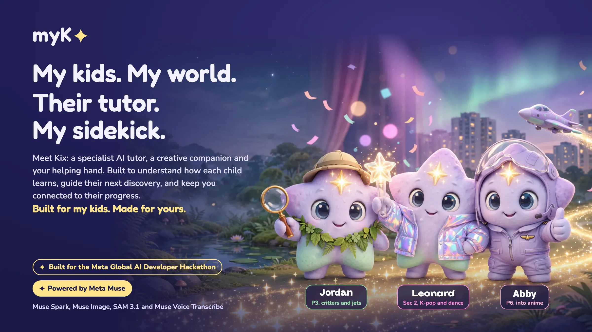
</p>

# myKx

[](https://github.com/cyyeong/mykx/actions/workflows/ci.yml)

**My kids. My world. Their tutor. My sidekick.**

Meet **Kix**: a specialist AI tutor, a creative companion and your helping hand. Built to understand how each child learns, guide their next discovery, and keep you connected to their progress. Kix meets every child inside the world they already love (critters, jets, anime, K-pop), turns it into learning, and gets to know them a little better every day. A busy parent gets back the afternoon they missed: what each child learned, how they're feeling, where they are, how home is, and something to do together at the weekend.

**Built for my kids. Made for yours.**

Built for the **Meta Global AI Developer Hackathon** (track: Build for Your World). Powered by **Meta Muse**: 15 of myKx's 17 specialist agents run on Muse Spark, Muse Image, SAM 3.1 or Muse Voice Transcribe.

[Live app](https://mykx.vercel.app) · [Home simulator](https://mykx-sim.vercel.app) (passcode on request) · [Architecture](docs/ARCHITECTURE.md) · [Docs index](docs/README.md)

---

## For judges: where to find each criterion

| Criterion | Where to see it |
|---|---|
| **Impact** (Build for Your World) | [Why I built it](#why-i-built-it): a problem the founder lives every day, in a country where most couples both work. myKx frees up a parent's time and mental space, and makes something possible that wasn't before: a child's own interests become their learning world. |
| **Use of Meta AI tooling** | [17 specialists, 15 on Meta Muse](#17-specialists-15-of-them-on-meta-muse): four Meta models chained into pipelines (Muse Image + SAM 3.1 transforms; Muse Spark vision + rules + SAM 3.1 for home cameras; Muse Spark web search + planning), with every call logged in Under the hood. Muse Code built four of the branches. |
| **Technical depth and execution** | [Architecture](docs/ARCHITECTURE.md), more than 900 automated tests run by CI on every push, deterministic engines for scores and alerts, row-level security per household, cached fallbacks for every generated surface.<br><br>A few ideas make it more than a chatbot on a syllabus:<br>• **Skills, not search.** Kix's agents load versioned skill packs for the child's level and read the exact section they need through tools that run as trusted code, and every step is logged.<br>• **It quietly gets better.** In the moment, a drifting child gets a spark from their own interests. Each day, the Memory Keeper updates Kix's Notebook, and a hard day yesterday means a gentler start today. Each week, new exam papers become admin-reviewed skill-pack versions, and agents' instructions are versioned with guardrails that stay fixed.<br>• **Models explain; code decides.** Mastery, rewards, alerts and when Kix adapts are plain, tested rules, so a score never moves without evidence.<br>• **Open, and safe by construction.** Each child's world arrives with their magic name, one device protocol (proven today by the simulator) carries phones, cameras and future peripherals, and the guest site has no keys that could reach real data. |
| **Demo** | The video, the [guest walkthrough](https://mykx-guest.vercel.app) (one tap, no password), the [live app](#try-it-live) (sign-ins are in the submission form), the [Home simulator](https://mykx-sim.vercel.app), [raising a critter through its life cycle](#critter-lab-raise-a-critter-learn-its-life-cycle), and [everything in the MVP](#everything-in-the-mvp). |

**Not a chatbot, not RAG, not medical advice.** Kix is one face on 17 specialist agents that run multi-step workflows: reading papers, choosing questions, keeping a memory, voicing a child's pet, reading a home, planning a weekend. Kix loads the right skill pack and reads the exact section it needs through tools that run as trusted code (and refuse to check the question a child is answering), with no vector search; every load and tool call is logged. Scores and rewards are plain code. Wellbeing notes say "possibly" and show the evidence against the child's own usual; they never diagnose, and distress words always bring in the parent and the helplines.

**Built during the hackathon.** Everything in this repository was built between 27 October and 4 November 2026: the first commit is the bootstrap on 27 October, every commit since is in the history, every generated image is dated in [`public/art/manifest.json`](public/art/manifest.json), and [`docs/plan/PROGRESS.md`](docs/plan/PROGRESS.md) logs each task with the models it used. Coding agents: Claude Code throughout, and Meta's Muse Code for four branches on 28 October.

## Try it live

**Explore as a guest: [mykx-guest.vercel.app](https://mykx-guest.vercel.app).** One tap, no password: sign in as the sample family's grown-up, or tell Kix a kid's magic name (`jordan`, `abby` or `leonard`) and watch their door fly in. You get exactly the same screens and walkthrough as a real sign-in, with games to play and the admin side to look around (read-only). AI is switched off there, so every Kix reply is a ready-made sample, and nothing you change is saved. It runs on its own deployment with no access to real accounts.

**For live AI,** open **[mykx.vercel.app](https://mykx.vercel.app)**. The sign-in for the sample family (a grown-up who is also the admin, and the three kids' magic names and codes) is in our hackathon submission form. Anyone else who'd like to try it: message me on Discord, **`antz81_91105`**, and I'll send it over.

Kids don't need the grown-up at all: on the sign-in page, tap **"Kids: tell me your magic name"**, type it, and watch their door fly in.

Everything in this family is synthetic, and everyone trying it shares it, so you may see other visitors' answers and messages. The Home simulator at [mykx-sim.vercel.app](https://mykx-sim.vercel.app) is behind a passcode for the same reason.

## Why I built it

> I'm a parent of three hyperactive kids, each with a different nature and different interests. Getting them to talk about schoolwork at all is a challenge. So I built a place where what they love becomes how they learn.
>
> — the founder of myKx

In Singapore, school ends around 1:30 and work ends after 6. In between, children learn, play, squabble and wander home, and a parent at work sees none of it. It's most families' problem: **56.6%** of married couples here both work ([General Household Survey 2025](https://www.singstat.gov.sg/publication-resources/general-household-survey-2025)), parents already spend **7.9 hours** a week helping with schoolwork, above the 6.7-hour average across 29 countries ([Varkey Foundation](https://www.varkeyfoundation.org/_files/ugd/5c330e_08203a0b372c4a4fa9185c3ee517fcaa.pdf)), and families spent **S$1.8 billion** on private tuition in 2023, with the richest fifth of households spending four and a half times what the poorest fifth do ([Household Expenditure Survey 2023](https://www.singstat.gov.sg/news/parents-seem-persuaded-that-tuition-is-necessary-and-not-optional)). It isn't only Singapore: three in four South Korean students are in private education, three in ten teenagers in England and Wales have had tuition, and the global tutoring market is heading for an estimated US$155 billion by 2030 ([sources](docs/RESEARCH.md)). By the time everyone is home, there's dinner, homework and bedtime, and "How was school?" gets a shrug.

**Not another AI tutor.** A general chatbot will happily explain a method Singapore schools don't teach, or invent a "likely exam question". myKx is built the other way round. It follows local education strictly: every question sits in a skill pack for the child's level that names the MOE syllabus and SEAB exam format it follows, every new question is mapped to a syllabus outcome, and Kix teaches the methods schools use, such as model drawing and claim-evidence-reasoning. Its recommendations come from data, not guesses. The next question is chosen by a tested formula from the child's own record: how weak each skill is, how long since it was practised (spaced review), whether the difficulty is right for their next step, and a mix of question families so no single skill dominates. Each pack's topics and question types carry weights from the exam's mark allocation and from past-paper patterns the Content Curator derives, which shape the practice papers. The model explains and encourages; it never decides what counts.

myKx keeps the afternoon for the parent, and keeps each child's learning balanced: not more screen time, but the right questions at the right moment, breaks and quiet hours, and plans that get the family outdoors together.

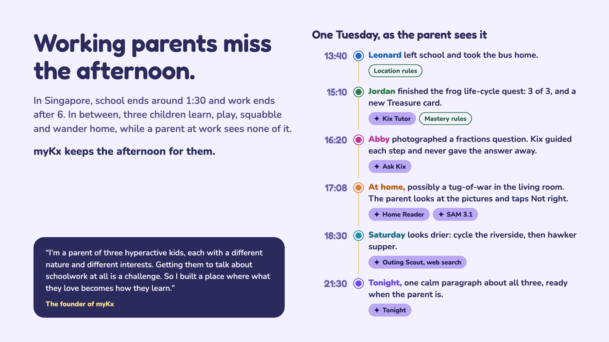

## Built on evidence

myKx's design follows the research, and says where the research stops. Full sources: [docs/RESEARCH.md](docs/RESEARCH.md).

| What myKx does | Why |
|---|---|
| A patient tutor for every child, with step-by-step hints | Intelligent tutors beat teacher-led large-group teaching and match one-to-one human tutoring ([Ma et al., 2014](https://doi.org/10.1037/a0037123)) |
| Hints, never answers | Unguarded GPT-4 left students 17% worse once it was taken away; a hint-only tutor largely avoided that ([Bastani et al., PNAS 2025](https://doi.org/10.1073/pnas.2422633122)) |
| The next question chosen for the child's level; spaced, fresh questions | Adapting to the learner's level gave the largest effects in 16 trials of children aged 6–15 ([Major et al., 2021](https://eprints.whiterose.ac.uk/176999)); testing beats rereading a week later, 56% to 42% ([Roediger & Karpicke, 2006](https://psychology.ecu.edu/wp-content/pv-uploads/sites/216/2019/03/Roediger-Karpicke-2006.pdf)) |
| Lessons framed in the child's own interests | Problems personalised to students' interests improved learning, most for those who struggled ([Walkington, 2013](https://edsurge.com/news/2013-11-08-can-interest-based-personalization-deliver-better-learning-outcomes); [Bernacki & Walkington, 2018](https://doi.org/10.1037/edu0000250)) |
| A stunning world outside the lesson, a calm question player inside it; rewards that celebrate, no leaderboards | Relevant pictures help learning, decorative distractions hurt it ([Mayer](https://www.cambridge.org/core/books/abs/multimedia-learning/multimedia-principle/1CC3DE892B0431BA48B4C4DCA10D0B8F)); expected tangible rewards undermine children's motivation ([Deci et al., 1999](https://depts.washington.edu/techdocs/papers/deciExtrinsicRewardsAndIntrinsicMotivation99.pdf)) |
| Guardian that the child can see, with a teen pause and "possibly" alerts | What children choose to tell parents, not surveillance, goes with good outcomes ([Kerr & Stattin, 2000](https://pubmed.ncbi.nlm.nih.gov/10830980)); more parental control went with more online risk ([Ghosh et al., CHI 2018](https://doi.org/10.1145/3173574.3173768)) |

What we don't claim: Bloom's "two-sigma", that AI doubles learning, that games or visuals raise motivation by themselves, or that monitoring is proven to keep children safe. That evidence is weak or correlational.

## Three kids, three worlds, one sidekick each

Each child picks a world and two things they love in **Sidekick Studio**, and Kix transforms to match: Muse Image redraws Kix in that world and SAM 3.1 cuts it out, and the whole app re-skins around them. The sample family in this repo uses the founder's three kids' stand-in names: **Jordan** (Primary 3, Terrarium; into critters and jets), **Abby** (Primary 6, Anime Sky; into anime) and **Leonard** (Secondary 2, Idol Stage; into K-pop, dance and anime). Their data is synthetic.

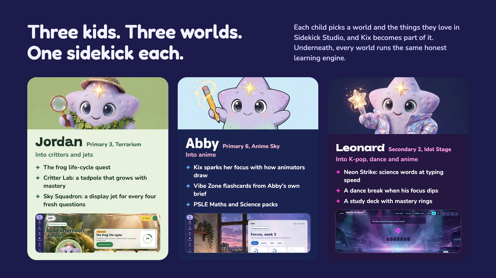

The worlds change how learning looks, never how it's scored. A junior child gets one task per screen, a big Kix that reads aloud and a picture-code sign-in; a teen gets a denser study deck and a Kix that speaks only when asked.

## A world before the first question

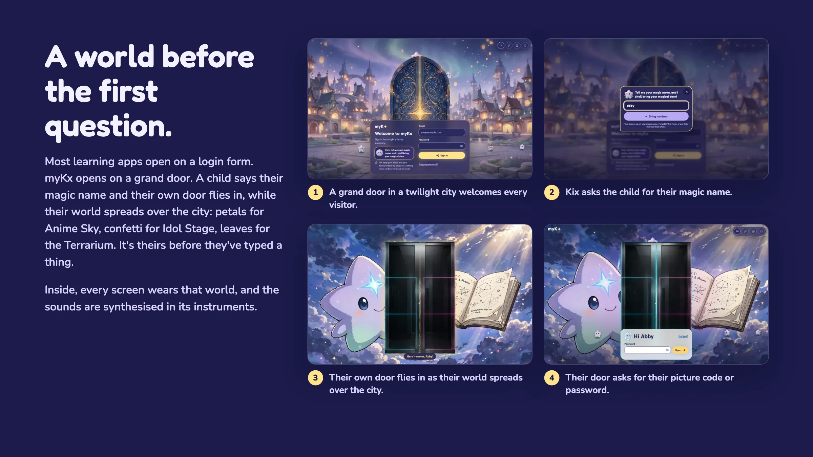

myKx was designed not to look like another learning platform. Most of those open on a login form; myKx opens on a grand door in a twilight city, inviting the child in. They tell Kix their magic name, and their own door flies in while their world spreads over the city: petals drifting in the Anime Sky, confetti on the Idol Stage, leaves in the Terrarium. It's personal before they've typed a thing. Through the door, a time tunnel carries them home, and every screen after that wears their world, down to the sounds, which are synthesised in that world's own instruments. The magic is in the welcome; behind it, the learning stays honest.

## Kix gets better every day

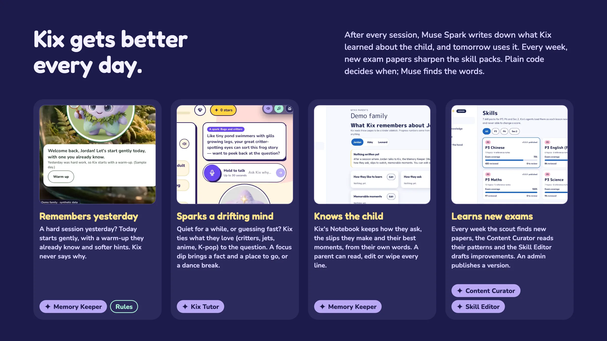

myKx learns from every session and from every new exam. Muse provides the intelligence; plain, tested code decides when it's used. All of this is running in the app today:

- **It remembers yesterday.** After each session the Memory Keeper (Muse Spark) reads the child's own words to Kix and notes how the session went. If yesterday was hard going, today starts more tenderly: Home opens with a warm-up they already know, and Kix's hints and homework help are told to go gently. Kix never says why, and never names a mood to the child ([`lib/kix/today.ts`](lib/kix/today.ts)).
- **It notices a drifting mind and sparks it.** If a child goes quiet on a question or guesses in a few seconds, Kix ties something they love to the question: Muse Spark writes one line that links critters, jets, anime or K-pop to the thinking the question needs, without giving the answer away. When the focus camera (on-device, parent-approved) sees attention dip, Kix suggests a place in myKx that fits: their Sky Squadron, anime flashcards, a round of Neon Strike, or a dance break for a dancer ([`lib/kix/interests.ts`](lib/kix/interests.ts), [`app/api/kix/spark`](app/api/kix/spark/route.ts)).
- **It knows the child.** Kix's Notebook keeps how they ask, the slips they make and their best moments, and Kix reads it before every hint. The parent can read, edit or wipe every line.
- **It learns new exams.** Every week the past-paper scout finds new papers, the Content Curator reads their patterns and traps, and the Skill Editor proposes improvements as a diff. An admin publishes a new version of the skill pack, and the next lesson uses it.
- **Its instructions improve too.** In Under the hood, an admin can edit the instructions of the ten agents that write words, publish versions and roll back; the safety guardrails stay fixed in code.

None of this changes a score or a reward: mastery stays deterministic, and an answer Kix helped with never counts as mastery.

## How the learning works

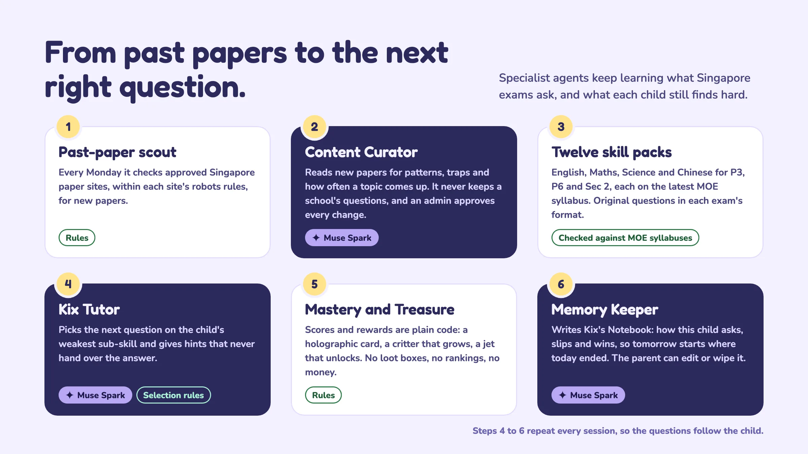

1. **Past-paper scout** checks approved Singapore paper sites every Monday, within each site's robots rules.
2. **Content Curator** (Muse Spark) reads new papers for patterns, common traps and how often each topic comes up. It never keeps a school's questions; an admin approves every change before it reaches a child.
3. **Twelve skill packs** hold original questions in each exam's format: English, Maths, Science and Chinese for each of P3, P6 and Sec 2, over 1,100 in all, each pack following the latest MOE syllabus and SEAB format it names. Questions from school papers are never used; only their patterns are.
4. **Kix Tutor** (Muse Spark) works on the child's weakest sub-skill and gives hints that never hand over the answer. Which question comes next is decided by code.
5. **Mastery and Treasure** are deterministic: a holographic card, a critter that grows through its real life cycle, a display jet that unlocks. In the Critter Lab, kids also raise their own pets: a tadpole, a mealworm, a caterpillar or a chick, each stage needing its own care (the right food, a clean home, play, warmth) before it grows, while the life cycle stays in view. No loot boxes, no rankings, no money.
6. **Memory Keeper** (Muse Spark) writes Kix's Notebook: how this child asks, slips and wins, so tomorrow starts where today ended, and more gently after a hard day. The parent can read, edit or wipe every page.

Steps 4 to 6 repeat every session, so the questions follow the child, and the packs get better as the Curator learns what the exams ask. The full loops are in [the architecture doc](docs/ARCHITECTURE.md).

## Critter Lab: raise a critter, learn its life cycle

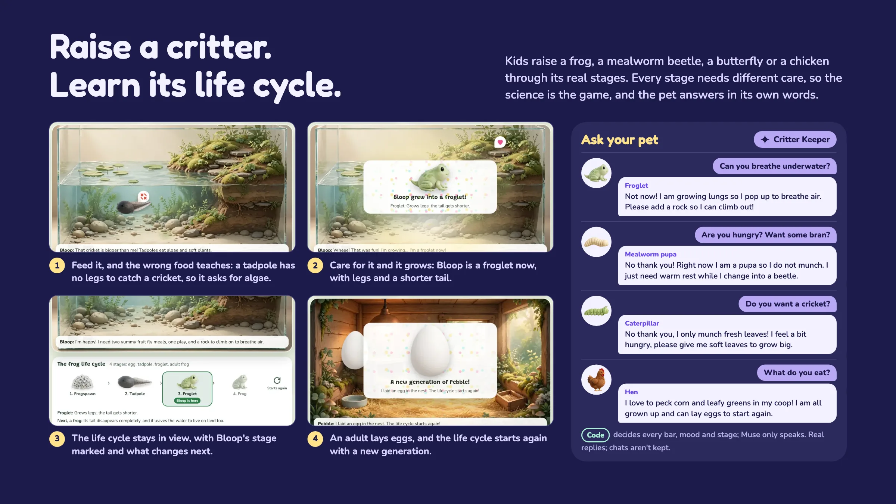

In myKx the P3 Science life cycles aren't a page to read: they're a pet to raise. From the **Critters** tab (every age), a child adopts a frog, a mealworm beetle, a butterfly or a chicken, and raises it from eggs to adult and on to a new generation. Every stage needs different care, so getting the science right is how you play.

| The child… | What happens in the app | What they learn |
|---|---|---|
| Adopts a clump of frogspawn | The eggs wobble in their jelly. Offer food and they say: *"We're eggs! The yolk inside each egg feeds the tadpole growing in it."* | Eggs don't eat; the young grows inside. |
| Feeds the tadpole | Four foods on the tray. The cricket is turned down: *"That cricket is bigger than me! Tadpoles eat algae and soft plants."* The algae is eaten. | Each stage eats different food, and the young of some animals look and live nothing like the adult. |
| Does the stage's own job | Add a rock so the froglet can climb out and breathe air; let the pupa rest; turn the egg; let the chick hatch by itself. | What changes at each stage: a froglet grows lungs, a pupa doesn't eat or move much while it changes. |
| Keeps it looked after | Bars for food, a clean home, love and warmth run down by the hour. The pet gets hungry, sad or cross (never sick), and shows it in how it moves. | Living things need food, water, air and a suitable home. |
| Watches it grow | A celebration: *"Bloop grew into a froglet! Froglet: grows legs; the tail gets shorter."* The life-cycle track moves its marker on. | The order of the stages, and what changes between them. |
| Sees the adult lay eggs | *"A new generation of Pebble!"* Back to stage one. | A life cycle really is a cycle. |
| Talks to it | The Critter Keeper answers as the pet at its stage (below). | Asking in their own words, and hearing the science back. |

<p align="center">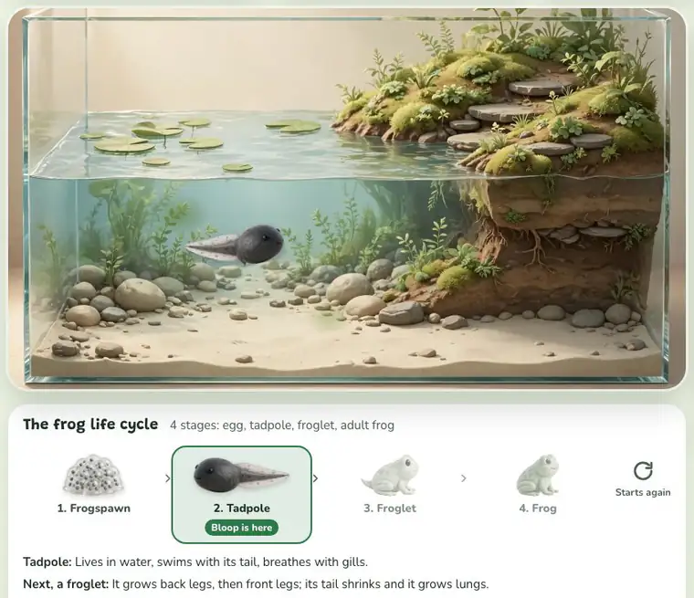</p>
<p align="center"><sub>Recorded in the app: the tadpole turns down a cricket, eats algae and grows into a froglet. The marker moves on, and the froglet's last line is a live Critter Keeper reply.</sub></p>

**The pet answers like the creature it is.** Real replies from the Critter Keeper (Muse Spark), asked on the sample family:

| Asked | The pet answers |
|---|---|
| A froglet: *"Can you breathe underwater?"* | "Not now! I am growing lungs so I pop up to breathe air. Please add a rock so I can climb out!" |
| A mealworm pupa: *"Are you hungry? Want some bran?"* | "No thank you! Right now I am a pupa so I do not munch. I just need warm rest while I change into a beetle." |
| A caterpillar: *"Do you want a cricket?"* | "No thank you, I only munch fresh leaves! I feel a bit hungry, please give me soft leaves to grow big." |
| A hen: *"What do you eat?"* | "I love to peck corn and leafy greens in my coop! I am all grown up and can lay eggs to start again." |

**How it's built.**
- **Code decides every bar, mood and stage**, the same way every time ([`lib/pets/care.ts`](lib/pets/care.ts)). A full bar takes no more of the same care, so a pet grows over hours of looking after it, not by tapping. It never gets sick, dies or goes back a stage, and it never touches mastery or rewards.
- **The Critter Keeper only speaks.** It's given the pet's facts (species, stage, foods, bars, the care it still needs) and the child's words, nothing else. Distress words skip it: Kix's caring reply, the helplines and an urgent flag for the parent. Other pet chats aren't kept. Without a model, a scripted reply answers.
- **Real movement:** a tadpole's tail and a butterfly's wings move as separate halves of the sprite, frogs hop with squash and stretch, larvae inch along and chicks peck. Mood changes the pace and posture.
- **The art** is Muse Image redrawing each stage from the Critter Lab's life-cycle sheets, cut out with SAM 3.1, plus foods and four habitats.

The full design is in [docs/prd/PETS.md](docs/prd/PETS.md).

## 17 specialists, 15 of them on Meta Muse

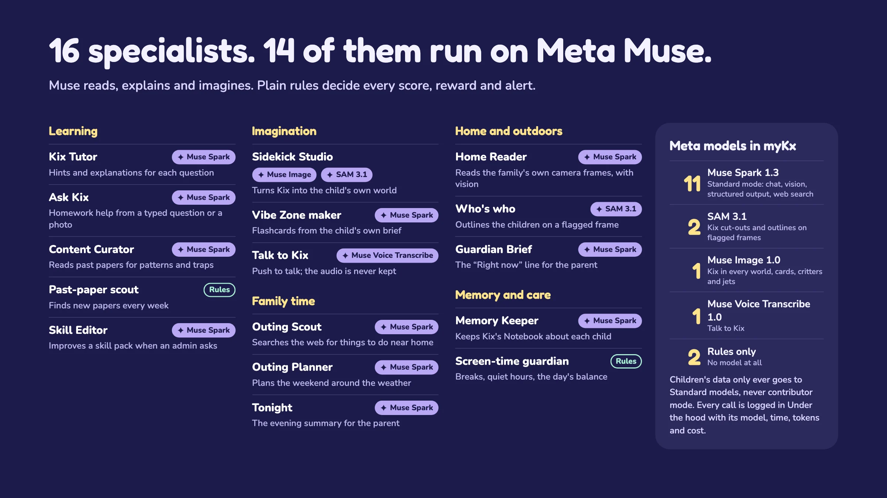

| Agent | What it does | Meta model |
|---|---|---|
| Kix Tutor | Hints and explanations for each question; loads skill packs and reads the section it needs through tools; sparks a drifting child with what they love | Muse Spark 1.3 (function tools) |
| Ask Kix | Homework help from a typed question or a photo: picks the subject's pack and reads its method, then guides first | Muse Spark 1.3 (vision, function tools) |
| Content Curator | Reads past papers for patterns, traps and topic weight | Muse Spark 1.3 (files) |
| Past-paper scout | Finds new papers on approved sites every week | rules only |
| Skill Editor | Improves a skill pack when an admin asks: a proposed diff with checked new questions | Muse Spark 1.3 (structured output) |
| Sidekick Studio | Turns Kix into the child's own world | Muse Image 1.0 and SAM 3.1 |
| Vibe Zone maker | Flashcards from a child's own brief, drawn by trusted components | Muse Spark 1.3 (structured output) |
| Talk to Kix | Push-to-talk questions; the audio is never kept | Muse Voice Transcribe 1.0 |
| Memory Keeper | Keeps Kix's Notebook about each child, and notes how each session went so tomorrow can start gently | Muse Spark 1.3 |
| Critter Keeper | Speaks as the child's pet at its life stage (a tadpole can't catch flies yet) and coaches its care; the care rules in code decide every bar, mood and stage | Muse Spark 1.3 (structured output) |
| Screen-time guardian | Breaks, quiet hours and the day's learning-to-play balance | rules only |
| Home Reader | Reads the family's own camera frames into words | Muse Spark 1.3 (vision) |
| Who's who | Outlines the children on a flagged frame | SAM 3.1 |
| Guardian Brief | The "Right now" line for the parent | Muse Spark 1.3 |
| Outing Scout | Searches the web for things to do near home | Muse Spark 1.3 (web search) |
| Outing Planner | Plans the weekend around the weather and the week | Muse Spark 1.3 |
| Tonight | The evening summary for the parent | Muse Spark 1.3 |

**Where Muse stops and code starts.** Muse reads, explains, imagines and narrates. Scores, mastery, rewards, screen-time rules, motion and every alert are decided by plain, tested code, and a model can never change them. Every model call is logged in **Under the hood** with its model, time, tokens and cost. Children's data only ever goes to Standard models, never contributor mode.

## Beyond the screen: Guardian

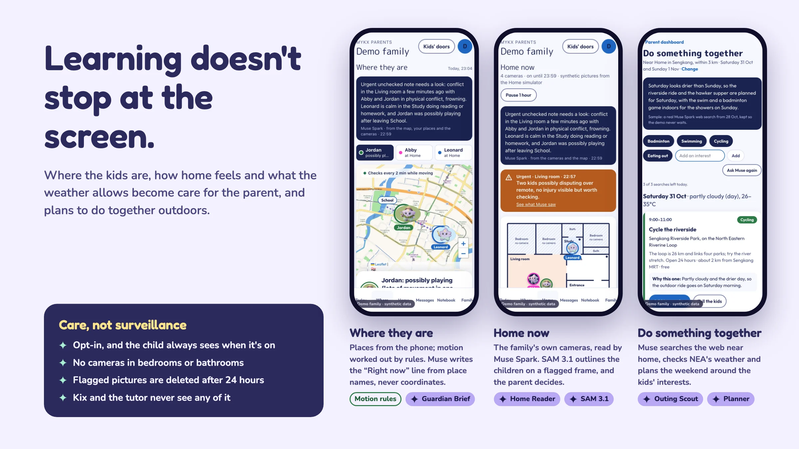

- **Where they are.** The phone's places and motion (walking, on a bus, possibly playing), worked out by rules. Muse Spark writes the "Right now" line from place names, never coordinates.
- **Home now.** The family's own cameras, read by Muse Spark into words: who's in which room and what's happening. On a flagged moment, SAM 3.1 outlines the children, and the parent decides: Right or Not right. A "not right" makes that camera need one more matching check next time.
- **Do something together.** Muse Spark searches the web near home for things to do with the kids' interests, checks NEA's four-day weather and plans the weekend; ideas without a source are dropped.
- **Tonight.** One calm paragraph about all three children, from facts the database already holds.

Care, not surveillance: everything is opt-in, the child always sees when it's on, no camera may look at a bedroom or bathroom, flagged pictures are deleted after 24 hours, and none of it ever reaches Kix, the tutor or the Notebook.

## The myKx simulator: tomorrow's devices, simulated today

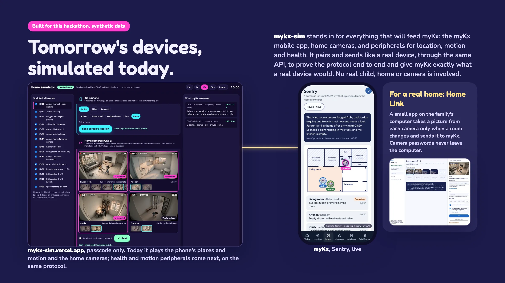

**[mykx-sim](https://mykx-sim.vercel.app)** is an in-place simulator built just for this hackathon. It stands in for everything that will feed myKx later: the dedicated myKx mobile app, the family's CCTV cameras, and supported peripherals for location, motion and health monitoring. It pairs and sends exactly like a real device, through the same API, to prove the protocol works end to end and to feed myKx the exact information a real device would. Today it plays a scripted walk home around Sengkang (the phone's places and motion) and home camera frames drawn by Muse Image; health and motion peripherals plug into the same protocol next. No real child, home or camera is involved, and it's labelled "Synthetic" everywhere.

For a real home, **Home Link** (`clients/home-link/`) is a small app on the family's computer. It takes a picture from each camera only when a room changes and sends it to myKx; camera passwords never leave the computer.

## Everything in the MVP

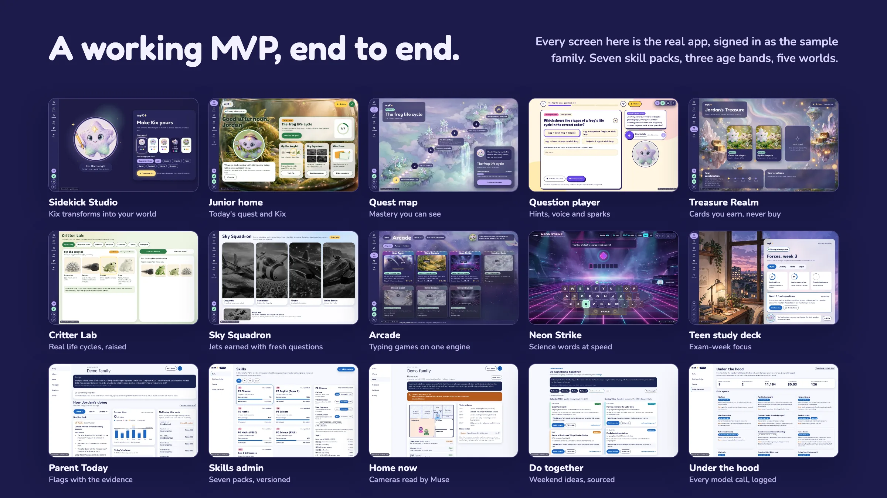

**For kids:** magic-name sign-in with their own door · Sidekick Studio · Home with today's quest · Quest map · Question player with hints, reasons, voice and sparks · Treasure Realm · Critter Lab pets raised through real life cycles · Sky Squadron · Vibe Zone flashcards · Arcade typing games · Ask Kix homework help · Talk to Kix · printable practice papers · family messages with Kix stickers.

**For parents:** Today, with flags shown alongside their evidence · Tonight · wellbeing notes ("possibly tired", against the child's own baseline, never a diagnosis) · Kix's Notebook · Messages · Where they are · Home now · Do something together · Your family (sign-in codes, voice, focus camera, screen time).

**For admins:** Skills catalogue · Add knowledge (the Content Curator) · weekly new papers · People · Under the hood.

**Safety built in:** kids never need an email (picture codes or passwords, hashed on the server); push-to-talk only, and audio is never stored; no child's photo is ever used to generate art; distress words always bring Kix's caring reply, the helplines (Tinkle Friend 1800 274 4788, SOS 1767) and an urgent parent flag. All the rules are in [AGENTS.md](AGENTS.md).

## Where Kix goes next

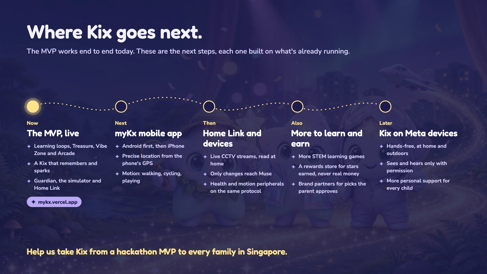

- **Now:** the MVP above, live at [mykx.vercel.app](https://mykx.vercel.app).
- **Next: the myKx mobile app.** Android first, then iPhone: precise location from the phone's GPS and motion from its sensors (walking, cycling, playing). Planned in [GUARDIAN.md §5a](docs/prd/GUARDIAN.md).
- **Then: Home Link and devices.** Live CCTV streams read on the family's computer, motion found locally so only changes reach Muse, signed installers for Mac and Windows, and health and motion peripherals on the same pairing protocol the simulator proves today.
- **Also: more to learn and earn.** **Vibe an app** in the Vibe Zone (coming soon on the page): a child describes a tiny app, like a revision timer or a quiz game, and Kix builds it from safe, trusted parts, the same way it makes flashcards today. More STEM learning games on the Arcade's engine; a rewards store where children spend the stars they've earned on items for Kix and their world (never real money, never random); and brand partners whose recommendations fit each child's interests, shown only to the parent, approved by them, with no child data shared.
- **Later: Kix on Meta devices.** A hands-free sidekick at home and outdoors that sees and hears only with permission, for richer and more personal support.
- **Later: a myKx model of its own.** A specialised tutor model, trained on the skill packs, local exam patterns and de-identified, consent-given learning traces, to make Kix faster and cheaper to run, more local in how it teaches, and more adaptable to each child. It starts with Meta's open-weight models and keeps the same rules: hints not answers, code decides scores.
- **Beyond: Kix goes global.** Singapore is the first country, not the last. Every country's education is different, so Kix adapts with more agents rather than one-size-fits-all lessons: a **Curriculum Scout** per country maps its syllabus, grade levels and exam formats into new skill packs (Malaysia's KSSR and SPM, Indonesia's Kurikulum Merdeka, Australia's national curriculum, Japan's and China's school standards, India's CBSE, Korea's national curriculum, the UK's key stages and GCSEs, the USA's state standards); a **Local Coach** teaches in the child's own language with local examples, money and places; and each country's child-privacy law (PDPA, COPPA, GDPR and others) is built into the rules from day one. The pack format, routing and agents are already level- and language-aware, so a new country is new packs and a new policy, not a new app.

Each step reuses what's already running: devices pair with a code and a hashed token, a Muse reader turns raw input into words, rules decide, and the parent reviews. How far that scales is in [the architecture doc](docs/ARCHITECTURE.md#10-scaling-and-the-long-term-vision). Built in Singapore, we'd love support to take Kix from a hackathon MVP to every family, everywhere.

**Built for my kids. Made for yours.**

## Run it

```bash
npm install
npm run dev          # http://localhost:3000
npm test             # Vitest
npm run typecheck && npm run lint && npm run build
```

Without `.env.local`, the dev server uses an in-memory sample family, so no keys are needed for UI work. Any email and password signs a grown-up in; the sample kids' codes are in the tests.

**The full stack on your own machine (Docker).** To run myKx against a real Supabase (Postgres with row-level security, Auth and Storage) in your own sandbox:

```bash
npm install
npm run db:local     # starts a local Supabase in Docker (first run pulls the images) and seeds the sample family
npm run dev          # http://localhost:3000
```

`db:local` builds the database from `supabase/schema.sql`, `rls.sql` and `seed.sql`, adds a local sign-in for the grown-up (`demo@mykx.ai` / `local-demo-only`, also the admin), and writes `.env.development.local` so the app uses it. Kids' magic names are `jordan`, `abby` and `leonard`; Abby and Leonard use `local-demo-only`, Jordan the picture code Kix smiling, Kix cheering, Kix the pilot, Starry Kix. These sign-ins are local-only. Add your own Meta key (`MODEL_API_KEY`, Standard mode) to that file for live Muse calls; without it every agent uses its cached fallback. `npm run db:local -- reset` re-seeds, `npm run db:local -- stop` stops it, and Supabase Studio is at http://127.0.0.1:54323.

Live model calls, Supabase and art generation need keys (names in `.env.example`: `MODEL_API_KEY`, `NEXT_PUBLIC_SUPABASE_URL`, `NEXT_PUBLIC_SUPABASE_PUBLISHABLE_KEY`, `SUPABASE_SECRET_KEY`, `KID_SESSION_SECRET`). Keys stay on the server.

**Stack:** Next.js 16 (App Router, Cache Components) · React 19 · TypeScript · Tailwind CSS v4 with per-world themes · `motion` · Tone.js (every sound synthesised) · Supabase (Auth, Postgres with row-level security, Storage) · the OpenAI SDK pointed at `api.meta.ai/v1` · Vercel.

## Licence

Code: [MIT](LICENSE). Art, Kix and content: CC BY-NC 4.0, all original and generated during the hackathon, with every image's prompt and model in [`public/art/manifest.json`](public/art/manifest.json). See [LICENSE-ASSETS.md](LICENSE-ASSETS.md).
