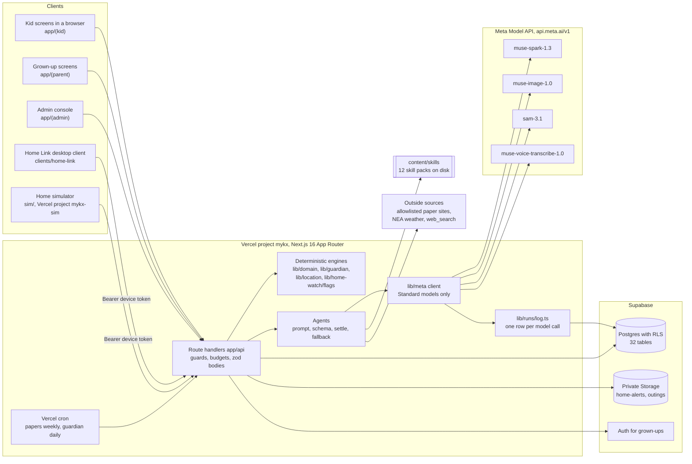
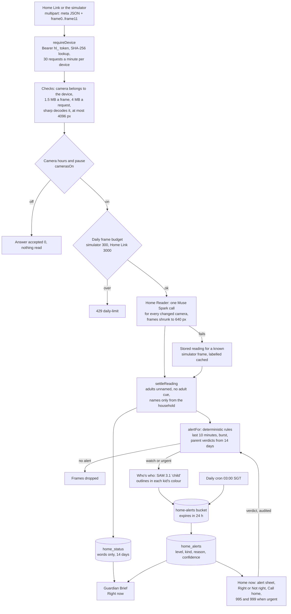
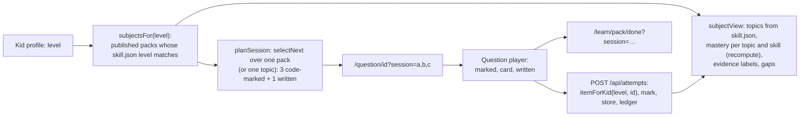
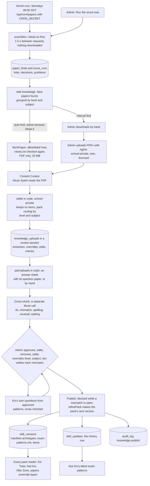
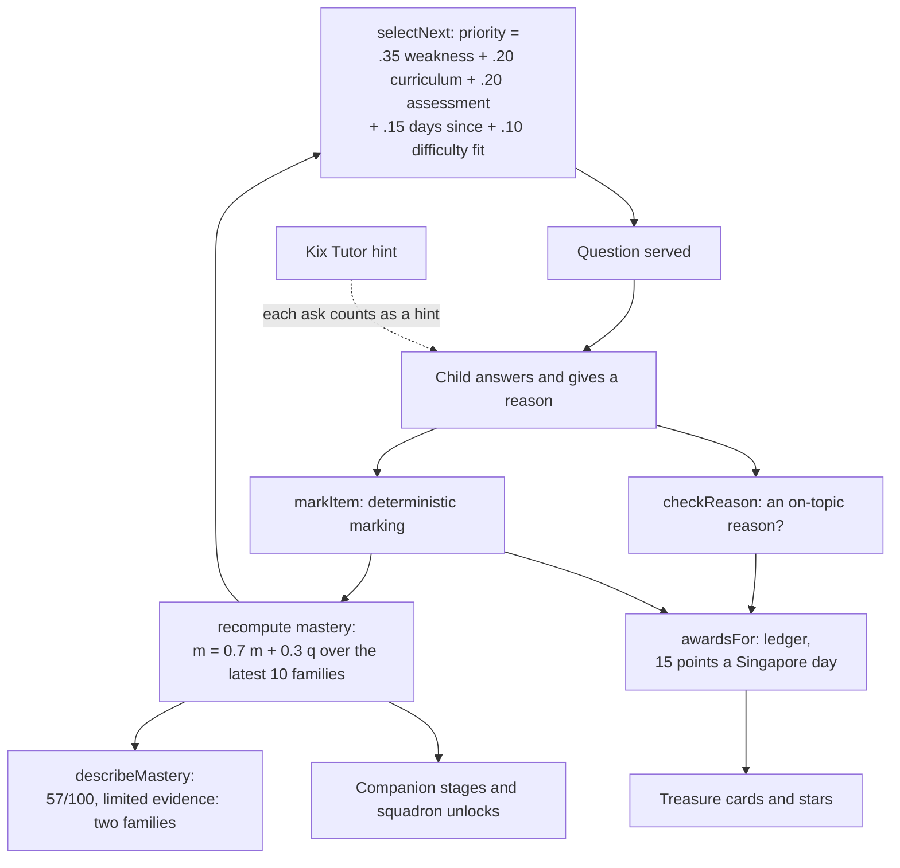
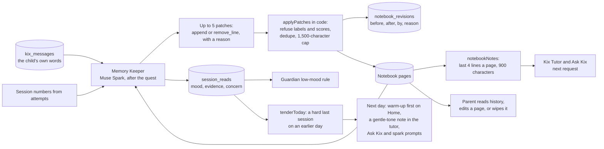
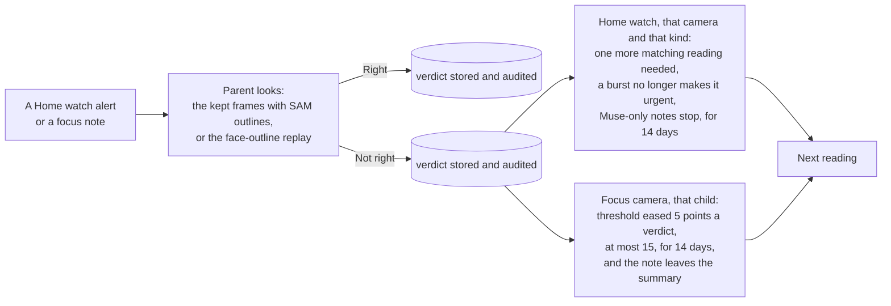

# myKx architecture

**Written:** Wed 28 Oct 2026, against the code on `main` that day. **Audience:** hackathon judges (use of Meta models, engineering quality, impact) and future contributors. **Scope:** the whole platform: the kid app, the grown-up app, the admin console, the agents, the skill packs, Guardian, the simulator and Home Link, and where the design can go.

Every statement about behaviour cites the file that does it. Anything not in the code is in a section or row marked **Roadmap**. Status markers used throughout:

| Marker | Meaning |
|---|---|
| **Built** | In the code on `main`, with tests where the logic is non-trivial |
| **Partly built** | The data shape or a first slice exists; the rest is roadmap |
| **Roadmap** | Designed or proposed only; not in the code |

The demo family is synthetic and labelled as such in the UI (`profiles.synthetic`, `components/ui/DemoLabel.tsx`): **Jordan** (P3, Terrarium world, junior band; into critters and jets), **Abby** (P6, Anime Sky, teen band; into anime) and **Leonard** (Sec 2, Idol Stage, teen band; into K-pop, dance and anime). These are the founder's stand-in names (`lib/auth/demo-family.ts`, `supabase/seed.sql`).

## Contents

1. [Overview and design principles](#1-overview-and-design-principles)
2. [Code map](#2-code-map)
3. [Data model](#3-data-model)
4. [The agent layer](#4-the-agent-layer)
5. [Skills and the Skill Engine](#5-skills-and-the-skill-engine)
6. [Self-learning and self-improvement](#6-self-learning-and-self-improvement)
7. [Safety, privacy and child-data rules in code](#7-safety-privacy-and-child-data-rules-in-code)
8. [Reliability and cost](#8-reliability-and-cost)
9. [Deployment and operations](#9-deployment-and-operations)
10. [Scaling and the long-term vision](#10-scaling-and-the-long-term-vision)
11. [Roadmap milestones](#11-roadmap-milestones)
12. [Appendix: where the code differs from the specs](#12-appendix-where-the-code-differs-from-the-specs)

---

## 1. Overview and design principles

myKx gives a Singapore student an AI sidekick, **Kix**. A child learns in short quests that adapt to them, earns honest rewards in a Treasure Realm, makes study things in the Vibe Zone, restyles Kix in Sidekick Studio, plays syllabus typing games in the Arcade, and gets homework help from a photo. A parent gets a calm picture of the day: screen time, learning, wellbeing signals shown as possibilities, Kix's Notebook, family messages, and **Guardian**, which reads the family's own cameras and the child's whereabouts into plain status lines. An admin grows the content: a weekly scout finds new exam papers, and a knowledge agent turns them into patterns Kix teaches from, after a human approves each one.

Sixteen agents do the work (`lib/admin/hood.ts`, `AGENTS`). Fourteen call Meta models: Muse Spark 1.3 in eleven, SAM 3.1 in two, Muse Image 1.0 in one and Muse Voice Transcribe 1.0 in one (Sidekick Studio uses both Muse Image and SAM). Two are rules only.

### 1.1 Design principles, and where the code enforces them

| # | Principle | How the code holds it | Evidence |
|---|---|---|---|
| P1 | **Models narrate, code decides.** Mastery, rewards, flags, alerts, motion state and arrivals are computed by tested, deterministic code. A model's output is one input to a rule, never the decision. | Pure engines with Vitest tests; the routes write their results; no tool or schema lets a model write a score | `lib/domain/mastery.ts`, `lib/domain/rewards.ts`, `lib/guardian/flags.ts`, `lib/home-watch/flags.ts`, `lib/location/location.ts` |
| P2 | **No model-authored code runs.** Models return JSON that zod validates; trusted React components draw it. | Explanation blocks, flashcard specs, room readings and plans are zod schemas | `lib/kix/homework.ts` (`explanationSchema`), `lib/vibe/flashcards.ts`, `lib/home-watch/reader.ts` |
| P3 | **Child data only reaches Standard models.** Contributor mode lets Meta train on prompts. | Every call passes `assertStandardModel`; the database refuses a contributor model in `model_runs` | `lib/meta/guard.ts`; `check (model not like '%contributor%')` in `supabase/schema.sql` |
| P4 | **Every generated surface has a cached fallback.** The demo path never waits on a live call. | Each agent has a fallback and the reply says which source answered | §8.1 |
| P5 | **Honest labels.** Synthetic data, cached answers, rule-written sentences and thin evidence are labelled. | `source` fields (`live`, `cached`, `fallback`, `sample`, `words`, `code`), `describeMastery` ("limited evidence"), `synthetic` columns | `lib/domain/mastery.ts`, `app/api/guardian/brief/route.ts` |
| P6 | **Thin inputs, Muse does the thinking.** Devices only capture and filter; reading, connecting and explaining happen server-side in Muse agents. | Home Link and the simulator post to the same ingest routes; Muse reads and writes words | `clients/home-link/`, `sim/api/send.js`, `app/api/home/frames/route.ts` |
| P7 | **No RAG.** No vector store, no embeddings. Agents get skill-pack sections and Notebook pages chosen by id. | Agents see each loaded pack's section index and read sections by id through the `read_reference` tool; the Notebook is four named pages read with `notebook_read` | `lib/skills/runtime.ts`, `lib/notebook/notebook.ts` |
| P8 | **Household isolation.** Everything a child does belongs to one household. | Every store method takes the caller's household id; RLS scopes browser reads; tests try to cross households | `lib/auth/store.ts`, `supabase/rls.sql`, `supabase/schema.test.ts` |
| P9 | **Privacy by construction.** If something must never be kept, there is no column for it. | `signals.counts` accepts four count keys only; no table holds audio; frames go to a 24 h private bucket only when flagged | `supabase/schema.sql`, `app/api/voice/transcribe/route.ts` |
| P10 | **Two memory systems, never mixed.** Progress lives in the database; understanding lives in Kix's Notebook. | The Notebook refuses lines that quote a score as its own; mastery is recomputed from attempts | `lib/notebook/notebook.ts` (`REFUSED`), `lib/domain/mastery.ts` |
| P11 | **Guardian data never reaches Kix.** Location and camera readings are for the parent only. | No Kix route imports `lib/home-watch` or `lib/location` | `app/api/kix/*`, `app/api/session/close/route.ts` |

### 1.2 System context



The browser never talks to Meta or to Supabase's service role. Keys live in the server's environment (`lib/meta/client.ts` reads the key on every call and never caches or logs it). The server's only outbound calls besides Meta and Supabase are the paper scout's polite reads of five allowlisted sites (`lib/papers/scan.ts`), NEA's keyless four-day outlook (`lib/outings/weather.ts`), and Muse Spark's own `web_search` tool for outings (`lib/outings/search.ts`).

### 1.3 Stack

| Layer | Choice | Where |
|---|---|---|
| App | Next.js 16.4.3 App Router, React 19.3, TypeScript 5.9; `cacheComponents: true` and `partialPrefetching: true` | `package.json`, `next.config.ts` |
| Runtime | Node 24 (runs TypeScript directly for scripts) | `scripts/`, `clients/home-link/` |
| Styling | Tailwind CSS v4 with CSS custom-property themes: two bands (junior, teen) times five style packs | `app/styles/tokens.css`, `components/theme/` |
| Motion and sound | `motion` 14.6; Tone.js 15.1, lazy-loaded, every sound synthesised (music as JSON scores) | `lib/sound/engine.ts`, `lib/sound/music/*.json` |
| Data | Supabase Auth, Postgres with RLS, Storage; an in-memory demo store for keyless development | `lib/auth/store.ts`, `store-supabase.ts`, `store-demo.ts` |
| Models | OpenAI SDK 7.45 pointed at `https://api.meta.ai/v1`; SAM masks parsed with `@meta-sam/parser` | `lib/meta/` |
| On-device vision | MediaPipe Tasks Vision 1.1.1 (face landmarks for the focus camera; face detector for homework photos) | `components/camera/mediapipe.ts` |
| Images on the server | `sharp` 0.35 (frame checks, resizing, outlines, cutouts) | `lib/home-watch/read.ts`, `lib/meta/mask.ts` |
| Maps | Leaflet 1.9.4 on OneMap tiles | `components/location/` |
| Hosting | Vercel: `mykx` (the app) and `mykx-sim` (the simulator); two cron jobs | `vercel.json`, `sim/vercel.json` |
| Tests | Vitest; PGlite runs the real schema and RLS in tests | 121 `*.test.ts` files, `supabase/schema.test.ts` |

---

## 2. Code map

### 2.1 Folders

| Folder | Responsibility |
|---|---|
| `app/(kid)` | Kid pages: `home`, `learn` (the Learn hub), `learn/[quest]` (a subject such as `p6-maths`, or the frog quest map) and its `done`, `question/[id]`, `treasure`, `studio`, `vibe`, `ask`, `talk`, `arcade/*`, `critters`, `squadron`, `messages`, `me`, `me/papers`, `me/sharing`. The layout mounts the kid nav, sound, theme, the heartbeat (`GuardianWatch`) and the focus camera (`FocusWatch`). |
| `app/(parent)` | Grown-up pages: `parent` (Today, Messages, Notebook), `family` and `family/guardian` (controls, Location and home cameras), `papers`, `together` |
| `app/(admin)` | Admin pages: `admin/people`, `admin/skills`, `admin/knowledge`, `admin/under-the-hood`, `admin/under-the-hood/agents/[agent]` (the agent editor, §4.11) |
| `app/(signin)` | The living-city door, kid doors (`doors/[kid]`), grown-up sign-in |
| `app/api` | Every server route (§2.2) |
| `components/` | UI by area: `screens/`, `kix/`, `voice/`, `camera/`, `guardian/`, `home-watch/`, `location/`, `outings/`, `studio/`, `vibe/`, `games/`, `papers/`, `scene/` (living art), `sound/`, `theme/`, `admin/` |
| `lib/meta` | Meta Model API client: Spark chat, stream and structured output; Muse Image edits; SAM 3.1 segment and cutouts; Voice Transcribe; pricing; run timing; Standard-model guard; secret redaction |
| `lib/runs` | `logRunsFor(route, household, kid)` and the hook that writes every call to `model_runs` |
| `lib/agents` | Agents you can edit (§4.11): each Muse Spark agent's built-in instructions and fixed guardrails (`instructions.ts`), the version rules (`versions.ts`), `instructionsFor` with its one-minute cache (`runtime.ts`), and what the editor shows (`catalog.ts`) |
| `lib/auth` | Store contract and both stores, sessions, kid secrets (scrypt), lockout and per-key limiter, parent PIN, admin check, request helpers |
| `lib/domain` | Deterministic learning engine: marking, mastery (PRD §6), selection, rewards ledger (FR10), reason check, companion, squadron |
| `lib/learn` | A kid's subjects (`subjects.ts`: their level's packs, item lookup and the other-level refusal), sessions and topic views (`session.ts`, `views.ts`), word cards as code-marked questions (`cards.ts`), reward cards for every subject (`reward-cards.ts`), the frog life-cycle quest (P3 Science's featured quest), attempt submission (`submit.ts`) |
| `lib/kix` | Ask Kix (homework) prompt builder, schema and sample; the Kix Tutor's hint and reason prompts (`tutor-prompt.ts`); reason coach schema and code fallback |
| `lib/notebook` | Kix's Notebook pages, patch application with refusals, the Memory Keeper's prompt and schema |
| `lib/guardian` | Screen time from heartbeats, sessions and focus, the safety word check, flags, Kix's next step, Tonight |
| `lib/signals` | Focus camera: per-minute counts in the browser, dip detection, baselines, corrections from verdicts, the face-outline replay |
| `lib/location` | Motion classifier, places, arrived and left events, battery modes |
| `lib/home-watch` | Device pairing and tokens, cameras, the Home Reader, alert rules, SAM outlines, rollups, the Guardian Brief |
| `lib/outings` | Outing Scout (web search), Outing Planner, source check, NEA weather |
| `lib/knowledge` | Content Curator: extraction schema and prompt builder (its wording and guardrails are in `lib/agents`), rights rule, routing, review sessions (pairing, overrides, keys; `session.ts`), Muse's cross-check (`crosscheck.ts`, `review.ts`), Kix's own questions (`kix-questions.ts`), publishing as a skill version (`refine.ts`) |
| `lib/papers` | Past-paper scout: allowlist, robots.txt, listing parsers, download decisions, finds |
| `lib/skills` | Pack and item schemas, the safety scanner, trusted SVG figure renderers; the Skill Engine runtime; skill versions (`versions.ts` rules, `service.ts` actions), the override layer every pack reader goes through (`overrides.ts`), skill import (`import.ts`) and Enhance with Muse (`enhance.ts`) |
| `lib/print` | Deterministic printable papers from reviewed items, with blueprints and answer guides |
| `lib/games` | Arcade registry, typing engine, scoring, progress |
| `lib/vibe`, `lib/studio` | Flashcard spec; Studio prompt and the Muse Image plus SAM transform |
| `lib/sound`, `lib/scene`, `lib/critters` | Synthesised sound and music, living-art layers, Critter Lab catalogue |
| `content/skills/` | Seven child-agnostic skill packs (§5); `content/skills.test.ts` scans them |
| `supabase/` | `schema.sql`, `rls.sql`, `seed.sql`, `migrations/`, `schema.test.ts` |
| `clients/home-link/` | The Home Link desktop client (separate Node package, MIT) |
| `sim/` | The Home simulator (static page plus one Vercel function) |
| `scripts/` | Importer, smoke test, soak test, Guardian setup and reset, migrations, art tooling (§9.5) |
| `public/art/` | Optimised art and `manifest.json` (167 entries: 58 Muse Image, 69 SAM 3.1 cutouts, 40 made in code with sharp) |

### 2.2 Routes by area

| Area | Routes | Caller |
|---|---|---|
| Sign-in and accounts | `api/auth/{parent,kid,kids,pin,reset,signout}`, `api/me`, `api/family/kids`, `api/family/kids/[id]`, `api/family/shared` | browser |
| Learning | `api/attempts`, `api/kix/tutor`, `api/kix/reason`, `api/kix/spark` (each takes only an item from the kid's own level's packs: 403 for another level's, 404 for an unknown one), `api/kix/homework`, `api/session/close`, `api/games/round` | kid session |
| Creating | `api/vibe`, `api/studio/transform`, `api/voice/transcribe` | kid session (a grown-up signed in on the device) |
| Care | `api/guardian/{beat,words,summary,seen,brief,tonight}`, `api/signals/focus`, `api/notebook`, `api/messages`, `api/messages/mine` | kid or grown-up |
| Guardian, location | `api/location` (POST from a device, GET for the parent), `api/location/{mine,pause,places,settings}` | device token or session |
| Guardian, home | `api/home` (Home now), `api/home/{pair,devices,cameras,frames,family,prefs,alerts}` | device token or grown-up |
| Family time | `api/outings` | grown-up |
| Admin | `api/admin/{people,people/[id],hood,knowledge,knowledge/publish,papers,papers/read}`, `api/admin/agents`, `api/admin/agents/[id]` | admin behind the PIN |
| Admin, skills and review sessions | `api/admin/skills` (catalogue), `api/admin/skills/[pack]` (files, versions; save, publish, restore, delete), `api/admin/skills/[pack]/enhance`, `api/admin/skills/import`, `api/admin/knowledge/{sessions,check,questions}` | admin behind the PIN |
| Cron | `api/cron/papers`, `api/cron/guardian` | Vercel scheduler with `CRON_SECRET` |

---

## 3. Data model

### 3.1 The store contract

All persistence goes through one interface, `AuthStore` in `lib/auth/store.ts`, with two implementations:

- **`SupabaseStore`** (`lib/auth/store-supabase.ts`): grown-up sessions are Supabase Auth cookies through `@supabase/ssr`; every other query uses the service-role client and **filters by the caller's household id explicitly**, because the service role bypasses RLS. RLS is the second wall, for anything the browser reads directly.
- **The demo store** (`lib/auth/store-demo.ts`): an in-memory synthetic family so `npm run dev` works on a fresh clone with no keys.

`authMode()` in `lib/auth/context.ts` picks `supabase` when all three Supabase variables are set, `demo` when none are and the build isn't production, and `off` otherwise (routes answer 503). A half-configured Supabase is an error, never a silent demo, and a production build can never fall back to the demo store.

### 3.2 Tables by domain

All 36 tables are in `supabase/schema.sql`; migrations in `supabase/migrations/` bring an older database up to it and are written to run twice safely.

| Domain | Tables | Notes |
|---|---|---|
| Accounts | `households`, `profiles`, `audit_log` | Kids are `profiles` rows with `role = 'child'`, a nickname (at most 20 characters), a magic name (`username`, unique, for the sign-in page's door), band, level and pack; `secret_hash` and `pin_hash` are scrypt strings (`check (secret_hash like 'scrypt$%')`). `audit_log` is append-only, written by the service role, and holds field names and reasons, never child content. |
| Learning record | `attempts`, `ledger`, `game_progress` | `attempts` carries marks, `first_try`, `hints_used`, `revealed` and a unique `idempotency_key`; mastery is recomputed from it. A written (open) answer is saved as practice with `confirmed: false` in its `answer` envelope (there is no column), and the store reads it back unconfirmed, so it never counts as mastery evidence. `ledger` holds stars, cards, companion stages and squadron unlocks, each with the rule that granted it and a unique key. Game stars are separate and never mastery evidence. |
| Memory | `notebook_pages`, `notebook_revisions`, `session_reads` | Four pages per kid (`personality`, `asking`, `slips`, `moments`), each at most 4,000 characters in the database and 1,500 in code. Every write records a revision (`before`, `after`, `by`, `reason`). `session_reads` holds the Memory Keeper's mood reading with its evidence. |
| Wellbeing and guardian | `screen_beats`, `kix_messages`, `guardian_settings`, `flags_seen`, `signals` | One beat per 30 s slot while a kid page is visible. `kix_messages` is the child's own words to Kix (never family messages), with `distress` and `self_talk` set by the server. Flags are computed on read; only "seen" marks are stored. `signals.counts` may contain only four keys (`awaySeconds`, `eyesClosedEvents`, `yawns`, `facePresentRatio`). |
| Family | `family_messages`, `creations`, `shares` | Messages are household-only and never read by a model. Creations keep every version of a validated spec; shares can only target the household's own grown-ups (checked in RLS). |
| Platform content (admin) | `knowledge_uploads`, `skill_updates`, `paper_finds`, `scout_runs` | Uploads keep the extraction and the review marks, never the PDF. `skill_updates` is one row per published pack version (`unique (pack, version)`). Finds hold links and decisions, never papers. |
| Skills you can edit (admin; migration `20261030_skill_versions.sql`) | `skill_versions`, `knowledge_sessions`; `knowledge_uploads.session_id` and `.state` | A version is a whole snapshot of a pack's text files (`files` jsonb: `skill.json`, `SKILL.md`, `references/*.md`, `items/*.json`) with `status` (`draft`, `published`), `source` (`edit`, `enhance`, `import`, `knowledge`, `restore`), a note, who and when; `unique (pack_id, version)`; delete is a soft delete (`deleted_at`). The pack on disk is the default and never a row. A session groups uploads; an upload's `state` holds the admin's overrides, pairing, edits, Muse's cross-checks and their resolutions, never a school paper's questions. Server only: no browser grants (§3.3). |
| Guardian, location | `guardian_prefs`, `kid_location`, `locations`, `places`, `place_events` | Points carry motion and source (`web`, `android`, `sim`). Places are the parent's own pins, so no map service sees where a child is. |
| Guardian, home | `home_devices`, `home_cameras`, `home_status`, `home_alerts` | Devices keep only SHA-256 hashes of the pairing code and token (`char_length = 64`), plus a daily frame counter. `home_status` is words only. Alerts keep frame paths in a private bucket, `frames_expire_at`, and the parent's verdict. |
| Agents (admin) | `agent_versions` | Versions of each Muse Spark agent's instructions (§4.11): agent id, version (2 and up, unique per agent and never reused; the built-in default is version 1 and is code, not a row), instructions (at most 8,000 characters), note, `draft` or `published`, the admin who saved it, and a soft-delete time. Platform content, never a child's data; the guardrails are code. |
| Observability | `model_runs` | One row per model call: route, operation, model, ids, latency, first-token time, tokens, images, audio seconds, cost, ok and a short error. Never a prompt, an output, audio or a key. |
| Reserved | `summaries` | In the schema for persisted evening summaries; Tonight caches in memory today (see §12). |

### 3.3 Row-level security

`supabase/rls.sql` is short and strict:

- Two `security definer` helpers: `my_household()` returns the signed-in parent's household (null for anyone else or a disabled account), and `i_am_admin()`.
- RLS is enabled on every table. Household tables have `select` (and, where a parent may remove data, `delete`) policies of the form `household_id = my_household()`. Platform content tables are readable by admins only. `model_runs` is readable by the household it belongs to or an admin.
- **Start from nothing:** `revoke all … from anon, authenticated`, then grant exactly what the browser needs. `profiles` is granted column by column, so `secret_hash` and `pin_hash` are never readable by a client; parents may update only `pack`, `interests`, `kix_url`, `voice_enabled`, `camera_enabled` and `daily_limit_min`. Nicknames, secrets, locks and the admin flag change only through audited server routes.
- `attempts`, `ledger` and `model_runs` are read-only to the browser: only server code writes progress.
- `agent_versions` is server only, like `skill_events`: RLS on, no policies and no grants, so not even an admin's browser reads it directly; the admin routes do.
- `supabase/schema.test.ts` runs the schema in PGlite and checks household isolation, server-only progress writes, idempotency, the contributor-model refusal, secret-hash invisibility, admin-only audit reads, and the signals shape.

### 3.4 Storage

| Bucket | What | Lifetime | Where |
|---|---|---|---|
| `home-alerts` (private, WebP or JPEG, 2 MB a file) | Frames behind a watch or urgent Home watch alert, the last one with SAM outlines | 24 h, then deleted by the daily cron; the parent sees 10-minute signed links | `lib/auth/store-supabase.ts` (`saveAlertFrames`, `alertFrameUrls`, `purgeAlertFrames`) |
| `outings` (private, JSON, 256 KB) | Each family's latest outing run, as `<household>/latest.json` | Replaced on each refresh | `lib/auth/store-supabase.ts` (`outings`) |

### 3.5 Retention

| Data | Kept | Enforced by |
|---|---|---|
| Flagged camera frames | 24 h | `KEEP_FRAMES_MS` in `lib/home-watch/home-watch.ts`; `/api/cron/guardian` at 03:00 SGT |
| Unflagged camera frames | Not at all: dropped after the read | `app/api/home/frames/route.ts` |
| Room statuses | 14 days | Trimmed on write (`KEEP_STATUS_DAYS`) |
| Location points | 30 days | Trimmed on write (`KEEP_POINTS_DAYS`) |
| Face-outline replay points | 7 days, on the kid's device only (IndexedDB) | `lib/signals/replay.ts`, `components/camera/` |
| Audio | Not at all | `app/api/voice/transcribe/route.ts` holds it in memory for the request |
| Homework photos | Not at all | `app/api/kix/homework/route.ts` reads it once |
| Exam-paper PDFs | Not at all on the server | `lib/knowledge/read.ts` |
| Imported skill archives (.zip, .skill) | Not at all: read in memory; scripts and other files are dropped before anything is kept | `lib/skills/import.ts`, `app/api/admin/skills/import/route.ts` |
| Skill versions | Until an admin deletes one (a soft delete; the default on disk always stays) | `lib/skills/service.ts` |

Tables without a retention rule yet (`screen_beats`, `kix_messages`, `place_events`, `home_alerts` rows, `model_runs`) are listed in §12.

---

## 4. The agent layer

### 4.1 How an agent is built here

There is no agent framework. An agent is a route handler plus a small library module, and every one follows the same recipe. The recipe is the architecture: it is what makes thirteen model-backed features safe to run on child data.

| Step | What happens | Where |
|---|---|---|
| 1. Who is asking | A kid session bound to the parent signed in on this device (`requireFamily`), a hashed device token (`requireDevice`), or an admin behind the parent PIN (`requireAdmin`, `pinLockedResponse`) | `lib/auth/guard.ts`, `lib/home-watch/device-auth.ts`, `lib/auth/admin.ts`, `lib/auth/pin.ts` |
| 2. Budget | A per-household (or per-device) per-minute token bucket; daily caps where the cost is real (frames, outings) | `takeToken` in `lib/auth/lockout.ts`; `spendFrames`; `MAX_REFRESHES_PER_DAY` |
| 3. Credit the calls | `logRunsFor(route, householdId, kidId)` puts the route into an `AsyncLocalStorage` context; every model call made later in the request is logged under it | `lib/runs/log.ts`, `lib/meta/run.ts` |
| 4. Strict input | A zod `strictObject` body (unknown keys refused, sizes capped; a 16 KB JSON limit in `readBody`) | `lib/auth/http.ts` |
| 5. Deterministic pre-checks | The safety word check on any child text, before any model sees it; consent switches (voice on, camera on, cameras' hours, sharing on) | `lib/guardian/words.ts` (`checkWords`) |
| 6. The prompt | The agent's published instructions (an admin may have edited them), then its fixed guardrails, then the context: exactly the pack sections, Notebook lines, item steps or facts the task needs, chosen by code, trimmed to a cap | `instructionsFor` in `lib/agents/runtime.ts` (§4.11); `lib/kix/homework.ts` (`packNotes`, `teachingNotes`), `lib/notebook/notebook.ts` (`notebookNotes`), `briefFacts`, `tonightFacts` |
| 7. The call | `sparkStructured` (zod to `json_schema`, output validated), `sparkTools` (function tools, for the Skill Engine's loop), `sparkStream`, `sparkSearch`, `museImageEdit`, `samSegment` or `transcribe`; a timeout, the caller's abort signal, SDK retries | `lib/meta/spark.ts`, `lib/outings/search.ts`, `lib/meta/image.ts`, `lib/meta/sam.ts`, `lib/meta/voice.ts` |
| 8. Settle in code | Rules applied to whatever came back: stage gates, rights rule, adults unnamed, sources checked, labels refused | `enforceStage`, `settle`, `settleReading`, `settleIdeas`, `applyPatches` |
| 9. Fallback | A cached or rule-written answer when there is no key, an error or a timeout, labelled with its source | §8.1 |
| 10. Store and answer | Write only what the rules allow (words, counts, revisions); reply with the source label | the store |

The structured-output path (`lib/meta/schema.ts`) converts a zod schema to JSON Schema and refuses shapes Meta rejects: no `$ref` or `$defs`, no `allOf` or `oneOf`, a root object, every key required, `additionalProperties: false`. Output text is parsed (tolerating a fenced block) and validated with the same zod schema; a failure becomes a `MetaApiError` with code `invalid_output` and a logged failed run.

### 4.2 The sixteen agents

**What each one is for:**

| Agent | Purpose | Model | Route (log id) | Status |
|---|---|---|---|---|
| Kix Tutor | Hints and answers to "why?" in the question player as a Skill Engine agent with tools (§4.10); feedback on the child's reason after marking; an interest spark when the child drifts (§6.3a) | Muse Spark (function tools, structured output) | `api/kix/tutor`, `api/kix/reason`, `api/kix/spark` (`tutor`) | Built |
| Ask Kix | Homework help from a typed question or a photo: a research step loads the right pack and reads its method (§4.10), then a visual lesson that guides first | Muse Spark (vision, function tools) | `api/kix/homework` (`ask-kix`) | Built |
| Memory Keeper | After a quest: a mood reading from the child's words and Notebook patches | Muse Spark | `api/session/close` (`memory-keeper`) | Built |
| Vibe Zone maker | Flashcard sets from the child's own words, revisable | Muse Spark | `api/vibe` (`vibe`) | Built (flashcards; songs are roadmap) |
| Content Curator | Reads exam PDFs into patterns, traps and marking cues, routed to a pack; cross-checks every answer; writes Kix's own questions from approved patterns | Muse Spark (PDF input; structured) | `api/admin/knowledge`, `api/admin/knowledge/{check,questions}`, `api/admin/papers/read` (`knowledge-agent`) | Built |
| Skill Editor | Enhance with Muse: proposes changes to a pack and new draft questions; proposes an imported skill's manifest | Muse Spark (structured) | `api/admin/skills/[pack]/enhance`, `api/admin/skills/import` (`skill-editor`) | Built |
| Sidekick Studio | Restyles Kix for the child's world and cuts it out | Muse Image, SAM 3.1 | `api/studio/transform` (`studio`) | Built |
| Talk to Kix | Push-to-talk speech to text | Muse Voice Transcribe | `api/voice/transcribe` (`voice`) | Built |
| Guardian (screen time and learning) | Heartbeats, focus, mood from words, flags, Kix's next step | none: rules | `api/guardian/*` | Built |
| Home Reader | Reads each tick's changed camera frames into room statuses | Muse Spark (vision) | `api/home/frames` (`home-reader`) | Built |
| Who's who | Outlines the children on a flagged frame, in each kid's colour | SAM 3.1 | `api/home/frames` (`whos-who`) | Built |
| Guardian Brief | "Right now": one or two sentences from place, motion and room facts | Muse Spark | `api/guardian/brief` (`guardian-brief`) | Built |
| Outing Scout | Searches the web for things to do near home this weekend | Muse Spark with `web_search` (Responses API) | `api/outings` (`outing-scout`) | Built |
| Outing Planner | Fits the Scout's sourced results to the family's week and the weather | Muse Spark | `api/outings` (`outing-planner`) | Built |
| Tonight | The evening summary for the parent | Muse Spark | `api/guardian/tonight` (`tonight`) | Built |
| Past-paper scout | Finds the newest papers on five approved sites | none: rules | `api/cron/papers` | Built |

**What each one reads, may never do, and how its output is checked:**

| Agent | Reads | May never | Output checked by | Fallback |
|---|---|---|---|---|
| Kix Tutor | The item's stem, options, worked steps and hints; the quest pack's index (`SKILL.md` core and section list) and the sections it chooses to read; Notebook pages it asks for; up to 900 characters of Notebook notes; the child's question | Say the answer or which option is right; change a score (every ask is a hint) | Prompt rules; the client counts each ask as a hint; reason coach: `reasonCoachSchema`, and `better` is forced to null after a wrong answer | The item's own next hint; `fallbackCoach` from the reason check |
| Ask Kix | A typed question or face-checked photo; the sections its research step read (else every pack's method notes for the level); published pack updates for the level; Notebook notes | Keep the photo; give the final answer before the child asks for it | `explanationSchema`; `enforceStage` strips `finalAnswer` and `try-this` before the full stage | `sampleExplanation(stage)`, labelled as a sample |
| Memory Keeper | Only the child's own words to Kix since the last reading, the session's numbers, the current Notebook | Label or diagnose; quote a score as its own; read family messages; touch mastery | `sessionReadSchema` (at most 5 patches); `applyPatches` refuses label words, dedupes, caps page size; a distress word always sets `concern` | The word-list mood reading; Notebook unchanged |
| Vibe Zone maker | The child's request (and the set to revise); the level's pack notes | Write code; use pictures it has no art for; name real people, brands or characters | `flashcardSpecSchema` (3 to 8 cards; pictures from a fixed list of four) | `SAMPLE_SET`, labelled |
| Content Curator | One admin-uploaded PDF (4 MB) or one scout find (20 MB) as a `file` part; each pack's topic ids. Cross-check: each question's number, pattern, marks, key and Muse's earlier answer (stems only for our own material and Kix's questions). Kix's questions: the approved patterns, traps and cues | Keep a school paper's questions; publish; decide a key is wrong | `extractionSchema`; `settle` empties `items` for `school-private` uploads whatever the model returned; routing and pairing are code (`packFor`, `pairUploads`); `crossCheckSchema`; publishing is blocked by code on an open mismatch; the version passes the pack schemas and the safety scanner | The upload is saved as `failed` with the reason; a failed cross-check falls back to comparing the key with Muse's worked answer (`fallbackCheck`); nothing is published |
| Skill Editor | One pack's `SKILL.md`, references (trimmed), manifest topics and item counts, and the admin's request; for an import, the archive's `SKILL.md` and references | Change `skill.json` or existing items; save or publish | `enhanceSchema`; code keeps only `SKILL.md` and `references/*.md` changes, makes questions drafts through `SkillItemSchema`, and the cross-check flags answers it can't reproduce; `manifestProposalSchema`, then every field edited by the admin | Nothing changes; the admin edits by hand (an import starts from a guess from the skill's name) |
| Sidekick Studio | The picked world and up to two interest chips (chips only) | Take a child's photo or free text | SAM masks must exist and touch the body; a 35 s deadline | The world's ready-made Kix (`/art/kix/<pack>-800.webp`) |
| Talk to Kix | A WAV clip, mono 16-bit PCM, 16 or 24 kHz, at most 30 s | Store or log audio | `checkWav`; "Kicks" normalised to "Kix" | The typed box |
| Guardian rules | Heartbeats, attempts, words to Kix, focus notes, session readings, the parent's settings | Call a model; diagnose; change rewards | Tested rules | n/a |
| Home Reader | One tick's changed frames (shrunk to 640 px) with their room labels; the kids' nicknames, bands and the parent's own descriptions | Name an adult or give an adult a cue; keep an unflagged frame; raise an alert by itself | `readerSchema`; `settleReading` nulls adults' names and cues, accepts a name only if it is one of the household's nicknames at confidence 0.5 or more, and owns the room cue | For simulator frames read live before, the stored reading for that exact frame hash (`sim-readings.json`), labelled cached; real cameras are simply not read that tick |
| Who's who | A flagged frame and the prompt "child" | Identify anyone | Masks drawn as outlines by code; a colour only follows the Home Reader's "likely" match | The frame without outlines |
| Guardian Brief | Place names, motion, minutes ago, each room's latest reading, unchecked alerts: as sentences of facts | See a coordinate; add a fact | `briefSchema` (10 to 360 characters); prompt rules; cached per family by a digest of the facts | `fallbackBrief`, the same facts in a rule-written sentence, labelled |
| Outing Scout | The home area (a town name), radius, interests and dates | Get a child's name, age or whereabouts | Citations are extracted from `url_citation` annotations; no citations means the run fails | The last saved run (or the seeded run), labelled with its time |
| Outing Planner | The Scout's text and cited URLs, NEA's outlook, each kid's nickname, level and average minutes a day on myKx | Use the web; keep an idea whose source the Scout didn't cite | `plannerSchema`; `settleIdeas` drops ideas whose URL isn't among the Scout's citations | As above |
| Tonight | Screen time and learning per kid, unseen flags, arrivals, rolled-up home stretches, alerts and their verdicts, the weekend plan | Add a fact, diagnose or judge | `tonightSchema` (20 to 620 characters); cached per family by digest, at most every 5 minutes | `fallbackTonight`, labelled |
| Past-paper scout | Listing pages of five allowlisted sites, robots.txt first | Bypass a CAPTCHA, a sign-in or a robots rule; download anything | Pure parsers and decision rules with tests | n/a |

The ten Muse Spark agents (Kix Tutor, Ask Kix, Memory Keeper, Vibe Zone maker, Content Curator, Home Reader, Guardian Brief, Outing Scout, Outing Planner, Tonight) have instructions an admin can edit in Under the hood (§4.11). Their "May never" lines that live in the prompt are fixed guardrails, appended after the instructions whatever an admin writes, and the "Output checked by" column holds in code either way. Sidekick Studio, Talk to Kix, Who's who and the two rules-only agents have nothing to edit; the editor says why.

### 4.3 A worked request path: a hint from the Kix Tutor

Jordan is on "Pip the tadpole" in the frog life-cycle quest and taps **Ask Kix for a hint**.

```mermaid
sequenceDiagram
  autonumber
  participant QP as Question player (browser)
  participant R as /api/kix/tutor
  participant G as requireFamily
  participant W as checkWords
  participant ST as Store
  participant SE as Skill Engine (lib/skills/runtime.ts)
  participant API as Meta API muse-spark-1.3
  participant L as model_runs and skill_events

  QP->>QP: hint counter +1 (sent later with the attempt)
  QP->>R: POST itemId, hint number, optional ask
  R->>G: parent cookie, kid cookie, household budget 20 a minute
  G-->>R: household id and kid profile
  R->>R: logRunsFor tutor, household, kid
  R->>R: zod strictObject body, find the item in the kid's level's packs (403 for another level's)
  opt the child typed or said a question
    R->>W: deterministic safety check
    W-->>R: distress and self-talk flags
    R->>ST: save the words to kix_messages
    alt distress words
      R-->>QP: caring reply and helplines, no model call
    end
  end
  R->>R: cached hint = the item's own hint for this step
  alt no Meta key on the server
    R-->>QP: cached hint, header x-kix-source cached
  else key present
    R->>ST: Notebook pages for the kid
    R->>SE: runSkillAgent(tutor, level P3, auto pack p3-science, current item)
    SE->>SE: policy: the child's packs, at most 2 loaded; load p3-science (event)
    loop up to 3 tool rounds
      SE->>API: chat completions with tools, tool_choice auto, 12 s
      API-->>SE: tool calls, e.g. read_reference p3-science/content-cycles#4
      SE->>SE: trusted code runs each tool (never the current item's answer)
    end
    SE->>API: final round without tools if the rounds ran out
    API-->>SE: one or two sentences
    SE-->>R: text, loaded packs, sections read, events
    R->>L: one model_runs row per call; skill events
    R-->>QP: text, headers x-kix-skill, x-kix-source, x-kix-trace
  end
  Note over R,QP: If any round fails, the cached hint is sent instead.
  QP->>QP: shows "Kix read: Stage features" under the bubble
  QP->>QP: on submit, hintsUsed goes with the attempt
  Note over QP,ST: In the mastery engine a helped answer can never raise mastery.
```

What makes this safe is in the order of steps: the safety check runs before the model; the model never sees a score and has no way to write one; its tools are code that refuses to check the child's current question and never return an item's answer; the answer stays in the "for you only" part of the prompt; and the mastery maths caps any helped attempt at the current level (`step()` in `lib/domain/mastery.ts`: `if (c.hints > 0) q = Math.min(q, m)`).

### 4.4 Learning agents

**Kix Tutor** (`app/api/kix/tutor/route.ts`, `app/api/kix/reason/route.ts`, `lib/kix/reason-coach.ts`). Two jobs in the question player. The hint path runs the Skill Engine's agent loop (§4.10): one or two sentences with `reasoningEffort: "minimal"`, up to three tool rounds of 12 s each, 1,500 tokens a round; the prompt carries the item's worked steps "for you only; never repeat the conclusion". The reason path runs after marking: the child's own "because…" is first checked in code (`checkReason` in `lib/domain/reason.ts`: three words or more using the question's own ideas), and that check alone decides whether the explanation stars are paid. Then Muse Spark returns `{verdict, feedback, better}` about the reason only. The route forces `better` to null after a wrong answer so a retry is never spoiled. Both paths read the item's own pack (`packNotes(<pack>)`: `SKILL.md` up to 4,000 characters and its method references up to 3,000 each), and refuse an item outside the kid's level. The reason path doesn't run for a word card (it asks no reason) or a written answer (Kix's model answer is shown instead).

**Ask Kix** (`app/api/kix/homework/route.ts`, `lib/kix/homework.ts`). The child types a question or takes a photo. In the browser (`components/kix/AskKix.tsx`) the photo is redrawn on a canvas at most 1,600 px wide, which drops EXIF location and camera data, and MediaPipe's face detector checks it; if it finds a face, or cannot run, the photo is not sent. On the server, Muse Spark reads it once with the level's teaching notes (`teachingNotes(level)`: every pack at that level, each `SKILL.md` and its method references from `METHOD_REFS`), the published updates for that level (`updateNotes`), and Notebook notes. It returns an `explanationSchema` object: up to six blocks of kinds `say`, `steps`, `bar-model`, `cer`, `memory-hook` and `try-this`, which trusted components draw (`components/kix/ExplainBlocks.tsx`). Stages are hint, steps and full; `enforceStage` removes the final answer and the try-this question before the full stage, so guide-first is enforced in code, not trusted to the prompt. Later stages send back the text Kix read the first time, so a photo is never sent twice.

**Vibe Zone maker** (`app/api/vibe/route.ts`, `lib/vibe/flashcards.ts`). The child asks in their own words, typed or by hold-to-talk. Muse Spark returns a `flashcardSpecSchema` set (3 to 8 cards, pictures only from `frogspawn`, `tadpole`, `froglet`, `frog`). "Change something" sends the current spec back for a new version. Saving pays `creation_saved` (+5) once per creation through the ledger; sharing sends one version to the device's grown-up and can be revoked, with an audit row.

**Talk to Kix** (`app/api/voice/transcribe/route.ts`, `lib/meta/voice.ts`, `components/voice/`). Hold-to-talk records in the browser, which encodes 16 kHz mono WAV. The route refuses a clip when the parent has turned voice off for this kid (`voiceEnabled`), checks the WAV header and the 30 s cap, and sends it once to Muse Voice Transcribe. The audio is never stored or logged; the transcript then goes wherever the child was speaking (the tutor, Vibe, `/api/guardian/words`). Kix speaks back with the browser's `speechSynthesis` (Meta has no text-to-speech), and the UI says so.

Around these agents, everything that counts is deterministic: `markItem` (`lib/domain/marking.ts`), `recompute` and `describeMastery`, `selectNext`, `awardsFor` (15 points a Singapore day), the companion's stages and the squadron's unlocks (§6.2).

### 4.5 Imagination agents

**Sidekick Studio** (`app/api/studio/transform/route.ts`, `lib/studio/transform.ts`, `lib/studio/prompt.ts`). The child picks a world and up to two interest chips; there is no free text and no photo. The prompt is the Kix canon plus the world's style and one accessory per world and per chip, each named by a noun SAM can find ("lantern", "goggles", "headphones"). The pipeline:

1. Muse Image edits `public/art/kix/kix-base.webp` (1024 x 1024, PNG out, `maxRetries: 0`).
2. SAM 3.1 runs in parallel for the body ("plush toy") and each accessory noun.
3. The largest body mask is kept; accessory masks are unioned only when they touch the body box (`touches`), so a stray second Kix is dropped.
4. `cutoutFromMasks` makes the transparent cut-out; sharp writes an 800 px WebP.
5. The whole thing has a 35 s deadline; any failure returns the world's ready-made Kix with the line "Kix is wearing a ready-made look this time."

The art pipeline uses the same models offline: 58 Muse Image assets and 69 SAM 3.1 cutouts are in `public/art/manifest.json` with prompts, references and hashes (AGENTS.md rule 6). Living-art layers (leaves, clouds, waterfalls, critter eyes) come from `scripts/living-art.ts`.

### 4.6 Memory and care agents

**Memory Keeper** (`app/api/session/close/route.ts`, `lib/notebook/session-close.ts`, `lib/notebook/notebook.ts`). The quest's done page calls it. It reads only `kix_messages` since the last reading (at most three hours back, synthetic rows excluded), the session's numbers from `attempts` (answered, right first time, hints opened, whether the safety check matched), and the current Notebook. One structured call returns a mood (`calm`, `happy`, `curious`, `unsure`, `frustrated`, `tired`, `worried`), a confidence, up to three of the child's own phrases as evidence, a `concern` flag and up to five patches (`append` or `remove_line`, each with a reason). Code then:

- makes `concern` true whenever a distress word matched, whatever the model said;
- refuses any patch whose line or reason matches the label list (`REFUSED`: diagnoses, "lazy", "stupid", "slow learner", "IQ", "mastery is 60", and so on);
- skips a line already on the page, dates each new line, and drops the oldest lines when a page passes 1,500 characters;
- writes each changed page as a revision with the reasons.

**Guardian rules** (`lib/guardian/`, no model). Heartbeats every 30 s (`api/guardian/beat`) become screen time by activity kind against the parent's limit and quiet hours (`screen-time.ts`). Sessions get a focus score from interaction against the child's own two-week usual (`session.ts`). `flags.ts` raises urgent flags for distress words (always, even in quiet hours), watch flags for negative self-talk, two low-mood sessions in three days (each session's mood is the Memory Keeper's reading when there is one, otherwise the word lists', `lib/guardian/view.ts`), tired evenings and low focus, and info flags for limits and late use. Each flag carries what was seen, what it may mean, what may help, and whether to show the helplines. `next-step.ts` picks Kix's suggestion (rest, break, review, learn, play, create) by fixed rules, and always says why.

**The safety path** (`lib/guardian/words.ts`). Every place a child's words enter (Talk to Kix, the tutor's "why?", Ask Kix, Vibe requests, the "Because…" reasons) runs `checkWords` first. A distress match returns Kix's caring reply (`caringReply`: talk to a trusted grown-up, Tinkle Friend 1800 274 4788) and the helplines (Tinkle Friend and SOS 1767), skips the model, and the stored `distress` mark makes an urgent flag on the parent's Today view.

**The focus camera** (`lib/signals/`, `components/camera/`, `app/api/signals/focus/route.ts`; no Meta model). Off by default; a grown-up switches it on per kid, and the child sees a camera dot. MediaPipe face landmarks run in the browser and are reduced on the spot to per-minute counts. The server stores counts only, re-runs the dip rule on its own copy, and keeps its own wording for a "possibly losing focus" note.

### 4.7 Home and outdoors agents



**Home Reader** (`lib/home-watch/read.ts`, `lib/home-watch/reader.ts`). One structured call per tick reads every changed camera; a burst's three frames go together with a note that they are a second apart. For each camera it returns people (child, adult or unknown, left to right), an activity from a fixed list of eleven, a 120-character note, a hazard from a fixed list, a concern level, a reason and a confidence. The prompt tells it to say "possibly" when unsure and that play-fighting can look like conflict. Code then applies rule 15 (§7).

**Alert rules** (`lib/home-watch/flags.ts`, tested):

| Level | Fires when |
|---|---|
| Urgent | A hazard of a child near an open window or ledge, fire or smoke, or a child lying still, on one frame; or physical conflict in 2 of the last 3 readings from one camera, or in a burst |
| Watch | A child near a lit stove; physical conflict once (or in a burst the parent has softened); arguing 3 times in 10 minutes; a child crying across 5 minutes; or Muse's own "urgent" concern at confidence 0.6 or more, downgraded to watch |
| None | Anything else; and the same kind on the same camera never repeats within 10 minutes |

**Who's who** (`lib/home-watch/outline.ts`). Only for a flagged camera, only on the last frame. SAM 3.1 segments "child"; code sorts masks left to right, matches them to the Home Reader's children in the same order, and draws each as an outline in that kid's pack colour (amber when unknown). Adults are not outlined.

**Location** (`lib/location/location.ts`, `app/api/location/route.ts`; no model). A paired device posts points for a kid. The route refuses them unless the parent has turned sharing on, stores nothing while a teen's 30-minute pause runs, drops points older than 24 h or more than 10 minutes in the future, and classifies motion with `motionOf` (still, walking, running, cycling, vehicle, and "playing": high accelerometer variance while most of the last three fixes are within 40 m). `placeEvents` turns movement across the parent's pins into arrived and left events. Only the simulator's device kind may post points today; the phone app is milestone M6.

**Guardian Brief** (`lib/home-watch/brief.ts`, `app/api/guardian/brief/route.ts`). Code builds the facts as sentences: each kid's place name (from the parent's pins), motion label and "a few minutes ago"; each room's newest reading, with a kid shown only in the room where they were seen most recently; and alerts nobody has checked from the last two hours. The time words are coarse on purpose, so the SHA-256 digest of the facts changes only when something real does. A new brief is written when the digest changes and two minutes have passed (a same-digest brief is reused for up to 30 minutes).

### 4.8 Family-time agents

**Outing Scout and Outing Planner** (`lib/outings/`). Two calls, so child data never meets the web:

1. **Scout:** `client.responses.create` with `tools: [{ type: "web_search" }]`, told only the home area, the radius, the interests and the dates (`scoutPrompt`). The citations come from the response's `url_citation` annotations. A run without citations stops here.
2. **Planner:** a structured call with no tools, given the Scout's text and cited URLs, NEA's four-day outlook for the dates, and each kid's nickname, level and average daily minutes on myKx. `settleIdeas` keeps only ideas whose `sourceUrl` is one the Scout actually cited.

A refresh takes about a minute and was measured at about $0.20 (36 s and 12 searches on 28 Oct, GUARDIAN §2.6). Families get three refreshes a day; the latest run is cached in the `outings` bucket. "Tell the kids" sends an idea as a family message from the parent, so no model reads it.

**Tonight** (`lib/guardian/tonight.ts`, `app/api/guardian/tonight/route.ts`). Facts from code: each kid's minutes on myKx against their limit, learning sessions and minutes, quiet-hours minutes and unseen flags; arrivals; home stretches rolled up from room statuses (`lib/home-watch/rollup.ts`); alerts with "checked: right / not right / not checked yet"; and the outings the family planned. Muse Spark writes three or four sentences (at most 70 words) and is told that a "not right" note was a false alarm. Cached per family by digest, at most every five minutes.

### 4.9 Content agents

**Past-paper scout** (`lib/papers/scan.ts`, `lib/papers/scout.ts`, `app/api/cron/papers/route.ts`; skill `.agents/skills/past-paper-scout`). Weekly, it reads robots.txt for each of five allowlisted sites, then their listing pages for P3, P6 and Sec 2, 1.5 s apart, with an honest user agent. It parses each listing, keeps the latest year per level and subject, and decides per paper (`decide` in `lib/papers/scout.ts`): `skip` when the site's terms forbid reuse, the site has only older papers, or robots.txt disallows the paper's page; `manual` (an admin downloads it by hand, with the reason) when there is no direct file link or robots.txt disallows automated downloads of the file; otherwise `auto`, which the agent may download once an admin asks. It downloads nothing. Problems (a changed layout, a stale site, a pack no site covers) are saved with the run.

**Content Curator** (`lib/knowledge/`, `app/api/admin/knowledge/*`, `app/api/admin/papers/read/route.ts`). Three Muse Spark (Standard) calls, all logged as `knowledge-agent`: the extraction of each PDF (what it is, its patterns, traps, cues and every question's number, marks, printed answer and Muse's own worked answer), the **cross-check** (`lib/knowledge/crosscheck.ts`, a separate structured call that judges each key: `ok`, `mismatch` with Muse's answer, `spelling` with the fix, `unusual`; code adds `waiting`), and **Kix's own questions** (`lib/knowledge/kix-questions.ts`, written from approved patterns only, then cross-checked). §6.1.

**Skill Editor** (`lib/skills/enhance.ts`, `lib/skills/import.ts`, `app/api/admin/skills/*`; route `skill-editor`). Enhance with Muse: the admin says what to improve; Muse Spark (Standard, structured) returns whole-file replacements or additions, limited in code to `SKILL.md` and `references/*.md`, plus new questions that code turns into `items/enhance-<version>.json` as drafts; the cross-check works each new question out again and flags any it couldn't reproduce. Import: when an archive has no myKx `skill.json`, Muse proposes the manifest (level, subject, tier, topics, which agents may load it) from `SKILL.md`. It proposes only: the admin accepts a diff into a draft or edits every field, and nothing is published by the model. Packs hold no child data, so none reaches it.

### 4.10 The Skill Engine runtime: agents that load skills and call tools

**Built** (29 Oct, `lib/skills/runtime.ts`, tests in `lib/skills/runtime.test.ts`). The Kix Tutor and Ask Kix run an agent loop on Muse Spark's function calling (chat completions with `tools`; tested live: Meta accepts `tool_choice: "auto"` only, so the last round is sent without tools to make the model answer).

| Tool | What trusted code does | Guardrail |
|---|---|---|
| `load_skill(pack)` | Loads another pack and returns its section index | Only the child's own level's published packs (`packsForChild`), at most two loaded at once; refusals are logged |
| `read_reference(section)` | Returns one section of a loaded pack, by id (`p3-science/content-cycles#4`), from its heading to the next heading of the same level, at most 2,400 characters | The pack must be loaded; at most four reads per answer |
| `find_items(pack, topic?, subskill?, n)` | Reviewed items from a loaded pack, as stem, options, topic and difficulty | Never the answer, working, hints or distractor notes (`publicItem`); never the current question |
| `check_answer(item_id, answer)` | Marks by `markItem` and says correct or not | Refuses the question the child is answering now |
| `notebook_read(page)` | One of the child's four Notebook pages | Kix Tutor and Ask Kix only; household-scoped by the route |

**Policy** (`POLICY`): the Kix Tutor has all five tools and starts with its quest's pack loaded; Ask Kix has all but `check_answer` and starts with nothing loaded, so its research step must choose the subject itself. Each agent gets at most three tool rounds. **Every load, refusal and tool call** becomes a `skill_events` row (agent, kind, pack, tool, target id, ok, note; never a child's words), kept 30 days and shown on Under the hood's Skill Engine card; the question player and Ask Kix show the child which pack Kix loaded and which sections it read (`x-kix-trace`, `skills`).

**Ask Kix's research step:** Muse Spark sees the question (text or photo) and the child's packs, calls `load_skill` for the subject, then `read_reference` for the method sections. The structured explanation is then written from what code read, not from the model's own summary. Later stages send the section ids back and code re-reads them, so research runs once per question. Measured on 29 Oct: a P6 "before and after" word problem loaded `p6-maths` and read "Before-and-After, 4 types" by itself; the hint took 13 s in all, a tutor hint 4 to 5 s.

**Still to build** (Roadmap): client-executed `tool_search` over skill namespaces on the Responses API, `learner_summary`, unloading between quests, the Vibe Zone maker and the parent's narrator on the engine, and `agent_policies` as a table an admin can edit.

### 4.11 Agents you can edit: instructions, guardrails and versions

**Built** (founder's batch F, 29 Oct; `lib/agents/`, `app/api/admin/agents/*`, the editor at `/admin/under-the-hood/agents/[agent]`, board `AgentEditor`; tests in `lib/agents/agents.test.ts`). An admin clicks an agent in Under the hood, reads its instructions, edits them, and saves and publishes versions; any version can be diffed against the published one, restored or deleted, except the built-in default, which can't be deleted, so myKx always keeps a copy.

**Each prompt has three parts**, in this order:

| Part | What | Who changes it |
|---|---|---|
| Instructions | Persona, tone, style and method. `{{variables}}` are filled in by code (`nickname`, `level` and, per agent, `pages`, `packTopics`, `area`, `radiusKm`, `dates`, `interests`); any other `{{name}}` is left out, and a value is never expanded again. A line that starts with `[junior]` or `[teen]` is used for that band only (Ask Kix's tone lines use it). | An admin, as versions; the default is today's wording |
| Guardrails | The safety lines: never give the answer, never check the current question, guide first by stage, never name an adult or guess anyone's gender, never label or diagnose, no copying a school paper's questions (and the rights rule), no real brands or people, only the facts given, sources exactly as given. Some apply only for a value (the Ask Kix stage, a right or wrong answer, a school paper). | Code only; shown read-only, always appended after the instructions |
| Context | The question and its steps, pack notes, the Notebook, the facts | Code, per request (§4.1 step 6) |

The editor also shows, read-only, what holds in code whatever the model says (the zod schema, the settle function, the distress path, the Skill Engine policy) and each agent's models and tools.

**The defaults are the prompts as they were.** Each builder (`lib/kix/tutor-prompt.ts`, `systemPrompt`, `sessionClosePrompt`, `makePrompt`, `extractionPrompt`, `readerPrompt`, `scoutPrompt`) takes the published head and falls back to the default, so a test compares them with the prompts captured from the 29 Oct code (`lib/agents/today-prompts.json`): word for word for nine of the eleven prompts, and line for line for the Kix Tutor's hints and the Outing Planner, where a method line that sat among the safety lines moved up into the instructions. The Kix Tutor's text has two parts, `## Hints` and `## Reason feedback` (the reason coach); saving refuses a text without both headings.

**Versions** (`agent_versions`, `lib/agents/versions.ts`): the published instructions are the newest live published version, else the default. Save draft writes or rewrites the one draft; Publish turns it into the published version in place while it is newer than the published one, else adds a new version and drops the stale draft. Restore publishes an older version's text (or the default's) again as a new version. Delete is a soft delete of any version but the default; deleting the published one falls back to the one before it, or the default. Numbers are never reused. Every change writes `audit_log` (`agent.draft`, `agent.publish`, `agent.restore`, `agent.delete`, with the agent and version, never the text).

**Runtime:** `instructionsFor(agent, vars, { part })` reads the published text through the store, caches it in memory for a minute per agent (dropped on that server when an admin publishes, restores or deletes; other instances pick it up within the minute) and composes instructions plus guardrails. A store that fails, or a database without the table, means the default. Verified live on 29 Oct: a published tutor line ("end with Ribbit power!") changed the next hint, which still didn't give the answer away.

**Not editable:** Sidekick Studio (its Muse Image prompt is built from the canon, the world and chips; no free text), Talk to Kix (transcription has no instructions), Who's who (one fixed SAM prompt), and the Guardian rules and the past-paper scout (no model). Ask Kix's research step, which loads the pack and reads its method, stays in code with the Skill Engine.

---

## 5. Skills and the Skill Engine

### 5.1 What a skill pack is

A pack is a versioned bundle of teaching method, syllabus knowledge and reviewed questions for one subject at one level. It stays compatible with Agent Skills (a `SKILL.md` with `name` and `description` front matter), so the same folder works in a coding agent too.

```
content/skills/p3-science/
  SKILL.md            method: how to teach this subject at this level; no child details
  skill.json          manifest: id, version, status, level, subject, syllabus, topics with weights
                      and subskills, archetypes with exam weights, references, agents, tools, sources, licence
  references/*.md     loaded section by section (## headings are sections)
  items/*.json        reviewed, original items in the unified item schema
  figures/*           original diagrams the items use
```

The schemas are in `lib/skills/schema.ts` (zod) and `lib/types.ts`. An item has an id, skill, topic, subskill, archetype, difficulty, marks, type (`mcq`, `short`, `open`, `card`), stem, options, answer, working, distractor notes, hints, an optional figure, provenance (`own`, `licensed`, `generated`) and a review status (`draft`, `reviewed`, `retired`). `mcq` and `short` items are marked by code. A `card` becomes a question code marks (`lib/learn/cards.ts`, §5.3a). An `open` item is saved as practice, unconfirmed: it never moves mastery until a grown-up confirms a score (PRD FR04-05; there is no review screen yet, §12).

### 5.2 The twelve packs

Every MVP level has the four core subjects (English, Maths, Science and Chinese). All packs are `published`, licensed CC BY-NC 4.0 (`LICENSE-ASSETS.md`), and each `skill.json` names the MOE syllabus and SEAB format it follows.

| Pack | Level | Version | Topics | Archetypes | References | Items (reviewed) | Figures | Syllabus and format |
|---|---|---|---|---|---|---|---|---|
| `p3-english` | P3 | 1.0.0 | 6 | 40 | 6 | 84 | 3 | MOE English Language Syllabus 2020 (STELLAR 2.0), P3 Paper 2 |
| `p3-maths` | P3 | 1.0.0 | 10 | 66 | 5 | 97 | 26 | MOE 2021 Primary Mathematics |
| `p3-science` | P3 | 1.0.0 | 7 | 53 | 8 | 94 | 41 | MOE 2023 Primary Science |
| `p3-chinese` | P3 | 1.0.0 | 11 | 11 | 4 | 450 | 15 | MOE 小学华文课程标准 2024 |
| `p6-english` | P6 | 1.0.0 | 9 | 31 | 3 | 33 (all new) | 1 | MOE English Language Syllabus 2020 (Primary); SEAB PSLE English 0001, format from 2025 |
| `p6-maths` | P6 | 1.1.0 | 15 | 63 | 6 | 67 (23 new) | 21 | MOE 2021 Primary Mathematics (updated Oct 2025); SEAB PSLE Mathematics 0008 (2026) |
| `p6-science` | P6 | 1.1.0 | 15 | 88 | 7 | 60 (31 new) | 20 | MOE Primary Science 2023 (updated Jan 2026); SEAB PSLE Science 0009 (2026) |
| `p6-chinese` | P6 | 1.0.0 | 9 | 12 | 3 | 38 (all new) | 0 | MOE 小学华文课程标准 2015 (the one this cohort follows); SEAB PSLE Chinese 0005 |
| `s2-english` | Sec 2 | 1.0.0 | 5 | 19 | 3 | 30 (all new) | 1 | MOE English Language Syllabus 2020, Secondary G2/G3; SEAB SEC G3 English K300 (2027) |
| `s2-maths` | Sec 2 | 1.0.0 | 11 | 37 | 3 | 43 (all new) | 1 | MOE G2 and G3 Mathematics Syllabuses (2024 edition); SEAB SEC G3 Mathematics K310 (2027) |
| `s2-science` | Sec 2 | 1.1.0 | 8 | 49 | 5 | 73 (52 new) | 9 | MOE Lower Secondary Science G2/G3 (2024 edition) |
| `s2-chinese` | Sec 2 | 1.0.0 | 9 | 10 | 3 | 37 (all new) | 0 | MOE 2021 Secondary Mother Tongue Languages Syllabus; SEAB SEC G3 Chinese K320 (2027) |
| **Total** | | | **115** | **479** | **56** | **1,106** | **138** | |

**Who reviewed what.** The original seven packs at 1.0.0 were imported from the founder's own tutor skills and reviewed by the founder. The 287 items added on 29 Oct (five new packs, and the empty topics of `p6-maths`, `p6-science` and `s2-science`) were written by Claude Code from the latest public MOE syllabuses and SEAB formats, never from past papers (AGENTS.md rule 10). Each was re-solved blind by a separate agent, a further independent audit sampled every pack, and each item's `notes` name the syllabus outcome it tests; their `reviewed_by` says so, and founder review is pending (Admin → Skills). The same work corrected the older packs where they had drifted from the syllabus (for example photosynthesis at P6, life cycles at P3, Sec 2 Science topic names and depth limits). Writing, oral and listening carry weight in the Chinese and English manifests but have no items, and a few skills are still empty; the subject pages say so.

The figures are drawn by trusted code, not stored as model output: `lib/skills/figures/` has renderers for bar graphs, line graphs, circuits, electromagnets, life cycles, food webs, magnets, flowcharts, posters and more.

### 5.3 How agents use packs today

| Consumer | What it reads | Where |
|---|---|---|
| Kix Tutor | The quest pack's index (`SKILL.md` core, 1,600 characters, and every section's id and title) and the sections it reads with `read_reference`; the item's working and hints | `runSkillAgent` in `lib/skills/runtime.ts` |
| Reason coach | The item's pack: `SKILL.md` and its method references, trimmed | `packNotes` in `lib/kix/homework.ts` |
| Ask Kix | The sections its research step read from the pack it loaded; if research fails, every pack at the child's level (`SKILL.md` 3,500 and method references 2,500 each); plus the latest three published updates for the level | `researchSkills` in `app/api/kix/homework/route.ts`, `teachingNotes`, `updateNotes` |
| Vibe Zone maker | The level's teaching notes | `teachingNotes` |
| The learning loop (Learn) | Every reviewed item of the kid's level's packs (`loadPack`, so the published version), chosen per subject or topic by `selectNext`; the frog quest map keeps its five stops from `p3-science/items/demo.json` | `lib/learn/subjects.ts`, `lib/learn/session.ts`, `lib/learn/frog-quest.ts` (§5.3a) |
| Printable papers | Reviewed items of any pack, by blueprint, deterministic for a given seed | `lib/print/bank.ts`, `lib/print/paper.ts` |
| Arcade | Not the packs yet: its own original word lists and short questions written to each level's syllabus topics (the Skill Engine's `find_items` is the planned source, GAMES.md §2) | `lib/games/typing/answers.ts`, `curriculum.ts`, `garden.ts` |
| Admin Skills page | Manifests and item counts: coverage, reviewed and draft counts, which agents may load each | `packCards` in `lib/admin/hood.ts` |

At P3 the teaching notes are about 31,600 characters (about 8,000 tokens); at P6 about 17,000; at Sec 2 about 6,000. These sizes drive cost (§8.5).

**Every consumer above reads the published version** (29 Oct). They read pack files through `lib/skills/overrides.ts` (`packFile`, `packFilesIn`, `allPackIds`): a pack's published version from `skill_versions` when it has one, else the pack on disk; imported packs exist only as versions. Routes call `refreshSkillOverrides(store)` first (the tutor, homework, reason, spark and Vibe routes, the Learn pages through `learnContext`, the print pages, the admin Skills and knowledge routes): it loads every pack's published files into a cache kept 60 s and refreshed at once after a publish, restore or delete, so the readers stay synchronous. A store without the table, or a failed read, leaves the disk packs in charge. The figures stay on disk (versions carry text only).

### 5.3a Learn: a kid's subjects, sessions and the question player (29 Oct)

The founder's report: every kid landed on P3 Science and Start session did nothing. Now every learning surface asks one module for the kid's subjects.



- **The loader** (`lib/learn/subjects.ts`). `subjectsFor(level)` is every published pack whose manifest `level` equals the kid's: P3 gets English, Maths, Science and Chinese; P6 Maths and Science; Sec 2 Science. Packs come through the Skill Engine's `loadPack` (reviewed items only, the published version when there is one). `itemForKid(level, id)` finds an item in any pack and refuses one from another level (`other-level`); attempts, the tutor, the reason coach, the spark, the question page and the subject pages all go through it. An attempt is stamped with its own pack's version.
- **Pages.** `/learn` is the Learn tab for everyone: juniors choose a subject island (Dreamlight, over the quest-map sky); teens get the study deck listing every topic. `/learn/<pack>` is a subject: juniors see a trail of topic stops (gold once a topic holds at 70+ with developing evidence, a ring filled to its mastery once assessed, never a number without evidence) and one Start session; teens see the deck with that subject's tab. P3 Science keeps the frog quest map (`/learn/frog-life-cycle`) as its featured quest. Another level's pack, quest or question renders the not-found page. The teen Home is the same deck with three rings, the real next session and a focus timer (25 minutes, only a timer: it never touches a score; while it runs it marks a learning session for the focus camera).
- **Sessions** (`lib/learn/session.ts`). `planSession` runs `selectNext` over one pack's playable items (optionally one topic): up to three code-marked questions (multiple choice, short answers, word cards), weakest and least-evidenced subskills first, fresh families before review, never a family practised in the last seven days; then one written question when the pack has one whose family isn't already in (a short one first). Questions answered by drawing on paper (`needsPaper`) are never served. The ids ride in the URL, so the order holds across reloads, and every page checks each id against the subject. When everything was tried this week the subject says so instead of offering a session.
- **The player** (`components/screens/question/QuestionScreen.tsx`). Reading passages show above the question. A word card (`lib/learn/cards.ts`) is "pick the meaning" (four meanings from the same deck, same lesson first, with any Chinese stripped so the word isn't given away) or "type the word" (pinyin and meaning shown; exact match, spaces ignored); both are marked by code, so they are mastery evidence, but they ask no reason and earn no first-try stars. Writing a card on paper is "show me": recorded as revealed, practice only. A written answer is compared with Kix's model answer and key ideas after it is saved; it earns the first-try stars only when the code's reason check finds the question's ideas in it. Juniors keep the Toon Pop board; teens get their own world and the teen band.
- **Rewards and the done page.** Cards for any item are titled by its topic with a subject chip and existing art (`lib/learn/reward-cards.ts`: life cycles, living things, forces and magnets and light have card art; everything else shows Kix in the kid's world). The done page shows that session's questions, the skills with evidence before and after, the card it earned and, for juniors, Pip. Pip grows from evidence in any subject.

### 5.4 Versions

**Skill versions** (founder, 29 Oct; `lib/skills/versions.ts`, `lib/skills/service.ts`, table `skill_versions`):

- The pack on disk is the **default** version: never a row and never deletable. The **published** version is the newest non-deleted published row (by when it was published), else the default.
- **Save draft** applies the editor's changes to the version it started from (the default or any version) and writes the pack's one open draft, with the next number: one minor up from the highest of the default and every row, deleted ones too, so a number is never reused (`1.0.0` → `1.1.0`; an imported pack starts at `1.0.0`). **Publish** turns the draft into the published version. **Restore** makes a new published row from an older version or the default. **Delete** soft-deletes a row; deleting the published one falls back to the one before, or the default. An imported pack is deleted entirely only by deleting all its versions, with its id typed to confirm.
- Every save and publish is checked: allowed paths and sizes, `skill.json` passes `SkillManifestSchema` with the pack's id and a level-matching id prefix (`p5-`, `s2-`), `SKILL.md` has name and description front matter, references exist, items pass `SkillItemSchema` and agree with the manifest (topics, subskills, archetypes, figures on disk, `reviewed_by`), and the **safety scanner** finds nothing. Refusals come back as file, line and reason, shown inline. The manifest's `references` are rewritten from the reference files themselves (`# ` title, `## ` sections), so a new reference is readable by id at once; its `version` follows the row.
- Every action is audited (`skills.save`, `skills.publish`, `skills.restore`, `skills.delete`, `skills.delete-pack`, `skills.import`, `skills.enhance`; the target is the version's id, the pack's id is in the detail).

Knowledge published before 29 Oct is in `skill_updates`; publishing still writes a row there (the readable history, and what Ask Kix's "latest exam patterns" read), with the same number as the skill version it made. Attempts store the pack version their item came from (`attempts.skill_version`), so a later change never rewrites history.

### 5.5 How packs are made and kept safe

- **The importer** (`scripts/import-skill.ts`, `scripts/import-skill-lib.ts`, `scripts/import-skill-config.ts`) turns one of the founder's private tutor skills (kept outside the repository) into a public pack. It reads Markdown and JSON as data, runs nothing in the source, follows no instructions in it, maps question sets onto the unified schema, swaps any real name for its stand-in, and writes only scrubbed, original content. Hand-authored files (`items/demo.json`, `items/original-*.json`, `figures/demo-*`) survive a re-import.
- **The safety scanner** (`lib/skills/safety.ts`) is shared by the importer, which refuses to finish on a match, and by `content/skills.test.ts`, which scans every pack whenever the test suite runs. It looks for child names, diagnoses, school names and codes, paper codes, past-paper site names, exam-paper source phrases ("2025 P3 SA2"), learner notes and traits, exam dates and learner-profile fields. Private places are matched by SHA-256 of each one- to three-word phrase, so the repo never spells them out.
- **Rights rule:** questions from school or exam papers are never committed or served; only derived archetypes and statistics are (AGENTS.md rule 10). An item's provenance is `own`, `licensed` or `generated`; there is no provenance for a school paper, and the Curator's code enforces the rule for uploads (§6.1).
- **Importing a standard agent skill** (Admin → Skills → Import; `lib/skills/import.ts`): a `.zip` or `.skill` (a zip) up to 5 MB, read in memory with fflate (names first, then only the files kept). It keeps `SKILL.md` (with name and description front matter), Markdown (as `references/`) and JSON that is a list of questions (normalised to the item schema as **drafts**), and drops everything else with the reason, scripts above all: the app never keeps or runs a script from a skill. The safety scanner runs on everything kept, and the import is refused while it finds a child's name or a private phrase (shown by file and line). The archive's own myKx `skill.json` is the starting manifest; otherwise Muse proposes one (Skill Editor, §4.9). The admin edits every field, including level, subject and tier, before "Import as draft".
- **Editing in the app** (Admin → Skills → Edit skill): the pack's files in a text editor with live checks (JSON, the manifest and item schemas), Save draft, Publish, versions with Diff (`lib/diff.ts`), Restore and Delete, and Enhance with Muse (§4.9). Drafts never reach a child; new questions stay `draft` until the admin marks them reviewed.

---

## 6. Self-learning and self-improvement

myKx gets better in five loops. None of them trains a model on child data, rewrites a prompt by itself or lets a model change a score. Each loop has a named signal, a named guardrail, and a clear line between what is automatic and what a person approves.

| Loop | What improves | Signal | Who changes it | Guardrail | Automatic or approved |
|---|---|---|---|---|---|
| 1. Content | What Kix knows about the latest exams: patterns, traps, marking cues; new items for own or licensed material | New papers on allowlisted sites; admin uploads | Content Curator proposes; an admin approves each entry and publishes | Rights rule in code; robots.txt; nothing published unreviewed | Scanning and extraction automatic; downloads of `manual` finds, every approval and every publish by a person |
| 2. Per-child learning | Which question comes next and at what difficulty | Every marked attempt | `lib/domain` (deterministic) | Helped or revealed answers can't raise mastery; 7-day family exclusion; daily reward cap | Automatic |
| 3. Per-child memory | How Kix pitches hints and explanations to this child | The child's own words to Kix, session numbers | Memory Keeper proposes patches; code filters; the parent can edit or wipe | Label refusals, size caps, revisions, no family messages, no scores | Automatic, with parent review after the fact |
| 4. Parent feedback | How readily Home watch and the focus camera raise a note for this family | Right / Not right verdicts | Fixed rules in code | Bounded easing for 14 days; urgent hazards never softened | Automatic from a person's verdict |
| 5. Operations | Prompts, budgets, fallbacks, cost | `model_runs`, the soak test, cached-reading scripts | The team | Ids and numbers only in logs | Reviewed by people |

### 6.1 Loop 1: content (the knowledge flywheel)



What the Curator extracts (`extractionSchema` in `lib/knowledge/knowledge.ts`):

- `paper`: level, subject, year, exam type, school, pages, question count, total marks;
- `archetypes` (up to 40): topic, pattern in the model's own words, marks, how many questions follow it, difficulty 1 to 4, format and source pages. The prompt says "Never copy a question's wording, numbers or names";
- `traps` and `markingCues` (up to 15 each): the mistakes the paper is built to catch, and what the answer key rewards;
- `items` (up to 30): only for own or licensed material. For `school-private`, the prompt asks for an empty array and `settle` empties it anyway;
- `document` (29 Oct): what the PDF is (`question-paper`, `answer-sheet`, `both`, `notes`) and its paper number; `paper.tier` (`standard`, `foundation`, `g1` to `g3`);
- `questions` (up to 60): one row per question number with its topic, its pattern in Muse's own words, marks, the answer printed on this document (`keyAnswer`) and Muse's own answer worked out from the question (`workedAnswer`). No question text, so a school paper's rows are numbers, patterns and answers only;
- a confidence and notes for the reviewer (unreadable pages, missing answer key).

**Review sessions** (founder, 29 Oct; `lib/knowledge/session.ts`, `lib/knowledge/review.ts`, Admin → Add knowledge). A session groups uploads, added at any time. Code pairs an answer sheet with a question paper of the same level and subject whose school, year, exam and paper number don't conflict and agree the most (a tie is left for the admin); the admin can pair or unpair by hand, and that wins. When a pair completes (either order), when a paper carries its own answers, or when our own material has questions, the **cross-check** runs: a separate Muse call judges each key against Muse's earlier worked answer (school papers, whose questions it never sees again) or solves the item from its stem (own material, Kix's questions). Results: `ok`, `mismatch` (with Muse's answer), `spelling` (with the fix), `unusual` (marks that don't fit, a missing part), and `waiting` from code when there is no key yet. Papers are routed by level and subject as before, and the admin can override level, subject and tier per paper ("changed by you"), which re-routes it. Every pattern, trap, cue, question and key can be edited, removed (rejected) or added. The admin settles a mismatch with "key is right", "use Muse's" (writes it into the key) or by editing the key; **publishing is refused while any approved mismatch is unresolved** (`publishBlockers`). Kix's own questions are written from the approved patterns, traps and cues only (`lib/knowledge/kix-questions.ts`), cross-checked, and approved one by one.

**Publishing refines the skill** (`app/api/admin/knowledge/publish/route.ts`, `lib/knowledge/refine.ts`): a new skill version of the target pack (§5.4), from its published version or default, or a new pack's starting files. Approved patterns join the manifest's `archetypes` (`KN-n`, with marks, `seen` counts and an exam weight; the same pattern again adds to its count); a topic the pack doesn't cover joins its scope; `references/exam-patterns.md` lists the patterns, traps, marking cues and sources (month and level, never a school or paper code); new items go to `items/knowledge-<version>.json` as reviewed by the admin: our own or licensed material's approved questions, and Kix's approved questions (`generated`). A school paper's own questions are never kept, stored or served: its extraction carries none (`settle`), an edit can't add any (refused in the route), `refinePack` takes items only from other rights, and the version is checked by the pack schemas and the safety scanner before it is written. `draft: true` saves it as the pack's draft for the editor instead. A `skill_updates` row with the same number keeps the history readable and feeds Ask Kix's "latest exam patterns"; before the migration, publishing writes that row only, as before.

A scout find is always read with the `school-private` rights (`app/api/admin/papers/read/route.ts`), so it can only ever yield patterns; it joins the review session the admin has open. What is automatic: the weekly scan, the download for `auto` finds once an admin presses Read it, the extraction, the routing, the pairing and the cross-check. What a person decides: whether to read a find, level, subject and tier, every single entry, every mismatch, and when to publish. Nothing reaches a child without that approval.

Where this loop reaches today: published items are served by `find_items`, printable papers, the catalogue and Learn's sessions (the subject loader reads the published version, §5.3a); the frog quest map stays on its five stops.

### 6.2 Loop 2: per-child learning (deterministic adaptation)



The engine (`lib/domain/`) implements PRD §6 exactly, with decisions where the PRD is silent written at the top of each file:

- **Evidence:** only confirmed, unrevealed first attempts count, one per question family (the earliest), with a question's parts summed (`familyContributions`).
- **Update:** `q = clamp(marks / max - 0.2 * min(hints, 2), 0, 1)`; if any hint was used, `q = min(q, m)` so assisted success cannot raise mastery; `m = 0.7 m + 0.3 q` from a 0.5 prior over the latest ten families. When the window slides, a replay makes sure an assisted family never lifts the score shown before it.
- **Honesty:** fewer than five families or fewer than two days is "limited evidence"; more than 14 days since practice is "stale". The 0.5 prior is never shown.
- **Selection** (`selectNext`): fresh families first (only a family's first attempt is evidence), families practised in the last 7 days excluded, at most two questions per subskill per session, one cold-start probe reserved, never a question from another course, and ties broken by a hash of a daily seed, not randomness. Families seen more than 7 days ago come back as "delayed review", labelled "no new mastery evidence". The assessment factor (`A`) already takes an exam date and topic scope, ready for a school calendar (§10.2).
- **Rewards** (`awardsFor`): 2 for a first attempt with the child's own reason, 3 for a retry with a revised reason, 5 for a fresh-family success after an error in that subskill, 5 for a saved creation; 15 a day, keys per item so a replay never pays twice; no randomness, money, loot boxes or rankings.
- **Companion:** Pip grows on milestones (first attempt; first fresh success; a subskill above 0.7 with developing evidence), never on time spent, and never shrinks.

A soak test (`scripts/soak/simulate.ts`, report in `docs/plan/soak-report.md`) drove synthetic learners through every pack for 30 simulated days: 67,045 questions served with zero violations of the exclusion, cross-course, daily-cap, duplicate-key, refresh-award, NaN or crash checks. It also found correctness bugs and wrong answer keys, which were fixed with tests.

### 6.3 Loop 3: per-child memory (Kix's Notebook)



The Notebook has four pages in code: "How they like to learn" (`personality`), "How they ask" (`asking`), "Slips to watch" (`slips`) and "Memorable moments" (`moments`). The prompt section Kix sees (`notebookNotes`) tells it to use the notes "to be kinder and clearer; never quote it or mention a notebook". A grown-up's edits through `PATCH /api/notebook` pass the same label check, because Kix reads these pages too. `DELETE /api/notebook` wipes every page and its history for that kid. Both sit behind the parent PIN when a kid uses the device.

What the loop learns is pitch, not progress: "asks 'why' before trying" makes the next hint start with a nudge; "mixes up larva and pupa" makes the next explanation contrast them. What it may never learn: labels, diagnoses, scores, anything from family messages or Guardian.

### 6.3a Kix adapts day to day: a tender start and interest sparks (founder, 29 Oct)

Two deterministic rules turn the memory into behaviour; Muse only voices them.

**A tender start after a hard day** (`lib/kix/today.ts`). `tenderToday` takes the kid's `session_reads` from the last three days and finds the last reading from an earlier Singapore day (at most two days back). If its mood was `frustrated`, `worried`, `tired` or `unsure`, or it raised a `concern`, today is tender, unless today's own words already read `happy` or `curious`. Then `next-step.ts` puts a warm-up first ("Welcome back, Jordan! Let's start gently today, with one you already know."; the reason line says "Yesterday was hard work" and nothing about mood), the teen study deck's Kix line eases in, and `toneNote` adds a "# Today" block to the Kix Tutor hint prompt, the Ask Kix prompt and the spark prompt: be extra gentle, small steps, notice effort, and never mention yesterday, moods or feelings unless the child does. The demo family's Jordan has a labelled sample hard day (`sampleTender`, "(Sample day.)") when there is no real reading, so the behaviour shows in the demo; it never applies to a real family.

**Interest sparks when focus drifts** (`lib/kix/interests.ts`, `app/api/kix/spark/route.ts`). A kid's interests are chips on `profiles.interests` (at most four, from a fixed list: Bugs and critters, Jets, Anime, K-pop, Dance, Space, Animals, Music, Football, Robots, Drawing), picked in Sidekick Studio (`PATCH /api/me`) or set by a grown-up (`PATCH /api/family/kids/[id]`). Free text never reaches a prompt. Each interest has three short true facts, a place in myKx (Sky Squadron, Critter Lab, Vibe Zone flashcards, Neon Strike, the Arcade) and a flavour line for the prompt. Two triggers:

- *In the question player:* no taps, keys or scrolls for 45 s on an open question, or a wrong answer in under 5 s. The player calls `POST /api/kix/spark` once per question (three per session). `pickSpark` turns through the kid's interests and facts by a counter; the Kix Tutor's `spark` part (Muse Spark, Standard, structured `{ line }`, 10 s) writes one line, at most 30 words, that ties the interest to the thinking the question needs, with the item's worked steps as context and the guardrails "never the answer" and "never mention focus or name real shows, idols or brands". If the line contains the answer's words, the model fails or there is no key, the cached fact plus "Now, back to the question" stands in. Kix's bubble shows it with an "A spark: Jets" chip. A sparked answer is sent as one more hint used, so it is never mastery evidence (rule 5).
- *Anywhere in the kid app:* when the on-device focus camera has written a real focus note in the last 15 minutes and a break isn't due yet, `nextStep` returns a `spark` step: "Psst, Leonard! Pop dance routines are learned in counts of eight beats. Want a quick look, then back to it?" with the interest's place as the button. `GuardianWatch` shows it between tasks (never mid-question), snoozed for 10 minutes. When a break is due and the kid loves Dance or K-pop, the break becomes a dance break.

Nothing about a drift is stored. Sparks and tender days never change mastery, rewards or the parent's flags.

### 6.4 Loop 4: parent feedback (Right / Not right)



- **Home watch** (`lib/home-watch/flags.ts`, `app/api/home/alerts/route.ts`). The frames route loads 14 days of the household's alerts and passes the kinds the parent marked "not right" on this camera as `softened`. For a softened kind, conflict needs one more matching reading in the last three, a burst alone no longer makes it urgent, arguing needs four times in ten minutes instead of three, crying needs one more stretch, and if the softened kind is Muse's own note (`muse`), that note stops. Hazards (window, fire, a child lying still, a lit stove) are never softened.
- **Focus camera** (`lib/signals/focus.ts` `withCorrections`, `app/api/signals/focus/route.ts`). Each "not right" in the last 14 days lowers that child's dip threshold by 5 points, at most 15. A "not right" note stops counting as a flag and drops out of the evening summary (`lib/guardian/load.ts`).

Each verdict is a fixed rule applied to a person's judgement, not a model learning from it, and every verdict writes an audit row (`home.alert-verdict`, `signal.verdict`).

### 6.5 Loop 5: operations and observability

- **`model_runs`** records every call (route, operation, model, request and response ids, latency, first-token time, tokens, images, audio seconds, estimated cost, ok, a short key-free error). `lib/runs/log.ts` writes it through a hook in `lib/meta/run.ts`, so no route can forget; logging never breaks a call.
- **Under the hood** (`/admin/under-the-hood`, `app/api/admin/hood/route.ts`, `lib/admin/hood.ts`) shows the sixteen agents with what they read and may never do, per-model totals (calls, failures, average latency, tokens, images, audio seconds, cost), the latest 60 calls by agent name (never by child: `publicRun` reports only whether a call was for a child), the packs, published versions and the art manifest.
- **Refreshing fallbacks from live runs:** `scripts/guardian/home-reader-cache.ts` runs the real Home Reader on the eight synthetic frames and stores its answers by frame hash as the cached fallback; `scripts/guardian/outings-seed.ts` records a real outing run as the demo's cached run.
- **Engine checks:** the soak test and the content scanner run offline and deterministically.

### 6.6 What is deliberately not self-learning

- No fine-tuning and no training on child data: child data goes only to Standard models, which don't train on prompts.
- No automatic prompt rewriting and no self-modifying rules.
- No model-written question is served as practice or counts as evidence without review. The Curator's items wait for an admin's approval. The study aids a child asks for (Vibe flashcards, Ask Kix's "try this" question at the full stage, Kix's hints) are labelled, are never marked, and never move mastery or pay rewards beyond the fixed `creation_saved` award.
- Parent verdicts tune thresholds within fixed bounds; they never teach a model anything.

---

## 7. Safety, privacy and child-data rules in code


**The guest site (founder, 29 Oct; `lib/guest.ts`).** A public walkthrough with one-tap sign-in and no password, sandboxed from real data by construction: it is its own deployment (`mykx-guest`) with no database or Meta keys at all, and `NEXT_PUBLIC_MYKX_GUEST=1` makes `authMode` choose the in-memory sample family even if keys were set by mistake, and makes `hasMetaApiKey` false, so every agent answers with its cached sample (rule 7's fallbacks). `POST /api/auth/guest` (404 anywhere else) opens the sample family's grown-up or one of its kids by magic name or door, never anyone outside it; the sign-in page, the magic-name dialogue (one-tap sample names) and the doors keep their full animation, with a guest button where the password or picture pad would be. `proxy.ts` refuses every write on the guest site (403, "changes aren't saved") except the ones the walkthrough needs: guest sign-in and sign-out, the door lookup, answers, game rounds, the tutor, reason, spark and Ask Kix (samples), the session close, heartbeats, Vibe Zone *make* and the Studio transform (cached art). So Admin, Your family, messages, the Notebook, PINs and settings are viewable and read-only. Guests share one in-memory family per server instance, so a child's typed words are never kept there (the demo store's `saveMessage` is a no-op on the guest site) and Vibe Zone saves and shares are refused. Ask Kix offers two ready-made questions per level with hand-checked sample lessons (`lib/kix/guest-samples.ts`, the live schema). `GuestBanner` says on every page that AI is off and replies are samples (admin: read-only). Judges get a real sign-in on mykx.vercel.app for live AI.

**Kid sign-in (29 Oct).** Kids can sign in on any device with their magic name: `/api/auth/kid/door` (10 lookups a minute per address) returns only how to draw the door and sets a ten-minute signed door ticket; `/api/auth/kid` with `{ door: true }` checks the secret with the usual lockout and opens a solo session whose cookie carries an HMAC of the kid's secret hash (`secretVersion` in `lib/auth/kid-session.ts`), so any reset by a parent ends it. `currentKid` and `requireFamily` accept solo sessions; grown-up pages never do. Kids sign out from the rail, the avatar menu or Me, and after 15 minutes idle (`components/nav/KidIdle.tsx`).

| Rule (AGENTS.md) | Enforced by | Where |
|---|---|---|
| 1. Standard models only | `assertStandardModel` throws `ContributorModelError` on any id containing "contributor", in every call path (Spark chat, stream, structured, web search, image, SAM, voice); the database refuses such a row in `model_runs` | `lib/meta/guard.ts`; `supabase/schema.sql` |
| 2. Original art; no child photo for generation | Studio takes chips only; Ask Kix photos are face-checked on the device and never used for generation | `lib/studio/prompt.ts`; `components/camera/mediapipe.ts` (`photoHasFace`) |
| 3. Keys server-side only | Keys read from the environment on each call; no `NEXT_PUBLIC_` key besides Supabase's publishable key; `redactSecrets` strips configured secrets and bearer tokens from errors; the simulator's device token lives only in its server function | `lib/meta/client.ts`, `lib/meta/errors.ts`, `sim/api/send.js` |
| 4. No model-authored code runs | Every generated surface is a zod-validated spec drawn by trusted components; skill scripts are never executed; the importer reads sources as data | `lib/kix/homework.ts`, `lib/vibe/flashcards.ts`, `scripts/import-skill.ts` |
| 5. Mastery and rewards deterministic | Only server code writes `attempts` and `ledger` (RLS grants the browser select only); idempotency keys; the ledger's daily cap; game stars kept apart | `lib/domain/`, `lib/learn/submit.ts`, `supabase/rls.sql` |
| 6. Every kept asset in the manifest | 167 manifest entries, each with its model, prompt, refs, SHA-256, size and date (SAM cutouts also name what they were cut from) | `public/art/manifest.json` |
| 7. Demo never depends on live generation | A fallback on every agent (§8.1) | each route |
| 8. Honest labels | `source` on every agent reply, `synthetic` columns, `DemoLabel`, "limited evidence" | §1.1 |
| 9. Voice is child data | Push-to-talk only; 30 s cap and WAV check; audio held in memory for the request; the parent's per-kid voice switch is checked on the server | `app/api/voice/transcribe/route.ts`, `lib/meta/voice.ts` |
| 10. Skill packs child-agnostic; no exam questions | Safety scanner in the importer and in tests; the Curator's rights rule; PDFs never kept | `lib/skills/safety.ts`, `content/skills.test.ts`, `lib/knowledge/knowledge.ts` (`settle`) |
| 11. Progress in the database, memory in the Notebook | Patches only, refused labels and scores, revisions, parent edit and wipe, no RAG | `lib/notebook/notebook.ts`, `app/api/notebook/route.ts` |
| 12. Wellbeing signals are care | "Possibly" wording against the child's own baseline; counts-only camera schema; mood only from the child's words to Kix; family messages never reach a model; distress always triggers the caring reply, helplines and an urgent flag | `lib/guardian/`, `lib/signals/`, `supabase/schema.sql` (`signals.counts` check) |
| 13. Kids never need an email | Picture codes and passwords hashed with scrypt (N 16384, r 8, p 1, 16-byte salt); timing-safe compare against a dummy hash when none is stored; five wrong tries lock for a minute, audited as `kid.lockout`; kid session is an HMAC-signed, http-only cookie bound to the parent signed in on the device, 12 h; admin actions audited and never show a child's messages, Notebook or answers | `lib/auth/secrets.ts`, `lib/auth/lockout.ts`, `lib/auth/kid-session.ts`, `lib/admin/hood.ts` |
| 15. Guardian is care, not surveillance | See below | `lib/home-watch/`, `lib/location/` |

**Rule 15 in code, point by point:**

- **No bathroom or bedroom cameras.** `forbiddenRoom` refuses room names matching bedroom, bath, toilet, washroom, shower, WC or changing, on the server (`PUT /api/home/cameras`), and Home Link asks for a privacy confirmation per camera.
- **Opt-in and visible.** Cameras run only inside the parent's days and hours or not at all while paused (`camerasOn`). Location is refused unless the parent turned sharing on. The child sees chips on Home and a "What my grown-ups see" page (`app/(kid)/me/sharing`), and a teen's 30-minute pause stores nothing and tells the parent.
- **Adults never named or read for mood.** `settleReading` sets every adult's and unknown person's `likely` and `cue` to null. A child's name is accepted only if it is one of this household's nicknames and the confidence is at least 0.5; it comes from the parent's own descriptions, with no face templates.
- **Frames.** Read, then dropped, unless they back a watch or urgent alert; then kept in a private bucket for 24 h, shown through 10-minute signed links, and purged daily.
- **Coordinates never reach a model.** The Brief and Tonight get place names from the parent's pins and coarse times. The Outing Scout gets the town name, radius, interests and dates, nothing about the children.
- **Every alert needs a person.** Rules raise alerts; the model's own concern can at most make a watch note; the parent marks Right or Not right; nothing acts on its own.
- **Guardian data never reaches Kix.** None of `app/api/kix/*`, `app/api/session/close`, `app/api/vibe` or `lib/notebook` imports `lib/home-watch` or `lib/location`.
- **Devices.** Pairing codes are 8 Crockford characters, single-use, 15 minutes, stored as SHA-256; tokens are 32 random bytes, returned once, stored as SHA-256, revocable; at most four active devices a household; every pairing is audited; pairing attempts are limited to 10 a minute per address.

**Grown-up gates.** The parent PIN (4 digits, scrypt) is asked on grown-up pages and data routes while a kid is signed in on the device, or has been since the parent last entered their password (the kids-here cookie), so a child can't step out of their own session to reach grown-up pages. Five wrong PINs in 5 minutes pause it, counted from the audit log (`lib/auth/pin.ts`).

**Monitoring the safety path.** The deterministic word list errs towards flagging. The Memory Keeper can raise a concern but can never clear a distress word. Kix never counsels and never promises secrecy (`caringReply`).

---

## 8. Reliability and cost

### 8.1 Fallbacks

| Agent | When the model is missing, slow or wrong | Label the UI gets |
|---|---|---|
| Kix Tutor hint | The item's own hint for this step; also if the stream fails before its first word | `x-kix-source: cached` |
| Reason coach | `fallbackCoach`: the code's reason check and the item's worked steps | `source: "code"` |
| Ask Kix | `sampleExplanation(stage)` (the frog life cycle) | `sample: true` |
| Vibe Zone maker | `SAMPLE_SET` | `sample: true` |
| Memory Keeper | The word-list mood reading; the Notebook stays as it was | `source: "words"` |
| Studio | The world's ready-made Kix | `fallback: true` |
| Voice | The typed box, with a plain error | error text |
| Content Curator | The upload is saved as failed with the reason | `status: "failed"` |
| Home Reader | A stored reading for a known simulator frame; otherwise the camera isn't read this tick | `source: "cached"` or `none` |
| Who's who | The frame without outlines | (no outlines) |
| Guardian Brief | `fallbackBrief` | `source: "fallback"` |
| Tonight | `fallbackTonight` | `source: "fallback"` |
| Outings | The last saved run (the production demo household is seeded with a real run) | `source: "cached"` with its time |

### 8.2 Timeouts, retries and budgets

The SDK client retries 408, 409, 429, 5xx and connection errors twice by default (`createMetaClient`, `maxRetries ?? 2`); Studio sets `maxRetries: 0` because it has a hard deadline. The meta-model-api skill records the team rate limits as 3,000 requests a minute and 4M tokens a minute for Spark Standard, 150 a minute for Muse Image and 3,000 a minute for SAM.

| Route | Model timeout | Reasoning effort | Function limit | Per-minute budget | Daily cap |
|---|---|---|---|---|---|
| `api/kix/tutor` | 20 s (stream) | minimal | default | 20 a household (bucket `tutor`) | |
| `api/kix/reason` | 15 s | low | default | 30 a household (same `tutor` bucket) | |
| `api/kix/homework` | 45 s | low | default | 8 a household | |
| `api/vibe` | 45 s | low | default | 20 a household (60 for reads) | |
| `api/session/close` | 30 s | low | default | none (one call after a quest) | |
| `api/studio/transform` | 35 s deadline overall | low (image) | 60 s | 4 a household | |
| `api/voice/transcribe` | 15 s | n/a | default | 20 a household | |
| `api/admin/knowledge` | 240 s | medium | 300 s | admin only | |
| `api/home/frames` | 40 s | low | 120 s | 30 a device | 300 frames (simulator), 3,000 (Home Link) |
| `api/guardian/brief` | 15 s | low | 30 s | 12 a household | at most one new brief per 2 minutes |
| `api/guardian/tonight` | 20 s | low | 30 s | 10 a household | at most one new summary per 5 minutes |
| `api/outings` | Scout 120 s, Planner 60 s | low (Planner) | 180 s | 2 a household | 3 refreshes |
| Sign-in routes | n/a | n/a | default | 30 kid, 10 parent, 10 PIN, 5 reset, per address | lockout after 5 wrong tries |

### 8.3 Prices

From `lib/meta/pricing.ts` (Meta's pricing page, checked 27 Oct 2026; estimates, the billing page is the source of truth):

| Model | Price |
|---|---|
| `muse-spark-1.3` (Standard) | $1.25 per 1M input tokens, $4.25 per 1M output tokens (reasoning included), $0.15 per 1M cached input tokens |
| `muse-image-1.0` | $0.01 an image |
| `sam-3.1` | $0.0025 an image ($2.50 per 1,000) |
| `muse-voice-transcribe-1.0` | $0.18 an audio hour, billed per whole second |

### 8.4 Measured latencies

| Call | Measured | Source |
|---|---|---|
| Spark chat (short) | 2.1 to 2.5 s | `docs/plan/smoke-log.md`, 27 Oct |
| Spark structured (3 flashcards) | 1.8 s | smoke log |
| Spark stream, first token | 2.7 s | smoke log |
| Muse Image edit (Kix restyle) | 12.9 to 20.8 s | smoke log |
| SAM 3.1 cutout | 4.4 to 5.1 s | smoke log |
| Voice transcribe, 2.4 s clip | 2.1 s, about $0.0001 | smoke log |
| Home Reader, one 640 px frame | 3.6 s, about 340 image tokens, about $0.0018 | GUARDIAN §0 |
| PDF read, 7 pages | 7 s, about 18k input tokens | meta-model-api skill |
| Outing refresh (Scout and Planner) | 36 s, 12 searches, about $0.20 | GUARDIAN §2.6 |

### 8.5 Cost per call (estimates)

Assumptions: about 4 characters a token for English prompts; output includes Spark's reasoning tokens; no prompt caching (the current prompts put the child's nickname before the stable pack notes, which limits prefix caching).

| Call | Input tokens | Output tokens | About |
|---|---|---|---|
| Tutor hint | 3,100 | 250 | $0.005 |
| Reason coach | 3,200 | 400 | $0.006 |
| Ask Kix, P3, with a photo | 10,000 | 1,500 | $0.019 (Sec 2, with shorter notes: about $0.011) |
| Vibe flashcards, P3 | 8,000 | 800 | $0.013 |
| Memory Keeper | 1,500 | 600 | $0.0045 |
| Guardian Brief | 700 | 300 | $0.002 |
| Tonight | 900 | 400 | $0.003 |
| Home Reader tick, one camera at 640 px | measured | measured | $0.0018 |
| Studio transform | 1 image, 2 to 3 SAM calls | | $0.015 to $0.018 |
| Voice clip, 8 s | | | $0.0004 |
| Outing refresh | measured | measured | $0.20 |

### 8.6 Rough cost per child per day

**Learning**, for one P3 child on an active school day: one quest (3 hints, 5 reason checks), one homework question taken to two stages, a Vibe set every third day, four voice clips and one Memory Keeper call.

| Item | Count | Cost |
|---|---|---|
| Tutor hints | 3 | $0.015 |
| Reason coach | 5 | $0.030 |
| Ask Kix | 2 | $0.038 |
| Vibe | 0.3 | $0.004 |
| Voice | 4 | $0.002 |
| Memory Keeper | 1 | $0.005 |
| **Total** | about 11 Spark calls | **about $0.09** |

A Sec 2 child costs less (shorter teaching notes). Prefix caching (stable pack notes first, then the child's details) could cut the input cost of most learning calls by about three quarters, bringing the day to roughly $0.05 (**Roadmap**).

**Guardian**, per household per day, only when the parent turns it on:

| Item | Assumption | Cost |
|---|---|---|
| Home watch | four rooms at 640 px, 60 s interval, a 4-hour after-school window, with Home Link's motion filter (GUARDIAN §0: about $1 without the filter) | $0.30 |
| Guardian Brief | about 20 new briefs a day | $0.04 |
| Tonight | about 3 new summaries | $0.01 |
| Outings | about 2 refreshes a week | $0.06 |
| Who's who | a few SAM calls on flagged frames | under $0.01 |
| **Total** | | **about $0.41 with cameras, about $0.11 without** |

---

## 9. Deployment and operations

### 9.1 Vercel projects

| Project | What | How it deploys |
|---|---|---|
| `mykx` | The Next.js app at https://mykx.vercel.app | Vercel builds every push to `main` |
| `mykx-guest` | The guest walkthrough at https://mykx-guest.vercel.app: the same app built with `NEXT_PUBLIC_MYKX_GUEST=1`, with no Supabase or Meta keys and its own `KID_SESSION_SECRET` (§7, guest site) | Vercel builds every push to `main` |
| `mykx-sim` | The Home simulator at https://mykx-sim.vercel.app: a static page plus `sim/api/send.js` (60 s), behind Vercel's sign-in protection and a passcode | From git on every push, with the project's Root Directory set to `sim` (29 Oct: the project had been connected to the repo without it, so pushes built the whole app into it and the simulator went down) |

The simulator holds a real Home Link device token for the synthetic demo household and posts only its own bundled frames (`public/art/sim/`, eight Muse Image frames in the manifest, labelled "Synthetic camera frames") and scripted points to the real ingest routes, so myKx can't tell it from a real client. It answers each send with what myKx said, newest first.

`next.config.ts` traces the skill-pack files and the Kix base image into the functions that read them at request time (`outputFileTracingIncludes`), because Vercel functions don't ship `public/` or `content/` by default.

### 9.2 Scheduled jobs

| Path | Schedule (UTC, `vercel.json`) | Singapore time | What |
|---|---|---|---|
| `/api/cron/papers` | `0 22 * * 0` | Mondays 06:00 | The past-paper scout's weekly scan |
| `/api/cron/guardian` | `0 19 * * *` | Daily 03:00 | Deletes flagged frames past 24 h |

Both refuse any request without `Authorization: Bearer $CRON_SECRET` (timing-safe compare) and answer 503 when the secret isn't set.

### 9.3 Environment variables (names only)

| Name | Used by | Notes |
|---|---|---|
| `MODEL_API_KEY` (or `META_API_KEY`) | `lib/meta/client.ts` | Standard-mode Meta key; without it every agent uses its fallback |
| `META_API_BASE_URL` | `lib/meta/client.ts` | Optional override of `https://api.meta.ai/v1` |
| `NEXT_PUBLIC_SUPABASE_URL`, `NEXT_PUBLIC_SUPABASE_PUBLISHABLE_KEY` (or `…_ANON_KEY`) | `lib/auth/context.ts` | Grown-up sessions |
| `SUPABASE_SECRET_KEY` (or `SUPABASE_SERVICE_ROLE_KEY`) | `lib/auth/store-supabase.ts`, scripts | Server only |
| `KID_SESSION_SECRET` | `lib/auth/tokens.ts` | HMAC key for kid, PIN and kids-here cookies, at least 32 bytes; production refuses kid sessions without it |
| `CRON_SECRET` | `app/api/cron/*` | Set on `mykx` |
| `SUPABASE_DB_URL` | `scripts/db-migrate.ts` | Local only |
| `SIM_HOME_LINK_TOKEN`, `SIM_PASSCODE`, `MYKX_URL` | `sim/api/send.js` | Set on `mykx-sim`, the first two marked sensitive |
| `MYKX_SERVER`, `MYKX_HOME_LINK_DIR`, `MYKX_HOME_LINK_FFMPEG` | `clients/home-link/` | Optional client settings |
| `GOOGLE_API_KEY` | `scripts/papers/connect.ts` | Local paper connector only |
| `DEMO_PASSWORD`, `DEMO_PICTURE_CODE` | `scripts/local-supabase.ts` (`npm run db:local`) | The full stack on your own machine: a local Supabase in Docker (CLI 2.122.0 through npx, project in `dev/supabase`) built from `schema.sql`, `rls.sql` and `seed.sql` plus `dev/seed-local.sql` (a local-only sign-in for the demo grown-up), and `.env.development.local` pointing the app at it; `-- reset`, `-- stop` |
| `scripts/set-demo-secrets.ts` | Local only: the sample family's production sign-ins (the grown-up `demo@mykx.ai` and the password kids; the picture-code kids). Never in git; the in-memory demo store keeps its own local-only secrets |

Values are never printed, logged or committed.

### 9.4 Database migrations

`supabase/schema.sql` and `supabase/rls.sql` describe a fresh install; `supabase/seed.sql` seeds the synthetic demo household. Migrations, each safe to run twice:

| Migration | Adds |
|---|---|
| `20261028_focus_camera.sql` | `signals` and the camera switch |
| `20261028_guardian.sql` | Screen time, words to Kix, guardian settings and flags seen, plus location, places, Home watch devices, cameras, statuses and alerts |
| `20261028_knowledge.sql` | `knowledge_uploads`, `skill_updates` |
| `20261028_parent_pin.sql` | `profiles.pin_hash` |
| `20261030_kid_username.sql` | `profiles.username`: kids' magic names (sign-in page door, solo kid session) |
| `20261029_family.sql` | Family messages, Notebook pages and revisions, session readings |
| `20261029_games.sql` | `game_progress` |
| `20261030_focus_verdict.sql` | `signals.verdict`, `verdict_at` |
| `20261030_paper_scout.sql` | `paper_finds`, `scout_runs` |
| `20261030_agent_versions.sql` | `agent_versions` (agents you can edit, §4.11). Until it runs, every agent uses its built-in default and the editor's Save and Publish answer that the table is missing. |

Apply them with `node --env-file=.env.local scripts/db-migrate.ts <files>` (each file in its own transaction; `--check` lists which tables exist), or paste them into the Supabase SQL editor. `supabase/schema.test.ts` runs the migrations against older and fresh databases in PGlite.

### 9.5 Scripts

| Script | What |
|---|---|
| `scripts/smoke-meta.ts` | Live smoke test of Spark (chat, structured, stream), Muse Image, SAM and Voice, capped at $0.10 a run; appends to `docs/plan/smoke-log.md` |
| `scripts/import-skill.ts` | Turns one private tutor skill into a scrubbed public pack (§5.5) |
| `scripts/soak/audit.ts`, `scripts/soak/simulate.ts` | Offline bank audit and 30-day learner simulation |
| `scripts/papers/scout.ts`, `scripts/papers/connect.ts` | The scout as a CLI, writing a private report; a sanctioned connector for one site's public files |
| `scripts/guardian/setup-sim.ts` | Readies production's synthetic demo household for the simulator and mints its device token (`--rotate` for a new one); refuses unless every profile is synthetic |
| `scripts/guardian/reset-demo.ts` | Clears the demo household's points, arrivals, readings, alerts, stored frames, pauses and frame budgets between video takes; refuses unless every profile is synthetic |
| `scripts/guardian/outings-seed.ts` | Records a real outing run as the demo's cached run (about a minute, about $0.20) |
| `scripts/guardian/home-reader-cache.ts` | Rebuilds the Home Reader's cached readings for the synthetic frames |
| `scripts/guardian-sample-sql.ts` | Prints Jordan's synthetic sample week as SQL |
| `scripts/db-migrate.ts` | Runs migrations |
| `scripts/set-family-password.ts`, `scripts/link-demo-parent.ts` | Demo account housekeeping |
| `scripts/set-demo-secrets.ts` | Sets the sample family's production sign-ins from `DEMO_PASSWORD` and `DEMO_PICTURE_CODE` (refuses unless the household is all synthetic; hashes like a reset in Your family; audited; prints nothing secret) |
| `scripts/living-art.ts`, `scripts/make-figures.ts`, `scripts/render-figures.ts`, `scripts/critter-eyes.ts`, `scripts/port-board.ts` | Art and design tooling |

Art generation (`.agents/skills/muse-image-assets/scripts/gen-image.mjs`) needs the Meta key and runs on the founder's machine.

### 9.6 Home Link

`clients/home-link/` is a separate Node 24 package (MIT): `node clients/home-link/home-link.ts`. Its settings page listens on 127.0.0.1 only, checks Host and Origin headers and a per-run token. It pairs with a code from Your family, takes up to ten cameras as a snapshot URL or an RTSP URL (one frame with ffmpeg, which isn't bundled), and keeps camera passwords in `~/.mykx-home-link/config.json` with mode 600. Its motion filter (`src/motion.ts`) compares a 64 x 36 grey thumbnail with the last frame sent: a mean difference of 6 sends, 25 sends a burst of three a second apart, and a heartbeat goes every 10 minutes. Frames leave at most 960 px wide at JPEG quality 70. It only pushes; myKx never connects into the home network.

### 9.7 Tests and checks

`npm run typecheck`, `npm run lint`, `npm test` (Vitest, 121 test files) and `npm run build`. Tests cover the domain engine, RLS and migrations in PGlite, the auth routes, the stores, the Meta client's pieces (zod to JSON Schema, the contributor guard, pricing, run logging, SAM masks, WAV checks), the Home Reader's settling and alert rules, the Guardian pipeline end to end on the demo store, location rules, outings' source check, the Notebook's refusals, the scout's parsers, the print builder, the music engine and the content scanner.

---

## 10. Scaling and the long-term vision

Section 10.1 is about the design as built. Sections 10.2 and 10.3 are **Roadmap**: none of the new devices or roles below exists in the code.

### 10.1 Technical scaling of the current design

**What already scales.** Route handlers are stateless and run per request on Vercel. Every query carries a household id, and the time-ordered tables are indexed by household or profile and time (`attempts_profile_time`, `home_status_household_at`, `locations_kid_at`, `model_runs_household_time`). The household is a natural partition key: no feature needs to read across households except the admin pages and platform content. The model layer is a thin typed client with run logging, so a provider or region switch is one module.

**What has to change before large numbers**, in the order it would bite:

| Today | Limit | Change (**Roadmap**) |
|---|---|---|
| Rate limits and the Brief and Tonight caches are in-memory maps per function instance (`takeToken`, `cache` in the brief and tonight routes) | Each instance has its own counts and caches, so budgets loosen and caches miss as instances multiply | A shared store (Redis or Postgres) for budgets and digests; persist Tonight in the existing `summaries` table |
| The frames route reads, saves, decides and outlines inside one request (up to 120 s) | Request time grows with cameras; a slow model call holds a function open | Ingest accepts and queues; a worker pool calls the Home Reader with back-pressure and a per-household concurrency of one; the device gets an id to poll |
| Pack notes are read from disk and trimmed on every request | Wasted I/O and tokens | Precompute each level's notes at build time; order prompts for prefix caching |
| One `model_runs` insert per call | Write amplification | Batch inserts, or stream to an analytics store; keep the per-call row shape |
| `screen_beats`, `kix_messages`, `place_events`, `home_alerts` and `model_runs` have no retention rule | Unbounded growth (120 beat rows per child per hour of use) | Retention jobs and daily rollups; time-partitioned tables |
| Home Reader frames are base64 in the request to Meta | Bandwidth | Keep 640 px; skip empty rooms on the device (below) |
| Team rate limits: 3,000 requests a minute for Spark Standard | See the table below | Quota increases, request queues per agent with priorities (safety and hints first), batching where latency allows |

**Model cost and throughput at scale.** Assumptions: two children per household; 60% of children active on a given day at the §8.6 learning cost ($0.09 a day uncached); half of all learning calls in a four-hour after-school window; 20% of households run Home watch and another 30% use Guardian without cameras, at §8.6 costs; with cameras, a household sends about 0.3 ticks a minute during camera hours after the motion filter; list prices of 27 Oct 2026 with no volume discount.

| Children | Households | Learning, a month | Guardian, a month | Total, a month | Per child, a month | Peak Spark requests a minute |
|---|---|---|---|---|---|---|
| 1,000 | 500 | about $1,600 | about $1,700 | about $3,300 | about $3.30 | about 45 |
| 100,000 | 50,000 | about $160,000 | about $170,000 | about $330,000 | about $3.30 | about 4,400 |
| 1,000,000 | 500,000 | about $1.6M | about $1.7M | about $3.3M | about $3.30 | about 44,000 |

How the peak is worked out: about 11 learning calls an active child a day, half in 240 minutes (1,000 children: about 14 a minute), plus 0.3 Home Reader calls a minute for each household with cameras (100 households: about 30 a minute). At 100,000 children the peak passes the 3,000-a-minute team limit, so queuing and a quota increase come before that point.

The biggest levers, in order: Home watch dominates Guardian's cost, so skipping empty rooms on the device (a small on-box person detector, or a stricter motion threshold) and a 2-minute default interval would cut it by half or more; prefix caching roughly halves learning cost; the Brief's digest cache already avoids most repeat calls.

### 10.2 Many devices, one sidekick (Roadmap)

Guardian already has a working pattern for a device that is not a browser. The pattern is general, and it is how myKx can take input from many devices while keeping one sidekick and one set of rules.

**The existing pattern, as built for Home Link and the simulator:**

1. **Pair:** the parent makes a one-time code (single use, 15 minutes, stored as a hash); the device swaps it for a long random token, stored as a hash, revocable, audited (`app/api/home/pair/route.ts`, `app/api/home/devices/route.ts`).
2. **Authenticate every push:** `requireDevice` looks up the token's hash and applies a per-device per-minute budget (`lib/home-watch/device-auth.ts`).
3. **Budget:** a daily cap per device kind (`DAILY_FRAMES`, `spendFrames`).
4. **Consent at the door:** the route checks the parent's switches and hours before anything is read (`camerasOn`, sharing on, teen pause).
5. **Filter on the device:** the device sends only what changed (Home Link's motion filter).
6. **A Reader agent turns raw input into words:** the Home Reader turns pixels into a room status; the model's output is settled by code.
7. **Deterministic rules decide:** `alertFor`, `motionOf`, `placeEvents`.
8. **Only words are kept**, with a retention rule.
9. **A person reviews** what matters (Right / Not right), and the verdict tunes the rules.

**Generalised, every device becomes an adapter with the same contract:**

```mermaid
flowchart LR
  subgraph DEV [Devices the family owns]
    PH["Kid's phone app"]
    CAM["Cameras via Home Link"]
    WR["Watch or band"]
    GL["Glasses or headset"]
    SP["Speaker with a talk button"]
    PEN["Printed worksheet or smart pen"]
    CAL["School calendar or LMS"]
    BUS["School bus or family car"]
  end

  subgraph EDGE [On the device]
    PRE["Pre-filter: motion, face check,<br/>push-to-talk, counts not raw signals"]
  end

  subgraph ING [myKx ingest]
    PAIR["Pair: one-time code,<br/>hashed token scoped to one kind"]
    REQ["requireDevice: budget per device,<br/>consent, hours, pause"]
    VAL["zod schema, size and type checks"]
  end

  subgraph RD [Reader agents]
    READER["Raw input to words<br/>Muse Spark vision or text,<br/>SAM 3.1, Voice Transcribe"]
    SETTLE["settle in code:<br/>rules on what may be said"]
  end

  RULES["Deterministic rules:<br/>flags, motion, arrivals, marking"]

  subgraph PARTS [Two partitions that never mix]
    LEARN[("Learning partition:<br/>attempts, Notebook, words to Kix")]
    GUARD[("Guardian partition:<br/>places, room status, alerts")]
  end

  KIX["Kix agents"]
  PARENT["Parent review:<br/>Right or Not right"]

  DEV --> PRE --> PAIR --> REQ --> VAL --> READER --> SETTLE --> RULES
  RULES --> LEARN
  RULES --> GUARD
  LEARN --> KIX
  GUARD --> PARENT
  PARENT -->|verdicts tune rules| RULES
  GUARD -.->|never read| KIX
```



**The adapter contract** (what every new device must provide):

| Part | Requirement | Today's equivalent |
|---|---|---|
| Kind and scope | A device kind with a token scoped to its routes (a phone's location token can't post frames) | `home_devices.kind` is `home-link` or `simulator`; location posts are limited to the simulator kind |
| Partition | Declared as learning (Kix may read the words) or Guardian (parent only), never both | Guardian routes never feed Kix (§7) |
| Schema | A strict zod body, size caps, server-side decoding | `framesMeta`, `locationPostBody` |
| Budget | Per-minute and per-day caps priced from the model it triggers | `DAILY_FRAMES` |
| Pre-filter | The device drops what doesn't need reading | Home Link's motion filter, Ask Kix's face check |
| Reader | One agent, Standard model, zod output, a `settle` function that enforces the rules | Home Reader and `settleReading` |
| Rules | Deterministic decisions with tests | `alertFor` |
| Retention | Words only, with a fixed lifetime; raw input dropped | 14 days for statuses, 24 h for flagged frames |
| Child's view | A chip and a line on "What my grown-ups see" | Home chips, `/me/sharing` |
| Review | Right / Not right on anything that alerts | Home watch, focus notes |

**Device by device:**

| Device | What it would add | Reader (Meta model) | Stays on the device | The rule that must hold |
|---|---|---|---|---|
| **Kid's phone** (Android first, milestone M6, GUARDIAN §5a) | Background location with the screen off, accelerometer for "maybe playing", battery; Talk to Kix on the go | None for location (`motionOf`, `placeEvents`); the Guardian Brief narrates place names | Distance filter, upload throttle, motion variance as one number | Android's permanent sharing notice; teen pause; coordinates never to a model; 30-day points; a location-only token (`POST /api/location/devices` in the M6 plan) |
| **Home cameras, streaming** (Home Link with RTSP streams and ONVIF discovery) | Short events between snapshots; bursts on change; fewer missed moments | Muse Spark vision (Home Reader); SAM 3.1 on flagged frames | Motion detection on the stream; a small person detector so empty rooms never upload | No bathroom or bedroom cameras; no audio, ever; adults never named or read for mood; flagged frames 24 h only; every alert reviewed |
| **Watches and bands** | An "I'm home" or "help" press; step cadence to tell walking from playing; a gentle nudge for a break | None for counts; Muse Spark only narrates for the parent | Raw sensor streams; only counts and button presses leave | Not health monitoring: counts only, no heart or sleep data without a separate parent opt-in; never to Kix; never a diagnosis |
| **Smart glasses and other Meta devices** (glasses, mixed-reality headsets) | Hands-free "Kix, look at this question" for a teen at a desk; 3D science models in a headset as Vibe Zone specs | Muse Spark vision through Ask Kix; SAM 3.1 to crop the question from the view | The capture happens only on an explicit tap; the face check runs before upload | Rule 2 (no faces, never for generation); no recording of other people; push-to-act only; the photo is read once and never stored |
| **Smart speakers** | Voice-only quizzing for juniors ("quiz me on frog stages"), read-aloud with the device's own voice | Muse Voice Transcribe, then the Kix Tutor | Audio is discarded after transcription | Rule 9: a physical talk button, never a wake word or always-on listening; clips 30 s or less; the parent's voice switch per child |
| **Tablets and e-readers** | Offline practice and printable papers; an e-ink worksheet with a stylus | None offline (marking is deterministic); sync later | Packs and marking can run offline; attempts queue with their idempotency keys | Mastery only from deterministic marking; a resent attempt never pays twice (already true: `attempts.idempotency_key`) |
| **Paper worksheets and smart pens** | A printed myKx paper (`lib/print`) with question numbers; a photo of the finished page marks it | Muse Spark vision reads each answer by question number; SAM 3.1 crops answer boxes | Face check and EXIF strip, as for Ask Kix | Rule 5: the read answers are shown to the child or parent to confirm before marking counts, like a voice transcript; marking stays `markItem`; the photo is never stored |
| **School LMS and calendars** | Test dates and topics in scope feed the engine's assessment factor (`A` in `selectNext`, which already takes a date and topics) | Muse Spark reads a school's scope letter (PDF) into pack topic ids, like the Curator; a parent approves | n/a | Parent-initiated and read-only; nothing about the child goes to the school; dates may appear in the Notebook as events, never as scores |
| **Fitness and sleep data** | "Possibly tired" context for Kix's next step (rest first) and the evening summary | None for thresholds; Muse Spark only narrates in Tonight | Raw health data stays in the device's health store; only a nightly summary number leaves | Health data: separate parent opt-in; never to Kix's prompt (Kix gets only "go gently today" from the rule); never a diagnosis; never changes mastery or rewards |
| **School buses and family cars** | "On the bus", "dropped at school" as place events | None (geofence rules); the Brief narrates | Operator systems share only events for the parent's own child | Consent from the parent and the operator; drivers and other adults never tracked or named; same 30-day limit |

The point of the contract is that a new device adds a Reader and some rules, not a new trust model. Muse does the reading in every row; code decides; the parent reviews; Kix only ever sees the learning partition.

### 10.3 Product scaling (Roadmap)

- **More levels and subjects through packs.** The pack format, item schema, importer, scanner, Curator and routing are level-agnostic. The publish route already accepts any pack id from P1 to P6 and Sec 1 to Sec 4 (`^(p[1-6]|s[1-4])-…`), and the Curator already knows Higher Chinese, Tamil and Malay as subjects. Opening a new level needs its packs, a migration widening `profiles.level` (today P3, P6 or Sec 2), and Arcade content.
- **Languages.** Packs carry `language`; Muse Voice Transcribe handles 25 languages including Mandarin; the P3 Chinese pack already ships 450 word cards.
- **Going global (founder, 29 Oct).** Singapore first, then Malaysia, Indonesia, Australia, Japan, China, India, Korea, the UK and the USA, with two new agents per country: a **Curriculum Scout** (Muse Spark, files and web search on an allowlist, like the past-paper scout and the Content Curator) that maps the country's syllabus, grade levels and exam formats into draft skill packs for review, and a **Local Coach** (a policy on the Kix Tutor and Ask Kix: the child's language, local examples, currency, places and names) so lessons feel local without forking the agents. Each country also gets its child-privacy rules as data (PDPA, COPPA, GDPR and others: consent age, retention, what Guardian may switch on), checked in code like the rules in §7.
- **Other countries' syllabi.** Packs carry `syllabus`; routing (`packFor`) would gain a country dimension, and the scout's allowlist becomes per-country, with the same robots.txt and rights rules.
- **Schools and tutors as roles.** `profiles.role` is `parent` or `child` today. A `tutor` or `teacher` role would get consent-scoped, read-only grants per child (attempts and mastery labels, not the Notebook or words), audited like admin actions; schools would see de-identified aggregates only. Household isolation stays the default.
- **Content marketplace.** Teachers and tutors upload their own material through the same rights, review and publish gate; each published version credits its source.
- **The full Skill Engine.** Tool-calling agents are built (§4.10); next, skill namespaces through `tool_search`, every child-facing agent on the engine, and policies an admin can edit (§11).

---

## 11. Roadmap milestones

Dates are SGT. From `docs/plan/IMPLEMENTATION_PLAN.md` and `docs/prd/GUARDIAN.md` §5 and §5a.

| Milestone | When | What | Status |
|---|---|---|---|
| Guardian M0, design | Wed 28 Oct | Boards and eight synthetic frames | Done |
| Guardian M1, data and ingest | Wed 28 Oct | Tables with RLS, pairing, ingest routes | Done |
| Guardian M2, Muse reads the home | Wed 28 Oct | Home Reader, Who's who, simulator with Send now | Done; production needs the migration and the simulator project, both done 28 Oct |
| Guardian M3, parent screens and the Brief | Wed 28 Oct | Home now, the map, settings, Right now, the kid's chips | Done |
| Guardian M4, Do together and Home Link | Wed 28 Oct | Outing Scout and Planner, Home Link | Done |
| Guardian M5, proof and polish | by Mon 2 Nov | Tonight and Under the hood done; the device pass and the video take remain | Partly done |
| Feature freeze | Mon 2 Nov 22:00 | Bug bash, device pass, security checks, three clean runs, tag `v1.0-freeze` | Planned |
| Capture | Tue 3 Nov | README, record the video in production | Planned |
| Submit | Wed 4 Nov 22:00 (deadline Thu 5 Nov 10:00) | Edit, submit, short cut on X | Planned |
| Guardian M6, mobile app | after submission, not scheduled | Android Capacitor shell with background location and a location-only device token, signed APK on GitHub Releases, emulator test; then iPhone; signed Home Link installers | Roadmap |

**After the hackathon, by area (all Roadmap):**

| Area | Next steps |
|---|---|
| Skill Engine | Built: tool calling with `load_skill`, `read_reference`, `find_items`, `check_answer`, `notebook_read`, the policy and `skill_events` (§4.10). Next: client `tool_search` namespaces on the Responses API, `learner_summary`, `agent_policies` as a table; at most two subject skills at once; quests for every pack, served from published items; in-app `SKILL.md` editor, version diffs and rollback |
| Learning | More quests beyond the frog life cycle; the Kix Tutor reading published updates; server-side cross-check of hint counts; Study Song (a song spec played by Tone.js) |
| Vibe Zone | **Vibe an app** (founder, 29 Oct; "Coming soon" in the Vibe Zone today): a child describes a tiny app (a revision timer, a quiz game, a habit tracker) and Muse Spark writes a zod-validated **app spec** (screens, a few state values, buttons and their actions from a fixed list, timers, the child's own content) that trusted React components run, like flashcards today. No model-authored code ever runs (AGENTS.md rule 4), so there's no sandbox to secure; the spec's actions can't reach the network, the child's data or other apps. Planners first, then apps; saved and shared like flashcards. More STEM learning games on the Arcade's engine, a rewards store for earned stars (never money, never random) and parent-approved brand recommendations are on the product roadmap (README) |
| Memory | The remaining Notebook pages from the spec (events, weak spots linked to subskills, revision log); line-level parent edits in the UI |
| Guardian | ONVIF discovery and streaming in Home Link; on-box person detection; push notifications; Supabase Realtime instead of polling; Activity Recognition through a native plugin |
| Platform | Shared budgets and caches; an ingest queue for frames; retention jobs and rollups; prompt ordering for prefix caching; persisted evening summaries |
| Reach | New levels and languages; school and tutor roles; Kix goes global (§10.3: a Curriculum Scout and a Local Coach per country, privacy rules as data; Malaysia, Indonesia, Australia, Japan, China, India, Korea, the UK and the USA after Singapore); the device adapters in §10.2 |

---

## 12. Appendix: where the code differs from the specs

The specs in `docs/prd/` describe more than the hackathon build does. These are the differences a contributor will meet first.

| Spec says | Code does | Where |
|---|---|---|
| Agents load and unload skills through `tool_search` and call `read_reference`, `find_items`, `check_answer`; events go to `skill_events` (SKILL_ENGINE §5) | The Kix Tutor and Ask Kix call those tools as plain function tools (plus `load_skill` and `notebook_read`) and log `skill_events`; no `tool_search` namespaces, no unloading, no `skills`, `skill_items` or `agent_policies` tables | §4.10 |
| The tutor uses the Responses API with a 10 s hint timeout (plan §2) | Chat completions with function tools, not streamed, 12 s a round, up to three tool rounds | `app/api/kix/tutor/route.ts` |
| Seven Notebook pages with `append`, `replace_section` and `remove_line` (SKILL_ENGINE §5a) | Four pages; `append` and `remove_line` only | `lib/notebook/notebook.ts` |
| Published updates are read by Kix when it tutors and helps with homework | Both read the pack's published version (its `exam-patterns.md` by `read_reference`); Ask Kix also reads the `skill_updates` rows as "latest exam patterns" | `lib/skills/overrides.ts`, `app/api/kix/homework/route.ts` |
| Published items join the pack and are served next session (SKILL_ENGINE §6) | They join the pack's next version and are served by Learn's sessions, `find_items`, printable papers and the catalogue; the frog quest map keeps its five stops | `lib/knowledge/refine.ts`, `lib/learn/subjects.ts` |
| Skill versions as `skills` and `skill_items` tables (SKILL_ENGINE §3) | One `skill_versions` table of whole-pack snapshots (text files as jsonb); figures stay on disk | `lib/skills/versions.ts` |
| Muse cross-checks every answer by working it out (founder, 29 Oct) | For a school paper Muse works each answer out when it reads the paper (it never sees the question again); the cross-check call judges the key against that answer | `lib/knowledge/crosscheck.ts` |
| Quests from every pack | Code-chosen sessions from every pack at the kid's level, per subject or topic; one quest map, the P3 frog life cycle | `lib/learn/session.ts`, `lib/learn/frog-quest.ts` |
| Open answers scored by a parent or admin rubric before mastery moves (PRD FR04-05) | Saved as unconfirmed practice and compared with Kix's model answer; there is no review screen yet, so they never move mastery | `lib/learn/submit.ts` |
| Tonight stored per child per date (`summaries`) | Cached in memory per function instance | `app/api/guardian/tonight/route.ts` |
| Studio cut-out saved to Storage and the profile's `kix_url` | The cut-out is returned to the browser; the chosen world is saved to the profile through `PATCH /api/me` | `app/api/studio/transform/route.ts` (TODO in the file), `components/studio/StudioPicker.tsx` |
| Location from the kid's phone | Accepted from the simulator's device kind only until M6 | `app/api/location/route.ts` |
| The Outing Planner reads learning plans and quest topics (GUARDIAN §2.5) | It reads each kid's nickname, level and average minutes on myKx | `lib/outings/run.ts` |
| Hints before submit feed mastery (PRD §6) | The question player counts hints, including tutor asks, and sends `hintsUsed` with the attempt; the server doesn't cross-check it against the tutor's calls | `components/screens/question/QuestionScreen.tsx`, `lib/learn/submit.ts` |
| Arcade content comes from the packs through `find_items` (GAMES.md §2) | The games use their own original word lists and short questions per level | `lib/games/typing/` |
| Retention for every Guardian and wellbeing table | Rules for frames, statuses and points; none yet for `screen_beats`, `kix_messages`, `place_events`, alert rows and `model_runs` | §3.5 |
| Rate limits per household | In-memory per function instance | `lib/auth/lockout.ts` |
| The agent editor has a "Try it" button (board `AgentEditor`) | No Try it: an edit is checked by publishing it and using the agent (Diff and Restore undo it) | `components/admin/hood/AgentEditor.tsx` |
| Guardrails are appended after the instructions, and the defaults are today's prompts (HANDOFF batch F) | Both hold; for the Kix Tutor's hints and the Outing Planner the default keeps every line but moves the method lines above the guardrails | `lib/agents/instructions.ts`, §4.11 |
| A publish changes the agent at once | Within a minute on other server instances (the in-memory cache); at once on the one that took the publish | `lib/agents/runtime.ts` |
