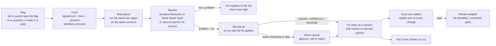

# Kix Synapse: the self-learning engine

Founder brief, 29 Oct 2026: trace every chat and its reasoning; let kids flag a question or a reply that's wrong (a typo, a wrong correction) from any screen where they talk to AI; record the reports for the admin; review them with a different model, an open one; fix by itself what it's sure of (a skill problem updates the skill, a model problem adds a guardrail to that agent); let the admin approve the rest against a threshold they set; keep an adapter ready to retrain a model later. Name it as a brand: it is how myKx learns and adapts with little human help.

**Kix Synapse** is that brand. It names all of myKx's learning loops (ARCHITECTURE §6: content, per-child learning, memory, parent feedback, operations) and adds the sixth, the one this spec is about: **Flag → Trace → Review → Fix → Re-test**, with **Retrain** as a later step. Its promise to judges and parents: *Kix only ships a fix it can prove.* A fix is published only after the problem has been reproduced and the fixed version has passed the same test.

Status: **built 29 Oct** (the same evening it was designed), live-tested on the sample family; designed first in the canvas (page "Kix Synapse, 29 Oct", boards `SynapseLoop`, `SynapseFlag`, `SynapseInbox`, `SynapseCase`, `SynapseLearned`, `SynapseSettings`; copies in `docs/design/boards/`, source `docs/design/canvas-src/synapse-boards.py`). Code: `lib/synapse/`, `components/synapse/`, `components/admin/synapse/`, `app/api/synapse/`, `app/api/admin/synapse/`, `app/api/cron/synapse/`; architecture in `docs/ARCHITECTURE.md` §6.5a. Where the build differs from this spec, §15 says so.

## 1. Goals and limits

**Goals**
1. One tap to report a problem, on every surface where a model speaks or a question is marked, for Junior and Teen.
2. Every report reaches a reviewed verdict in minutes, without a person, and most real problems are fixed without a person.
3. Every fix is a version that can be undone, with the report, the evidence and the test that proves it.
4. The admin sees a short queue (only what the engine isn't sure of), the trace behind each case, and the engine's track record.
5. Every confirmed problem becomes a regression test, run on every change and every night.
6. The reviewing systems can each use a different model; the default reviewer is Meta's open-weight **Muse Spark Open**.

**Limits (what Synapse never does)**
- It never changes a score by itself. Marking stays deterministic: a corrected answer key re-marks attempts through `lib/domain`; the model only proposes the corrected key (rule 5, §5.3).
- It never weakens a guardrail. It can only add a caution, which narrows what an agent does (§5.4).
- It never trains a model in this build. Retrain is an adapter and a dataset export (§8).
- It never shows an admin a child's chat history, Notebook or other answers. The admin sees only the turn a child chose to report (§9).

## 2. Who does what

| Who | What they do |
|---|---|
| **Kid** | Taps the flag, picks what's wrong, can add a few words (typed or held-to-talk). Sees "Checking", then the outcome: "Fixed, thanks to you" or Kix's explanation of why it was right. |
| **Parent** | Can flag the Tonight summary and Kix's suggestions with the same sheet. Sees their children's reports and outcomes in Family. Can turn flagging off per child. |
| **Synapse Reviewer** (agent, Muse Spark Open) | Reads the case, decides if it's a real problem, what kind, and proposes the fix with a confidence. |
| **Second opinion** (Synapse Reviewer on Muse Spark 1.3) | Reviews any fix that would change a score, independently. |
| **Synapse Judge** (agent, Muse Spark Open) | Judges eval cases that code can't check (a reply's meaning rather than a number). |
| **Code** | Builds the case, removes identities, reproduces, checks, applies fixes as versions, re-marks, runs evals, keeps the audit trail. |
| **Admin** | Approves, edits or rejects what's below the threshold; sets the threshold and the models; retires cautions; exports training data. |

## 3. The loop



## 4. Flag: capture

### 4.1 Where the flag appears

| Surface | What can be flagged | Kinds offered |
|---|---|---|
| Learn question player | the question, the marking, Kix's hint, the reason coaching | Typo or spelling · Marked wrong but I'm right · The picture doesn't match · Hint doesn't help · Something else |
| Ask Kix | each reply (hint, steps, full) | Kix's answer looks wrong · Typo · Doesn't make sense · Something else |
| Talk to Kix / Kix Tutor | each reply | Kix got it wrong · Doesn't make sense · Something else |
| Critter Lab talk | each pet reply | That's not true for this stage · Something else |
| Vibe Zone | a card or the deck | Wrong fact · Typo · Something else |
| Parent: Tonight, Kix's suggestions | the summary, a suggestion | Not right about my child · Wrong fact · Something else |

Guardian alerts keep their own Right / Not right (loop 4) and never enter Synapse (rule 15).

### 4.2 The sheet (designed: board `SynapseFlag`)

- A small flag button sits on every flaggable thing: in the question header, on each Kix reply bubble. ≥ 56 px target for Junior, ≥ 44 px for Teen. It never covers an answer control.
- Tapping opens a sheet (bottom sheet on compact): the kinds as big picture chips, then "Tell Kix more (optional)", typed or hold-to-talk (rule 9: push-to-talk, ≤ 30 s, transcript only), and **Send to Kix's crew**. Junior chips carry an icon and a read-aloud button; Teen chips are compact.
- One line of honest small print: "Kix's crew sees this question and Kix's reply. Not your other chats."
- After sending: the flag turns into a small "Checking" chip on that item. The outcome arrives in the kid's Kix inbox (and on the item if they come back): **Fixed, thanks to you** with what changed, or **Kix double-checked** with a short, level-right explanation of why it was right ("'Fewer' is right here because you can count the marbles").
- No points, stars or cards for reports, so nothing rewards spam (rule 5). The thanks is the fix itself and a named credit: "Fixed by your report" on the item.
- Limits: 10 reports a day per child, one open report per item; a duplicate joins the open case (it raises its weight, see §5.2).
- Distress or safety words in the note take the existing caring path first (Kix's caring reply, the helplines, an urgent parent flag, rule 12); that note is not sent to a reviewer.

### 4.3 Signed turns: content kept only when a kid reports it

`model_runs` keeps ids and numbers only, and that stays true. To review a turn without storing every chat, each AI response and each marked result carries a **turn token**: an HMAC (server secret) over the trace id, agent, versions and a hash of the exact text shown. When a kid flags it, the browser sends the text it showed plus the token; the server checks the signature and the hash, so the case is exactly what the kid saw, and nothing was stored before the kid chose to report it.

## 5. Trace, review and fix

### 5.1 Trace

A trace is one kid action (an ask, a marked answer, a pet reply). Each model call in it is a span. Spans extend `model_runs` with ids and numbers only: `trace_id`, `agent_id`, `agent_version`, `skill_version`, `caution_ids`, `provider`, and **guard events** (what code changed after the model, for example `enforceStage` trimming a hint that showed steps, or the marker's rule that decided the mark). For a reported turn, the case adds the words: the item from the pack (content, not child data), the ask, the reply shown, and the note, after de-identification (§9).

The admin's case view draws the trace as a timeline: kid action → each agent call (model, version, latency, tokens, cost) → guard events → the mark → the report → reproduce → review → second opinion → test → decision.

### 5.2 Review

The **Synapse Reviewer** gets the de-identified case and the reproduced turn, and answers with a validated structure (zod; no recursive refs; one repair retry, then the case waits for the admin):

```ts
{
  verdict: "problem" | "not-a-problem" | "unclear",
  kind: "typo" | "answer-key" | "marking-rule" | "figure-mismatch" | "wrong-explanation" | "model-behaviour" | "app-bug" | "not-an-issue",
  target: { type: "skill-item" | "skill-reference" | "agent" | "app", id: string, field: string | null },
  fix: { type: "item-patch" | "reference-patch" | "caution" | "none", before: string | null, after: string | null, caution: { when: string, check: string } | null },
  test: { kind: "exact" | "contains" | "not-contains" | "number" | "judge", expect: string },
  confidence: number,          // 0..100, the reviewer's own
  evidence: string[],          // ≤ 3, quoted from the case
  rationale: string,           // ≤ 600 chars, for the admin
  kidNote: string              // ≤ 200 chars, for the kid, at their level
}
```

**Confidence** is computed by code, not taken on trust. It is the reviewer's confidence, capped by:
- **Reproduced?** If the problem can't be reproduced on the same versions (for a model reply) or isn't in the item (for a typo), the cap is 60; if it shows in only some of three runs, the cap is 90.
- **Deterministic checks** (any fail → 0): the `before` text occurs exactly once in the target; a typo patch changes no number, unit or option letter and stays within a small edit distance; an answer-key change appears in the item's worked solution; a caution contains no name and no loosening words ("reveal", "ignore", "skip the check"…), is ≤ 160 characters and fits the `when … check …` form.
- **The re-test** (§5.5) must pass with the fix and fail without it (for a model reply), else the cap is 70.
- **Second opinion**, required when the fix changes a score: the lower of the two confidences, and 0 if they disagree on the fix.
- **Weight**: two or more independent reports of the same case raise nothing by themselves, but let a case at 95 or more skip the queue only if the admin has turned that on.

A case **auto-fixes** when the computed confidence ≥ the admin's threshold (default **100**), the fix type is allowed to auto-ship (§5.3), and the daily auto-fix cap isn't reached (default 20). Everything else waits in the admin queue, already reviewed and with the fix drafted.

### 5.3 Fix a skill problem

Typos, figure mismatches, wrong explanations and wrong keys in a pack are fixed through the skill-version layer that already exists (`skill_versions`, `lib/skills/overrides.ts`, ARCHITECTURE §5.4): Synapse writes the pack's next version with the patch applied and the note "Synapse: fix from report #…". Every reader of the pack sees it within 60 seconds. Undo is the existing Restore. Vercel's filesystem is read-only at runtime, so fixes never touch `content/skills/`; `scripts/fold-fixes.ts` (later) can fold published fixes back into git.

| Fix | Auto-ship when confident? |
|---|---|
| Typo, wording, a hint or explanation, a figure label | Yes |
| Answer key or marking rule (changes a score) | Only if the admin turns off **Scoring changes always need me** (on by default), and always with the second opinion |
| Anything to a pack the admin has locked | No |

When a key or marking rule changes, attempts on that item in the last 30 days are re-marked by `lib/domain` with the corrected key, mastery is recomputed the normal way, and the kid's outcome says "your answer now counts". Rewards follow the ledger's normal rules for that day; nothing is granted outside them.

### 5.4 Fix a model problem: learned cautions

When an agent behaved wrongly (Ask Kix's steps used the wrong total; a pet said a tadpole eats flies), Synapse adds a **learned caution** to that agent:

- A caution is one line in the form *When {situation}, {check}*, ≤ 160 characters, with a scope (subject, level, topic tags) so it is only added to calls it applies to.
- It sits in a "Learned cautions" block after the agent's editable instructions and before its fixed guardrails, which always come last and always win.
- At most 12 active per agent; the reviewer merges a new one into an old one when they overlap.
- Each has its reports, its eval cases and an expiry 30 days out. The nightly evals renew it while it is still needed; the admin can confirm it (no expiry), edit or retire it in **Learned**.
- It is a version of the agent's prompt like any other: Under the hood shows it, and the agent's version history records it.

This changes one line of ARCHITECTURE §6 ("none of them rewrites a prompt by itself"): Synapse may *add* a bounded caution, after reproducing the problem and proving the fix; it can never edit or remove instructions or guardrails.

### 5.5 Re-test and evals

Every confirmed case becomes an **eval case**: the de-identified input, the target versions, and the test (`exact`, `contains`, `not-contains`, `number`, or `judge` when only meaning can be checked, judged by the Synapse Judge). Code-checked tests are preferred; the reviewer must say why a `judge` test is needed.

- **Before a fix ships:** the case's test runs on the current version (must fail for a model problem) and with the fix (must pass), plus the agent's or pack's other eval cases (must not regress).
- **On every published agent or skill version** (by an admin or by Synapse): that agent's cases run; Under the hood shows "Evals 41/42" next to Publish.
- **Nightly** (Vercel cron, 03:00 SGT): every active case, at most 3 at a time, with a daily budget cap. Results go to `eval_runs`; a case that starts failing reopens its report.

### 5.6 App bugs and the rest

An `app-bug` or an `unclear` case goes to the queue as "For the team", with the trace attached. A GitHub issue adapter is a later step.

## 6. Models: every system can use its own

A **model role** names a job; the admin chooses the provider and model for each role in Settings. One OpenAI-compatible client per provider (`lib/meta/providers.ts`), the same retries, logging (`model_runs` gains `provider`) and timeouts.

| Role | Default | Fallback | Why |
|---|---|---|---|
| `synapse.reviewer` | **Muse Spark Open** on Baseten (`meta-models/muse-spark-open`) | Muse Spark 1.3 | A different model from the one that made the mistake; Meta open weights; zero data retention by default on Baseten |
| `synapse.second` | Muse Spark 1.3 (Standard) | none: the case waits | Independent check on any score change |
| `synapse.judge` | Muse Spark Open on Baseten | Muse Spark 1.3 | Meaning checks in evals |
| every kid-facing agent | unchanged (Muse Spark 1.3 Standard) | cached replies | Rule 1 |

When Baseten isn't configured or fails, the fallback runs and the case is labelled with the model that actually reviewed it (rule 8).

## 7. Admin: Kix Synapse (designed: boards `SynapseInbox`, `SynapseCase`, `SynapseLearned`)

A new admin section, **Kix Synapse**, beside Skills, Add knowledge, People and Under the hood.

- **Inbox**: the loop with live counts; this week's reports, auto-fixed, waiting for you, median time to fix, eval pass rate; tabs Waiting for you, Auto-fixed, Kix was right, For the team, All. Each row: what was flagged, kind, surface, reviewer, confidence against the threshold, outcome.
- **Case**: the trace timeline; what the kid saw and their report; the reproduced turn; the reviewer's verdict, evidence and rationale; the second opinion; the fix as a diff; the test before and after; **Approve and publish**, **Edit fix**, **Not a problem**, **Undo** (for auto-fixes). Every action goes to `audit_log`.
- **Learned**: active cautions per agent with their reports, evals and expiry; confirm, edit, retire.
- **Evals**: pass rate per agent over 14 days; failing cases; Run now.
- **Settings**: auto-fix threshold (50–100, default 100); Scoring changes always need me (on); daily auto-fix cap; the model for each role; the daily review and eval budget; Synapse on or off.
- **Retrain**: see §8.

## 8. Retrain: the adapter, not the training

Synapse builds a training set as it goes; training is a later step behind an adapter.

- **Dataset**: from fixed cases only, de-identified, and only from households whose parent turned on **Help Kix learn** (off by default; Family → Privacy). Two shapes: supervised pairs (input → corrected output) and preference pairs (rejected = the original reply, chosen = the fixed one). Export as JSONL to Supabase Storage, with a manifest (counts, versions, date, consent count).
- **Adapter** (`lib/synapse/retrain.ts`): `{ id, label, status(), submit(datasetUrl) }`. Listed providers: Baseten Training (fine-tune a Meta open-weight model; LoRA through Baseten Loops is early access) and "Your own trainer" (download the JSONL). Neither submits in this build; the panel says "Not connected yet". A trained model would come back as a provider in §6 and would have to pass the evals before any role could use it.

This matches the README's "a myKx model of its own", trained on de-identified, consent-given learning traces.

## 9. Privacy and safety

- **Only the reported turn.** The admin sees the turn a child chose to report, never their chat history, Notebook or other answers. **This amends AGENTS.md rule 13** ("never expose a child's messages"): a child's own report shares that one turn. Admin views show "P6 learner · report #…", never a nickname.
- **De-identified before any reviewer.** Code replaces the kid's and family's nicknames with "Learner"/"Parent", removes ids, and strips email addresses, phone numbers, addresses and school names from the note (reusing `lib/skills/private-names.ts` and the safety filters). The case carries level and subject, not age or household.
- **The open model.** Baseten serves Muse Spark Open with zero data retention by default and doesn't store inputs or outputs of real-time calls. Only de-identified cases go there, never a raw note, an image of the child or anything from Guardian. Kid-facing agents stay on Muse Spark 1.3 Standard (rule 1).
- **Prompt injection.** A kid's note is data. The reviewer's instructions say so; cautions come from a fixed form, are screened by code, can only narrow behaviour, and only ship after a reproduce-and-test cycle.
- **Retention.** Cases 90 days, then the words are dropped and the numbers kept; spans 30 days; eval cases while active (de-identified); training exports are deleted when consent is withdrawn.
- **Audit.** Every auto-fix, approval, rejection, undo and setting change is an `audit_log` row with the case id.

## 10. Data and routes

| Table | Holds |
|---|---|
| `synapse_reports` | one row per report: surface, kind, note (screened), the de-identified turn, target ids and versions, status (`new`, `reviewing`, `waiting`, `auto-fixed`, `approved`, `rejected`, `kix-was-right`, `for-team`, `merged`), review, second opinion, computed confidence, fix reference, decided by and at, `duplicate_of` |
| `synapse_cautions` | agent, `when`, `check`, scope, status (`active`, `waiting`, `retired`), report ids, eval case ids, expiry, created by |
| `eval_cases` | target (agent or pack item), de-identified input, test, source report, active |
| `eval_runs`, `eval_results` | when, trigger (fix, publish, nightly, manual), versions, pass and fail, cost |
| `synapse_settings` | threshold, scoring needs approval, caps, model per role, budgets, on or off |
| `model_runs` (extended) | `trace_id`, `agent_id`, `agent_version`, `skill_version`, `caution_ids`, `provider`, guard events: ids and numbers only |

All server-only (RLS on, no browser policies), like `agent_versions`.

| Route | Who | Does |
|---|---|---|
| `POST /api/synapse/report` | kid, parent | verifies the turn token, screens the note, stores the report, starts the review with `after()` |
| `GET /api/synapse/reports` | kid (own), parent (their children), admin | outcomes and the kid's inbox |
| `POST /api/admin/synapse/decide` | admin | approve, edit, reject, undo |
| `GET, POST /api/admin/synapse/settings` | admin | threshold, caps, models, budgets |
| `POST /api/admin/synapse/cautions` | admin | confirm, edit, retire |
| `POST /api/admin/synapse/evals` | admin | run now |
| `GET /api/admin/synapse/dataset` | admin | JSONL export (consented, de-identified) |
| `GET /api/cron/synapse` | cron (`CRON_SECRET`) | sweeps stuck reviews; nightly evals; expiries |

## 11. Feasibility on Vercel and Supabase (checked 29 Oct 2026)

**Yes, with what myKx already has.** Nothing here needs a new paid service. Findings:

| Question | Finding | Design response |
|---|---|---|
| Can a review run after the kid gets a reply? | Next.js `after()` runs on Vercel's `waitUntil` and shares the function's limit: 300 s on Hobby (default and maximum), up to 800 s on Pro. ([Vercel limits][v1], [`after`][v2]) | A review is 2–4 model calls, about 15–40 s. Report route returns at once; the review runs in `after()` with `maxDuration = 120`. |
| What if it dies mid-review? | Hobby crons run at most once a day, within the hour ([Vercel cron pricing][v3]); Pro runs every minute. | Reports have a status; a stuck one is picked up by the sweep. Daily Vercel cron for nightly evals; **Supabase `pg_cron` + `pg_net`** calls the sweep every 5 minutes on the free plan ([Supabase Cron][s1]). |
| Durable queues and workflows? | Vercel Workflow (durable steps, on Vercel Queues) is still labelled beta ([Vercel Workflow][v4]). | Not needed: a status column with `for update skip locked` claims is enough at myKx's volume. Revisit if volume grows. |
| Can a fix update a skill on Vercel? | The runtime filesystem is read-only. | Fixes are skill versions in Postgres through the existing override layer (60 s cache), never files. |
| Can a fix change an agent's prompt? | Agent versions are already rows (`agent_versions`, 60 s cache). | Cautions are rows, merged into the prompt by `instructionsFor`. |
| Does Supabase hold it? | Free plan: 500 MB database. A case is about 6 KB; 1,000 reports and 60 nightly eval results a day is under 10 MB a day; with 90/30-day retention it stays under 300 MB. Free projects pause after a week idle (keep the demo warm). | Retention jobs in the sweep. |
| Is the open model available? | **Muse Spark Open** (Meta, released 15 Oct 2026; 816B MoE, 42B active, 1M context) is on Baseten Model APIs, OpenAI-compatible at `https://inference.baseten.co/v1`, model `meta-models/muse-spark-open`, zero data retention on by default ([Baseten][b1], [library][b2], [Meta][m1]). Also on OpenRouter, Fireworks, Groq, Together and others. | Baseten is the default host (zero retention). Structured output on Baseten is **unverified**: the adapter asks for a JSON schema and validates with zod, with one repair retry. |
| Is there a key? | No, by choice: **the founder keeps `BASETEN_API_KEY` empty for now (29 Oct)**; Baseten partner credits weren't granted. | The Baseten path is built and tested (`lib/meta/open.ts`, `lib/meta/open.test.ts`): with the key empty, the reviewer and the judge run on Muse Spark 1.3 and every case says so; setting the key moves them to Muse Spark Open with no code change. Live check 29 Oct: `scripts/smoke-open-model.ts` reviewed a typo report on the fallback in 5.3 s. |
| Retraining? | Baseten Training is generally available; LoRA and RL through Baseten Loops are early access ([Baseten Training][b3]). An 816B model isn't a sensible fine-tune target for myKx. | Adapter and export only; a smaller Meta open-weight model is the likely target later. |
| Cost | Muse Spark Open is listed at $1.25 / $4.25 per million input / output tokens across its launch hosts (third-party listing; confirm on Baseten's pricing page), the same as Muse Spark 1.3. | About $0.02–0.04 a report (reproduce, review, test, sometimes a second opinion); nightly evals about $0.25. Daily budget caps in Settings. |

[v1]: https://vercel.com/docs/functions/limitations
[v2]: https://nextjs.org/docs/app/api-reference/functions/after
[v3]: https://vercel.com/docs/cron-jobs/usage-and-pricing
[v4]: https://vercel.com/docs/workflow
[s1]: https://supabase.com/docs/guides/cron
[b1]: https://www.baseten.co/blog/muse-spark-open-launch/
[b2]: https://www.baseten.co/library/muse-spark-open/
[b3]: https://docs.baseten.co/training
[m1]: https://research.meta.ai/blog/muse-spark-open

## 12. Rule changes this needs (applied with the build)

1. **AGENTS.md rule 13**: a child's own report shares that one turn with the admin, pseudonymised.
2. **ARCHITECTURE §6**: Synapse may add a bounded learned caution after reproducing a problem and proving the fix; no loop edits or removes instructions or guardrails.
3. **AGENTS.md rule 1**: de-identified review cases may go to Muse Spark Open on Baseten (zero retention, no training); nothing kid-facing moves off Muse Spark 1.3 Standard.
4. **AGENTS.md rule 5**: a corrected answer key re-marks through `lib/domain`; key changes need the admin unless they turn that off.

## 13. Demo moment

Abby flags "Tank B" in a P6 maths question whose figure says "Tank C". Twenty seconds later, the Inbox shows the case: reproduced, reviewed by Muse Spark Open at 100, the one-word diff, the test passing, the pack at its next version. Abby's question now reads right, with "Fixed by your report". Then a Kix reply problem: the caution, the failing test going green, Ask Kix answering correctly. Video line: "Kix Synapse: every flag makes Kix a little better, and it only ships a fix it can prove."

## 14. Not yet

Flags on the Kix Tutor's live hints, the Vibe Zone and the parent's Tonight (cut order 1); re-marking past attempts after a key change (future attempts mark with the corrected key); the five-minute `pg_cron` sweep (cut order 3); 
GitHub issues for app bugs; folding fixes back into git automatically; training a model; flags on printable papers.

## 15. As built (29 Oct)

- **Surfaces with a flag:** the Learn question player (the question, the marking, the hint; no token needed: the server looks the item up in the kid's own packs), every live Ask Kix reply and every live pet reply (signed turns). Cached samples carry no token, so they show no flag.
- **The kid's outcome** shows on the flag itself: "Checking… Kix's crew has it", then "Fixed by your report" or "Kix double-checked" with the note; it is looked up again when the kid comes back to the question. The flag stays available for a new report once one is closed.
- **Reproduce** runs the agent three times at once (Ask Kix at the full stage on the question as Kix read it, with the pack sections it read; the pet at its stage). A photo-only ask or the tutor can't be re-run: capped at 60. **Re-test** runs three more with the caution plus up to four of the agent's other eval cases.
- **Cautions** are scoped by the case's level and subject (not by model-chosen tags) and merged by `instructionsFor`. The reviewer doesn't merge overlapping cautions yet; the admin retires duplicates.
- **Model per job** is a setting: Muse Spark Open or Muse Spark 1.3 for the reviewer, the second opinion and the judge. **The Baseten key is empty by the founder's choice**, so the reviewer and judge run on Muse Spark 1.3 and every case says so.
- **Durability:** the review runs in `after()`; a report left at `new` is reviewed by the daily cron, and the admin can press Review again. The five-minute `pg_cron` sweep is cut for now.
- **Live checks on 29 Oct** (review server, sample family, Muse Spark 1.3): a typo slipped into an edit of a P6 question was flagged and fixed by itself in 6 seconds (reviewer 100, checks 4 of 4, reproduced in the pack, `p6-maths` next version published; undo restores the version before). A kid who thought a ratio question was wrong got "Kix was right" with an explanation after an admin approved the 95. An Ask Kix reply was flagged through its signed turn and judged correct (88). Each review cost about half a cent.
- **Production:** run `supabase/migrations/20261030_synapse.sql` once in Supabase; until then a flag answers 503 and the admin page is empty.
- **Traceability (founder, 30 Oct):** every case says what changed (or that nothing did); Learned is the change log by agent and by pack, with Undo; an agent's page in Under the hood lists its cautions. Undo is a deterministic revert: the inverse change as a new version, or the caution retired. An admin can overrule the reviewer (a caution or a question fix anyway), and the reviewer's verdict stays visible. The founder's first production report ("don't use the word fun") was judged a style preference, Kix was right, so nothing changed; overruling it adds the caution, and Ask Kix's next reply follows it (checked on the sample family).
