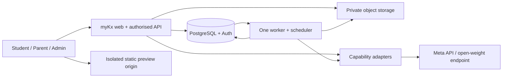

# myKx Product Requirements Document

**Decision date:** 26 October 2026 · **Capacity:** one developer/Muse Code: provisionally 56 build + 24 refinement person-hours; calendar reconciliation pending (§10). No application, inference integration or educational evaluation has been implemented/tested.

## 1. Executive summary, problem and brand

Students need understanding; parents need evidence to support them. myKx connects short learning sessions to family conversations, optimising understanding, confidence and retention. Its destinations are **Learn & Revise**, **Vibe Zone** and **Treasure**; daily parent summaries are core.

**Pitch:** “myKx gives every Singapore student their own AI sidekick: a personal assistant that learns how they learn, guides them through homework, adapts their revision, and builds with them in a safe coding studio.”

**Founder story:** “Leonard, Abby and Jordan have always been my sidekicks. I built myKx so each of them could have a sidekick of their own.”

*Leonard, Abby and Jordan are stand-in names, not the founder's children's real names.*

| Brand element | Specification |
|---|---|
| Canonical name/accessibility | `myKx` everywhere, including accessible text and code-facing product labels |
| Wordmark | Render `myK` followed by a glowing four-point sparkle ✦ replacing x. Keep capital K provisionally despite the “lowercase wordmark” description. |
| Sidekick | Kix; configuration display name “Kix Agent”. “Hey Kix, help me plan for my Science test.” |
| Main / parent / student taglines | “Every hero needs a sidekick.” / “My kids. Their sidekicks.” / “Your sidekick for school and beyond.” |

**Success:** a student completes a learning loop/creation; a parent understands progress, uncertainty and one offline activity. No grade-improvement or calibrated forecasting claims.

## 2. Assumptions, verified research and boundaries

Labels: **V = verified documentation**, **D = proposed design**, **A = assumption**, **U = unverified access/applicability**. Documentation does not prove account access. Research stayed below the 60–90-minute ceiling; blocked sources were recorded. All URLs were accessed/attempted **26 October 2026**.

| Decision | Evidence and status |
|---|---|
| Meta-first | **V:** [catalogue][R1]/[overview][R2] document text/vision/PDF, images, streaming/tools. **U:** credentials, credits, entitlements, latency/effective limits; no inference calls made. |
| Extraction | **V:** [file handling][R3] documents PDF text through page 100 and images through page 50; inline limit 50 MB, Files API 1 GiB. **D:** substantially smaller application limits, page batching and mandatory review. [Schema constraints][R4] validate shape, not educational correctness. |
| Curriculum | [MOE primary][R8]/[secondary][R9] returned anti-bot pages. Official PDF titles were search-index discoverable; applicability remains **U** pending uploaded PDFs. |
| Paper sources | [Testpapersfree P4][R10] retrieval failed; reuse permission **U**. [KiasuParents][R11] category was readable, but posts remain unverified teaching leads. **D:** original/permission-cleared uploads are the demo baseline. |
| Wiki | “Google open wiki” is ambiguous: [OpenWiki][R12] is LangChain’s tool; [Google Open Knowledge Format (OKF)][R13] specifies Markdown/metadata, not retrieval or learner storage. The old OKF location moved. **D:** Markdown/YAML, no CLI/catalogue/conformance claim; Meta CLI integration untested. |
| Learning | [EEF guidance][R14] supports explicit planning, monitoring and evaluation; [retrieval discussion][R15] motivates appropriately challenging recall. **D:** transparent heuristics; no validated learner forecast. |
| Preview | [MDN][R16] warns against scripts plus same-origin privileges for same-origin untrusted content. **D:** schema-constrained projects, separate preview origin, sandbox and CSP. |

**Organiser rules, verified from the supplied [saved guide][R34] ([online location][R33] inaccessible):** Build for Your World fits the founder problem. Stage One requires reasonable Meta API and/or open-weight use; no explicit all-model checklist found. Public repository, event-built contributions, rights-cleared assets/data and a three-minute video are required. Simple education chatbots/basic RAG are excluded: demonstrate the actual attempt → practice artifact → family-action workflow; eligibility remains judges’ decision. Four equally weighted criteria: impact, Meta tooling, technical execution, demo. The open-weight bonus names only Muse Glimmer/Spark Open.

**Confirmed runtime decision:** Meta API primary + Baseten-hosted Muse Spark Open for bounded tagging/provider switching; an already-working eligible partner takes precedence. Guide-specified target `meta-models/muse-spark-open-1026`; account access/credits/quality remain unverified. No self-hosting dependency or assumed bonus award.

**A:** seeded academic year 2026; support P4/Sec 1/Sec 3 × Mathematics/Science/English. Explicit enrolments select year, course/subject level, exam cohort and Science combination, never age. Provisional demo: Sec 1/3 G3; Sec 3 Science (Physics, Chemistry), without assuming the founder’s children’s courses.

**Non-goals:** full syllabuses, native clients, arbitrary coding/backends, social scraping/feed/chat/discovery, autonomous crawling, fine-tuning, enterprise CMS and validated forecasting. Formal compliance is outside the hackathon; review PDPA, consent, retention, third-party data handling and content reuse before public deployment. Authentication, child separation and safe sharing remain mandatory.

## 3. Scope and feature traceability

Stable requirements below total **56 P0 hours**, including initial checks/content. P1 is additional, unfunded work, permitted only before Day 7 freeze after P0 completion; later estimates are provisional. Tests: §11.

| ID / requested capability | MVP version and limitation | Priority / hours | Acceptance / implementation day |
|---|---|---|---|
| FR01 Accounts, households, enrolments | Managed login, child/parent/admin roles; year/course/scope configuration | P0 / 5 | Wrong household denied; all nine combinations selectable; D1–2 |
| FR02 Syllabuses, nine banks, provenance | 3 reviewed bank items/combination + 7 extra P4 Science + 2 Maths variants = 36 | P0 / 8 | Published items checked; unsupported topics empty; D1–2,4–5,7 |
| FR03 PDF/image/import pipeline | Upload plus one permission-cleared allowlist URL; resumable review queue, diagrams/subparts/deduplication | P0 / 6 | Original page/crop survives; failed batch retries without duplicates; D2–4 |
| FR04 Kix, dashboard, diagnosis, teaching, mastery | Short guided sessions, hints, partial marks, evidence and deterministic selection | P0 / 7 | New-family evidence changes estimate; repeats/hints cannot inflate it; D3–5 |
| FR05 Personalised home/three zones | Responsive PWA; fixed age-band copy/density (9–11/12–15), interests/themes, daily/manual refresh, cached Muse Image art | P0 / 2 | Timestamp, reduced motion/mature styling; D2,6 |
| FR06 RAG, wiki, self-improvement | Filtered lexical retrieval; one reviewed teaching-method revision with rollback | P0 / 3 | No wrong-course/key retrieval; source/page links and version visible; D3–4 |
| FR07 Parent/family summaries | Scheduled in-app summaries, evidence, offline activity, correction/retry handling | P0 / 5 | Household-safe daily result, including no-activity state; D3,5 |
| FR08 Skills, practice/PDF/variants/patterns | Versioned contracts; fixed printable set + separate guide; two checked numeric variants; distribution table/insufficient-data state | P0 / 4 | Marks/pagination correct; lineage and sample gaps shown; D4,7 |
| FR09 Vibe mini factory | Idea → agreed brief → flashcards or planner → isolated preview → one revision → save | P0 / 6 | Both templates interactive; unsupported requests scoped down; D6–7 |
| FR10 Treasure/rewards/shares | Ledger, badges, versions, fixed thumbnails, explicit approved-user grants/revoke | P0 / 3 | Duplicate reward suppressed; revoked/invalid ID denied; D5–6 |
| FR11 Provider switching/all Meta spikes | Meta API primary; Baseten Muse Spark Open tagging; capability adapters/budgets | P0 / 4 | Same typed task on both providers with genuine logs; D1,7 |
| FR12 Admin/deployment/jobs | Protected tables/forms, configuration versions, usage/errors, retry controls | P0 / 3 | Parent cannot publish or read secrets; D1,5,7 |
| FR13 SAM science activity | One approved image, reviewed object mask → clickable highlight; manual boxes fallback | P1 / +3 | Correct object/zero-match reviewed; Day 1 30min spike included in FR11 |
| FR14 More creation/paper depth | Science activity/clicker templates; one supplied school paper layout; supplementary source review | P1 / +8–12 | Template/date attributed; reviewed output; no universal “latest WA” claim |
| FR15 Broader platform | In-app/PWA only; defer email/WhatsApp, native clients, full banks, crawling/forums, validated forecasting, unrestricted studio | Later / 80–160+ | Recipient/isolation tests, permission audits, temporal holdout and code-security review before pilots |

Content: **1.5h syllabus/scope mapping + 6.5h answer review**, about 11 minutes/short record, including evaluation fixtures/variants; essays excluded. Provisional starter topics, subject to document/scope review:

| Level | Maths / Science / English |
|---|---|
| P4 | Fractions / light and shadows (polished demo: ten items) / subject–verb agreement |
| Sec 1 G3 | Linear equations / particle model / reading inference |
| Sec 3 G3 | Quadratics / forces within selected Physics component / summary evidence |

## 4. Personas, navigation and journeys

| Persona | Need / journey |
|---|---|
| P4 child, approximately 9–10 | Friendly steps: recommended topic → diagnostic → hint/example → fresh-family check → practice/reward. |
| Sec 1/3 learner, approximately 12–14 | Mature layout; course/scope selection; marks/evidence; useful creations. |
| Parent | Enrolment/school upload → review status → family overview/summary → offline activity. |
| Admin | Source/permission → extraction/taxonomy/key review → publish → inspect jobs/teaching revisions. |

**Complete learning loop:** upload/import → review extracted questions → confirm syllabus → publish → diagnose from actual attempts → teach/practise → update mastery → assemble targeted practice → award meaningful effort → generate parent summary/activity.

**Complete Vibe loop:** “I forget my revision tasks” → agree a tiny planner brief → generate validated project specification → compile HTML/CSS/JavaScript → preview → revise → save version in Treasure → explicitly grant that version to a parent-approved user ID.

## 5. Functional behaviour and important states

**FR01–05:** Missing scope offers configuration/balanced practice, never invented term sequencing. “Social information” means approved interests, family/friend connections and shared projects. Daily refresh changes recommendations/assets; manual settings override suggestions. Dashboard separates available-bank coverage, attempts, completion, marks, mastery/confidence/evidence. Empty states: “not yet assessed”/“content not yet available”. PWA caches only static shell assets, never private responses.

Kix offers 5–10-minute sessions, hints before answers, examples/delayed retrieval. Science: appropriate Claim–Evidence–Reasoning; Maths: steps/bar models; English: textual evidence/revision. No fixed learning styles. Mark objective items deterministically; parent/admin confirms open-response rubrics before mastery changes. Log reveals. Separate observations (“requested two hints”) from interpretations (“may benefit from smaller steps”). Model failure offers retry/reviewed practice.

**FR07:** Configurable delivery, default 20:00 Asia/Singapore; one child summary/local date plus family overview. Narrate deterministic aggregates: studied topics, improvement, difficulties/evidence/uncertainty, next session and offline activity. No activity: “Nothing recorded today; no catch-up needed”, with optional family activity. Never diagnose emotions or automatically recommend more screen time.

**Synthetic illustration, not measured progress:** “Light and shadows: 3 first attempts, 2 independent correct answers; yesterday’s comparable sample was 1/3. Two hints helped an explanation; independent transfer remains uncertain. Next: one fresh question tomorrow. Together for 12 minutes: use a torch, paper and three household materials. Predict which block light, test, then ask your child to explain one surprising result.”

**FR10:** Transparent ledger: 2 points/first submitted attempt with explanation; 3/retry with revised explanation; 5/fresh-family independent success following a subskill error; 5/saved creation. Cap repeatable awards at 15/day; unique rule/event keys, no refresh awards. No money/loot boxes/rankings. Shares grant one version to an existing approved ID; parent disables/revokes. New versions require grants. Revocation blocks subsequent reads, not already copied content.

**FR12:** Protected generic tables/forms manage households/roles, syllabuses/scopes, sources, ingestion/retries, publication, skill/prompt/template versions, model routes and jobs. Parent controls own household/scores/scope/contacts, never shared publication. Show usage/errors/budget pause; keys stay server-side.

## 6. Learner model and practice priority

**D:** uncalibrated mastery index, not exam-success probability. Retain first attempts, score revisions, hints/reveals/retries/timestamps. Per enrolment/versioned subskill, use ten latest distinct families. Hide cold-start prior .5 until evidence exists. Confidence: “limited” below five families across two dates; otherwise “developing evidence”. Flag evidence stale after 14 days.

```text
recompute(events):
  eligible = confirmed first attempts, excluding answer-revealed attempts
  eligible = earliest attempt per question_family, using latest score revision
  m = 0.5
  for e in latest_10(eligible, chronological):
    q = clamp(e.marks/e.max_marks - 0.2*min(e.hints_before_submit,2), 0, 1)
    if e.hints_before_submit > 0: q = min(q,m)  # assisted success cannot raise m
    m = 0.7*m + 0.3*q
  return m, distinct_family_count, dates, last_practised
```

Variants/retries contribute completion/feedback only. Show later same-family performance separately. Aggregate subparts into one family contribution; score corrections trigger replay.

**Worked example:** prior .50; first family scores 2/4 with two hints: q=.10, m=.38. A fresh family scores 4/4 without hints: m=.566. Ten correct retries of either family leave .566 unchanged. Display “57/100; limited evidence: two families”, with separate marks and completion counts.

```text
eligible = approved questions matching year, syllabus, level, course, combination
exclude families practised within 7 days; never cross course to fill a gap
W = 1-mastery_or_0.5
C = 1 selected curriculum topic; 0.5 reviewed prerequisite; otherwise 0
A = in_uploaded_scope * clamp(1-days_to_assessment/30,0,1); absent scope = 0
D = min(days_since_practice/7,1); unseen = 0.5
H = 1 if estimated difficulty matches next challenge band; otherwise 0.3
priority = .35*W + .20*C + .20*A + .15*D + .10*H
choose 3 diverse families; reserve one cold-start probe when available
```

Challenge bands: easy below .4, medium .4–.7, harder above .7; all weights are tunable MVP heuristics. Explain selection using its strongest factors. Exhausted bank offers delayed review labelled “no new mastery evidence”; it does not invent questions or mastery. Retention and learning effectiveness require later evaluation.

## 7. Ingestion, retrieval/wiki and paper lifecycle

**FR02–03:** official MOE → verified school scope/reviewed papers → reviewed supplements → attributed forum suggestions awaiting review. Allowlist: MOE + one cleared source. Unknown reuse blocks publication; school uploads remain household-private unless cleared.

1. Register owner/permission/fetch date/SHA-256/version. Same hash returns existing result; changed hash creates revision.
2. PDF/JPEG/PNG: ≤10 MB/20 pages; reject encrypted/oversized files. Allowlisted HTTPS fetches: validate redirects, block private IPs, 15s timeout; no bypasses.
3. Checkpoint five-page batches, preserving original offsets; extract text/images with available vision/document model. Unreadable pages need replacement/manual transcription.
4. Segment questions/subparts/passages; retain diagram crops/page coordinates. Protect separately extracted keys. Unknown values stay null.
5. Map versioned taxonomy; ambiguous mappings enter review. Label difficulty as estimated.
6. Validate schema/marks/key alignment; normalised hashes and shingle similarity ≥.85 flag duplicates/families for review.
7. Admin compares items/keys/diagrams with originals: approve/correct/reject. Resume failed batches; never auto-publish partial extraction.
8. Index approvals; propose cited wiki revisions. Changed sources mark dependants stale; disputed content stays excluded.

**FR06:** separate authoritative documents/questions, derived teaching/wiki and private learner stores. Filter permissions/year/course/combination before PostgreSQL lexical retrieval, maximum four approved chunks. No embeddings needed. Future vectors require named provider/model/dimension/chunk version, shadow reindex and atomic switch; never mix spaces.

Chunk questions/subparts together; link complete passages/diagrams. Exclude keys/rubrics from pre-answer contexts/payloads. Students see approved page crops; raw papers/marking guides are parent/admin-only. Claims link sources/pages or say “model-generated explanation”; insufficient/conflicting evidence triggers abstention/review. Official versions outrank supplements. Retrieved instructions cannot grant tools/change policy/execute content.

Wiki frontmatter: topic/version, sources/pages, generated/reviewed status, reviewer, updated/stale dates. Failure/common-error logs propose strategies; admin checks two examples, approves/version-controls/rolls back. Never silently rewrite official text/keys. Daily allowlist check: at most two sources, review queue; no retraining.

**FR08 skills:** versioned prompts + schemas + deterministic functions: `map_syllabus`, `extract_questions`, `select_practice`, `explain`, `make_variant`, `assemble_paper`, `parent_summary`. Authorised inputs → typed outputs/provenance/review state; no plugin framework.

Paper inputs: enrolment/scope/date/topics, marks **or** length, difficulty/original–bank mixes. P0: bank sets/two variants/one Maths family; unsupported mixes return feasible proposals. Recompute numeric answers; check units/rubrics/solvability, retain lineage, reject ambiguity. Label sourced past-paper versus generated practice. Second-model checks are advisory; generated items require review.

One `PaperSpec` renders student PDF/separate guide via fixed A4 HTML/CSS/[Playwright][R21]. Preserve passages/diagrams/answer space/pagination/totals; inspect three exports. Footer: `myKx Practice v1`, creation date, supplied school reference/date; no unsupported school-format claims.

Pattern analysis counts topics/skills/marks by comparable syllabus/course/assessment; show n/years/gaps. Below five papers: “insufficient history”, use uploaded scope/balanced coverage. No future-question probabilities. Future temporal holdout: earlier years → held-out later papers, compared with scope baselines and checked for curriculum drift; not performed.

## 8. Architecture, model routes and operating budgets

**D:** one TypeScript Next.js/Docker application; Render web + **one** worker/scheduler; Supabase [Auth][R18], PostgreSQL/[RLS][R19] and private [storage][R20]. Managed services/[worker][R22] reduce integration. Access **U**. Worker handles ingestion/PDFs/summaries/refreshes. No Redis, microservices, Kubernetes or graph database. Deterministic events/calculations precede narration.



Separate adapters: text/structured, streaming/tools, documents/vision, images, segmentation. Record provider/model, prompt/schema versions, sources, parameters, usage/output hash. Tools: authorised read-only lookups, maximum two turns; [application executes them][R23]. Routes cannot alter mastery.

| Component / documented capability | Proposed bounded role / access gate |
|---|---|
| Muse Spark `muse-spark-1.3` | Tutor/summary/tag/extract; **V** text/image/PDF → text; [schemas][R4]/[tools][R23]/[streaming][R2]. Account/quality **U**. |
| Muse Wonder `muse-wonder-1.0` | Difficult brief/validation escalation, five calls/day. [Wonder Full][R1] is Muse Code-only. |
| Muse Image `muse-image-1.0` | Generate/cache one Kix/theme/reward asset; vector/HTML educational diagrams remain deterministic. No runtime art requirement. |
| SAM `sam-3.1` | **V** [boxes/masks][R5]; P1 approved science-object highlighting. Zero match/manual boxes fallback; never OCR. |
| Meta open weights | Baseten Muse Spark Open: deidentified topic tagging, ≤2k input/128 output. [Chat endpoint][R35] documented; event alias from [guide][R34]. Account support/quality **U**. [Llama 3.2][R17] does not meet named bonus requirement. |
| Muse Code | Developer tickets/tests/review only; child data excluded from development prompts. Access/subscription **U**; verify Standard settings independently. |

Meta base: `https://api.meta.ai/v1`; [text/image][R2] and [SAM][R5] routes differ. Baseten: [documented][R35] `https://inference.baseten.co/v1/chat/completions`; verify event alias above before use. No Meta embeddings assumed. [Glimmer][R7]: roughly 72 GB BF16 VRAM; quantised weights exclude runtime overhead. Hosted deployment avoids local hardware dependency.

Day 1: smoke-test six requested components with synthetic inputs; record request ID/model/usage/errors. Verify hosted model identity/licence/terms; same tagging contract on Spark and hosted Muse open weights, ten reviewed items, valid output and ≥8/10 correct each. Cap partner setup at 45 minutes; failure leaves switching incomplete, with Meta API preserving the core. Guide-listed Voice Transcribe is optional, outside scope.

**Target estimates:** tutor first-token p95 ≤4s/completion ≤20s; ingest ≤3min/5 pages; PDF ≤30s; summary ≤60s. Timeouts: text 30s, documents/assets 90s; two transient retries/jitter/Retry-After. Cancel queued/abort supported calls. Cap 30 tutor calls/child/day, two concurrent family jobs, 12k input/1k output tutor tokens. Cache by authorised context/source/skill/model version. Incapable fallbacks fail clearly; text cannot replace vision.

[Published Standard USD prices][R6]: Spark $1.25 input/$4.25 output per million tokens; Wonder $4/$20; Image $.01/image; SAM $.0025/image. Estimates: 300 Spark × 4k/600 ≈$2.27; ten Wonder × 8k/1k ≈$.52; 20 images/ten masks ≈$.23. API ceiling $20; hosting allowance $40; Muse Code excluded. Partner pricing/credits unverified. Reserve/log spend, pause at cap. Meta child workloads: Standard; independently verify partner data-use terms. Guide advertises $150 Meta credits, requiring individual claim/billing activation; balance unverified.

**FR09:** untrusted specification → trusted renderer → self-contained HTML/CSS/JS. Escape text; bound collections/strings; reject HTML/URLs/scripts/unknown templates. Cookie-free preview origin, `sandbox="allow-scripts"` only, no privileged messaging. One-use 60s preview token checks owner/grant; no-store. HTTP CSP: `default-src 'none'; script-src 'sha256-<trusted-template-hash>'; style-src 'sha256-<trusted-style-hash>'; img-src data:; connect-src 'none'; frame-src 'none'; worker-src 'none'; object-src 'none'; base-uri 'none'; form-action 'none'`; frame ancestors restricted to app. No links/forms/popups/top navigation or privileged execution of model-authored code.

Limits: 80 KB, 20 cards/tasks, bounded timers; Start/Stop/remove iframe/Reset. No packages/shell/payments/accounts. Sandbox/CSP alone cannot guarantee CPU isolation or prevent every self-navigation; renderer excludes arbitrary code/navigation. Browser hangs remain possible. Fixed thumbnails avoid server execution of submitted HTML.

## 9. Minimal data model and contracts

UUID keys, timestamps and version fields throughout; JSONB for bounded nested schemas. RLS plus API checks enforce child/household ownership; admin service credentials stay server-side.

| Record group | Minimum fields / relationships / ownership |
|---|---|
| Profiles/enrolments | user, role, household, age band, interests/theme; child → enrolment(year, level, subject, course, combination, exam cohort, syllabus_version); parent-linked scope(file, topics, date, verified_by) |
| Syllabus/topics | version, effective cohorts, source/hash, verification date; topic/subskill parent IDs; admin-reviewed |
| Sources/questions | owner/visibility, URL/file, permission, fetch/hash/version/status; question → source/page/bbox, level/course/year, school nullable, assessment, topic/subskill, format, marks, difficulty_estimate, diagram, review status, family/variant lineage; protected answer/rubric record |
| Attempts/mastery | child/enrolment, question/version/family, first-submit marks/max, hints, reveal, retry, time, score revision/confirmation; derived subskill index/evidence/last-practised |
| Artifacts/shares/rewards | owner, project/PaperSpec version, spec/code hash, thumbnail, provenance; selected-version grant(recipient, approved_by, revoked_at); reward(event, rule, points, unique idempotency key) |
| Jobs/summaries | type, authorised owner, payload/version, status, checkpoint, lease, heartbeat, retries/error; summary(child, Singapore date, revision, event watermark, evidence IDs, body, stale flag) |
| Config/wiki/usage | skill/schema/prompt version, template version, capability/provider/model routes, budget; wiki content/source links/review history; model run usage/latency/errors |

| API/job contract | Input → result / transitions |
|---|---|
| `POST /api/sources`, `/api/admin/questions/:id/review` | file reference + metadata → job ID; approve requires version + reviewed fields |
| `POST /api/attempts`, `/api/kix` | idempotency key + owned enrolment/question + response; tutor returns cited text/hints, never accepts arbitrary child ID authority |
| `POST /api/papers`, `/api/projects` | typed PaperSpec request or brief/revision → job ID; `GET /api/jobs/:id` returns authorised status |
| `POST /api/shares`, `DELETE /api/shares/:id` | project version + approved recipient → grant/revoke; unknown/forbidden IDs return generic not-found |
| `POST /api/refresh`, `/api/summaries/run` | authorised scope → same scheduled job logic; CSRF/origin checks on cookie-authenticated mutations |
| Worker state | queued → running → review_required/succeeded; retry_wait → queued; failed/cancelled terminal. Source review → approved/rejected/stale. |

Transactional DB leases: 30s heartbeat, 3min reclaim; unique output/reward keys. Summary key `child_id:Asia/Singapore:YYYY-MM-DD`: upsert one visible result, retain revisions. Corrections invalidate watermark, replay mastery/aggregates and replace summary labelled “updated after correction”. Restart reconciles due dates; retries/no-activity never duplicate summaries.

## 10. Delivery plan, critical path and cuts

Person-hours include checks; Muse Code adds no reviewer. Days 8–10 remain refinement-only. **Calendar reconciliation pending:** kickoff 27 October 00:00 Singapore; deadline 5 November 10:00 Singapore (4 November 21:00 EST). Day 10 is partial: redistribute its provisional eight hours or reduce scope/refreeze earlier; never assume an eight-hour final daytime. Public code/data must contain no private child records.

| Day | 8-hour allocation | Demonstrable exit / dependency |
|---|---|---|
| 1 | FR01 3h; FR02 1h; FR11 3h; FR12 1h | Shell/auth; synthetic identities; integration/access ledger, organiser-rule check; one syllabus/scope mapping. |
| 2 | FR01 2h; FR02 2h; FR03 3h; FR05 1h | Correct household/course selection; upload persists and queues; initial reviewed examples. |
| 3 | FR03 2h; FR04 3h; FR06 2h; FR07 1h | Early slice: one uploaded question reviewed/published → first attempt → deterministic mark/mastery → basic parent evidence card. |
| 4 | FR02 2h; FR03 1h; FR04 3h; FR06 1h; FR08 1h | Diagrams/subparts/retry; teach/hint/new-family check; retrieval citations/wiki revision; printable set schema. |
| 5 | FR04 1h; FR07 4h; FR10 1h; FR02 1h; FR12 1h | Integrated learning → targeted selection → reward → scheduled parent/family summary and offline activity. |
| 6 | FR09 5h; FR10 2h; FR05 1h | Both creation templates preview/revise/save; explicit share/revoke; refreshed mature/younger home themes. |
| 7 | FR02 2h; FR08 3h; FR09 1h; FR11 1h; FR12 1h | Bank review complete; two PDFs/variants, pattern empty state, provider proof; admin controls. **Feature freeze.** |
| 8 | Security/correctness evaluation 5h; fixes 3h | Isolation, retrieval, ingestion, learner and preview gates pass; cut anything unsafe. |
| 9 | Integrated regression 3h; PDF/content review 2h; latency/accessibility refinement 3h | Three-profile rehearsal, all showcased items checked; no new features. |
| 10 | Provisional 8h: rehearsal 3h; demo 3h; buffer 2h; redistribution pending | Final partial morning is contingency only; public repo/video/live links checked before deadline. |

**Critical path:** access/auth/enrolment → reviewed question → authorised retrieval/marking → learner evidence → parent summary → security gates. Second chain: preview isolation → version → grant. Review runs daily.

**Cuts, in order:** P1 SAM/templates/delivery/layouts; generated art → static sparkle; extra Science items seven → one (30 total, retaining three/combination); remote fetch/daily HTTP → uploads/review reminders; simplest PDF/one Maths variant. Apply immediately if Day 3 slips. Preserve nine selectors/empty states, parent value, upload-review loop and complete Vibe/share flow. Never cut ownership, answer review, isolation or Days 9–10. Disclose remaining P0 gaps.

## 11. Testing, targets and release gates

Targets, not results. Gold set: **18 items, two/level-subject**, within 36 records: nine print/nine scans, overlapping six diagrams/six multipart items, poor scans/unknowns. Manually annotate extraction/mapping/answers/rubrics/citations; check every showcased item. Test allocation: FR01/03/04/06/10–12 D8; FR02/08 D7–9; FR05/07/09 D8–9.

| Dimension | Pass target / method / scheduled gate |
|---|---|
| Extraction fidelity | ≥17/18 preserve every essential stem/subpart/diagram/mark; remaining failures flagged, never silently published. Gold comparison/manual; D8. |
| Classification | ≥16/18 correct first-choice subskill; all ambiguous mappings queued; 100% approved mappings manually corrected. D8. |
| Answers | 100% of showcased keys/rubrics checked; both numeric variants pass deterministic recomputation/unit tests. Manual + automated; D7–9. |
| Retrieval / citations | 18 fixed queries: relevant top-three result ≥16/18; 100% supplied citations resolve to correct source/page. Automated IDs + manual relevance; D8. |
| Core flows | Three visibly synthetic learners complete learning-to-parent flow; one creation/share/revoke; keyboard/contrast/reduced-motion and phone/tablet/desktop checks. D9. |

Automated regression, initially alongside implementation and fully gated Day 8: wrong-course/year retrieval; cross-child/household/profile/storage/job access; repeated submissions/reward races; hints, reveals, repeated families and corrected-score replay; key leakage; sparse uncertainty; failed/resumed ingestion; changed/duplicate hashes; malicious source instructions; unavailable/incompatible models; image/PDF limits and original offsets; malformed/truncated structured outputs; PDF mark sums/overflow; invalid/revoked grants; Singapore midnight, no-activity, duplicate/restarted summaries. Deterministic fixtures test boundaries; mocked APIs test failures, not model performance.

Manual/adversarial checks D8–9: source injection and misleading diagrams; three rendered PDF pairs for overflow/passages/answer space; preview payloads attempting fetch/WebSocket, links/self-navigation, forms/popups, top navigation, cookies/storage, iframe nesting and infinite-code injection. Model-written code must be rejected before preview. Verify no network requests except the initial isolated preview load. Measure latency/cost targets on ten warm representative runs, report sample/observations honestly; benchmark failures remain visible.

**Release:** gates pass; demo items reviewed; no secrets in bundles/logs; private buckets/RLS; summary recovery; documented access/budgets; synthetic/cached labels; unsupported routes disabled; failure rehearsal. Isolation/key-leak/security failure blocks affected capability.

## 12. Judging demo and roadmap

**Required three-minute video:** 0:00–0:15 founder problem; 0:15–0:45 upload/review/provenance; 0:45–1:25 diagnose/hint/fresh-family check/PDF; 1:25–2:00 parent evidence/offline action; 2:00–2:40 planner brief/preview/revise/save/share/revoke; 2:40–3:00 genuine provider evidence and event-built contribution boundaries. Synthetic histories disclosed; omit SAM unless P1 passes. Longer live rehearsal is separate.

Failure: reviewed imports, cached art and disclosed timestamped recordings, never presented as live/new evidence. Local fixtures support marking/summaries/projects; hosting failure uses labelled flow recording. No live crawler needed.

Roadmap: educator-reviewed banks/courses → learner/retention and temporal evaluations → measured retrieval improvements → SAM/extra templates/school formats → delivery channels/broader studio. No ten-day efficacy inference.

## 13. Sources and Day 1 decisions

Source register: **26 October 2026** access/attempt date throughout; blocked pages/search titles prove neither account access nor full applicability.

| References | Decision supported |
|---|---|
| [Organiser guide location][R33], [user-supplied saved copy][R34] | Rules/judging/video/deadline/credit conditions; saved snapshot read, live fetch unavailable |
| [Meta models][R1], [overview][R2], [files][R3], [structured output][R4] | Model IDs/modalities, API surface and document/schema constraints |
| [SAM][R5], [pricing/limits][R6], [Glimmer deployment][R7], [tools][R23] | Segmentation boundary, published costs/retries, hardware caution, authorised tool execution |
| [MOE primary][R8], [secondary][R9] | Official syllabus entry points; both blocked |
| [Primary Maths 2021, updated Oct 2025][R24], [Primary English 2020][R25], [Primary Science 2023][R26] | Candidate 2026 P4 documents; PDFs blocked; admin must verify cohort and relevant pages |
| [Secondary Maths 2020][R27], [G2/G3 English 2020][R28], [Lower Secondary Science 2021][R29] | Candidate Sec 1 G3 documents; confirm current Full SBB versions, not legacy-label assumptions |
| [SEAB 2027 G3 school syllabuses][R30] | Sec 3 2026 demo cohort’s 2027 exam reference: English K300, Maths K310, Science (Physics/Chemistry) K326; school sequencing/scope still required |
| [Testpapersfree][R10], [KiasuParents][R11] | Failed retrieval/unverified reuse; forum suggestions only |
| [OpenWiki][R12], [current OKF][R13], [old OKF migration notice][R31] | Distinct projects; portable Markdown choice |
| [EEF metacognition][R14], [retrieval practice][R15], [MDN sandbox][R16] | Teaching design rationale and preview restrictions |
| [Llama/Ollama model][R17], [chat contract][R32] | Earlier local candidate; superseded by confirmed hosted Muse open-weight choice |
| [Supabase Auth][R18], [RLS][R19], [Storage][R20], [Playwright PDF][R21], [Render workers][R22] | Managed stack and export/worker choices |

**Only feasibility-changing unresolved decisions, due Day 1:**

- Clarify any organiser ambiguity; confirm competition track. Saved brief obtained; listed tools are not assumed universally mandatory.
- Confirm Meta/Muse Code credentials, Standard mode, credits/entitlements; absent vision blocks live extraction, with reviewed imports as disclosed fallback.
- Verify Baseten event alias, terms/credits and alternate tagging. Baseten preferred; access unconfirmed, switching proof pending.
- Reconcile 80 provisional hours with the partial final day while protecting refinement; decision pending.
- Supply actual enrolments, school scope/date/format and syllabus PDFs; confirm P4 Science cohort/Sec 3 combination. No universal term sequence.
- Confirm hosting/auth/storage/isolated-origin access and seed rights; unresolved paper reuse requires original material.

**Scope audit:** provisional 56h build/24h refinement; calendar adjustment pending. P1 unfunded, parent output Day 5, eight content hours. Hosted-model access gates remain; coverage/statistical validity limited. Uploads sustain demo; Day 3 slip triggers cuts.

[R1]: https://dev.meta.ai/docs/models
[R2]: https://dev.meta.ai/docs/overview
[R3]: https://dev.meta.ai/docs/file-handling
[R4]: https://dev.meta.ai/docs/cookbook/structured-output
[R5]: https://dev.meta.ai/docs/sam/overview
[R6]: https://dev.meta.ai/docs/pricing-rate-limits
[R7]: https://dev.meta.ai/docs/muse-glimmer/deploy
[R8]: https://www.moe.gov.sg/primary/curriculum/syllabus
[R9]: https://www.moe.gov.sg/secondary/schools-offering-full-sbb/syllabus
[R10]: https://www.testpapersfree.com/?level=P4
[R11]: https://forum.kiasuparents.com/category/27/primary-schools-academic-support
[R12]: https://github.com/langchain-ai/openwiki
[R13]: https://github.com/GoogleCloudPlatform/open-knowledge-format
[R14]: https://educationendowmentfoundation.org.uk/education-evidence/guidance-reports/metacognition
[R15]: https://educationendowmentfoundation.org.uk/news/guest-blog-retrieval-practice-a-common-good-or-just-commonplace/
[R16]: https://developer.mozilla.org/en-US/docs/Web/HTML/Reference/Elements/iframe
[R17]: https://ollama.com/library/llama3.2:3b
[R18]: https://supabase.com/docs/guides/auth
[R19]: https://supabase.com/docs/guides/database/postgres/row-level-security
[R20]: https://supabase.com/docs/guides/storage
[R21]: https://playwright.dev/docs/api/class-page#page-pdf
[R22]: https://render.com/docs/background-workers
[R23]: https://dev.meta.ai/docs/tool-calling
[R24]: https://www.moe.gov.sg/-/media/files/primary/2021-primary-mathematics-syllabus-p1-to-p6-updated-october-2025.pdf
[R25]: https://www.moe.gov.sg/-/media/files/primary/2020-english-language-primary.pdf
[R26]: https://www.moe.gov.sg/api/media/ba3562d3-5b31-4459-8693-45cde7b97273/Primary-Science-Syllabus-2023.pdf
[R27]: https://www.moe.gov.sg/-/media/files/secondary/syllabuses/maths/2020-express_na-maths_syllabuses.pdf
[R28]: https://www.moe.gov.sg/api/media/5039d1de-488f-4819-b5b9-3bbef1639358/2020%20G2%20and%20G3%20English%20Language%20Syllabus.pdf
[R29]: https://www.moe.gov.sg/-/media/files/secondary/fsbb/syllabus/2021-g2g3-lower-secondary-science-syllabus-updated-apr-2024.pdf
[R30]: https://www.seab.gov.sg/secondary-education-certificate-sec/g3-syllabuses-for-school-candidates-2027/
[R31]: https://raw.githubusercontent.com/GoogleCloudPlatform/knowledge-catalog/main/okf/README.md
[R32]: https://docs.ollama.com/api/chat
[R33]: https://cerebralvalley.ai/e/meta-ai-developer-hackathon/details
[R34]: </Users/cyyeong/Downloads/Details – Meta Global AI Developer Hackathon – Cerebral Valley (26_10_2026 23：17：25).html>
[R35]: https://docs.baseten.co/reference/inference-api/chat-completions
